# Building_load_ANKYRA_lite

**Version 0.2.1 (22 October 2026) is a maintenance release.** It fixes interface and guard code found in a code audit and corrects the documentation; default outputs, the checkpoints, `results/` and `figures/` are those of version 0.2.0, which produced every number on this page ([correction note](docs/CODE_AUDIT_CORRECTIONS_20261022.md)). No training or scoring was repeated.

**Month-ahead hourly load forecasting without a foundation model: a 61,613-parameter carrier network, trained per population, anchored to each unit's own history**

[中文说明](README.zh-CN.md) · [Install and run](#install-and-run) · [Quickstart](#quickstart) ·
[Your own data](#inputs-and-outputs) · [Model card](#model-card) · [Continuation layer](#the-continuation-layer) ·
[Training recipe Rw](#training-recipe-rw) · [Data splits](#data-splits) · [Evaluation](#evaluation) ·
[Checkpoints](#checkpoints) · [Method](docs/METHOD.md) ·
[Evaluation details](docs/EVALUATION.md) · [External tests](docs/EXTERNAL_TESTS.md) · [Data](docs/DATA.md) ·
[Theory](theory/) · [Results data](results/) · [Figures](figures/)

ankyra-lite (package `ankyra-lite`, distribution `building-load-ankyra-lite`, imported as `ankyra_lite`) forecasts the
next 744 hours (31 days) of hourly load of one unit (a building, a meter, a supply point or a household) from the
unit's own record up to a forecast origin. It has three parts. A small **carrier network** (a copy-pointer structured
load network with 61,613 parameters, trained from scratch for each population, with no pretrained weights) forecasts
the month from the unit's history and the known calendar, at the origin and at six earlier pseudo-origins; six trained
copies (seeds) are averaged. An **anchoring layer**, copied byte for byte from the ANKYRA 2.2.1 package, scores the
carrier's pseudo-origin forecasts against months the unit has already lived through and uses those errors to weight the
carrier against the unit's long history, block by block (monthly level, daily path, within-day shape). A
**continuation layer** with four frozen constants then corrects the first hours and days of the anchored month toward
the last observed hours. The output is the 744-hour trajectory, the month's energy and a monthly peak readout; energy,
level and peak are read before the continuation layer. A forecast runs on one CPU thread in about 0.66 s with six seeds
([cost](#cost-per-window)), and nothing is downloaded. This repository holds the package, 81 trained checkpoints (nine
populations: the six seeds of this version and the three of version 0.1), the training recipes, the scoring code, the
scored comparison with 21 external baselines on nine populations, the figures, and the exact properties of all three
parts.

> **Status (version 0.2.1, 22 October 2026; every result from version 0.2.0, 21 October 2026).**
>
> - **What changed from 0.1.** The carrier is trained with recipe Rw (recipe R with inverse-noise loss weights in its
>   second stage) and six seeds are averaged, and the new continuation layer corrects the first hours and days of the
>   month. Energy, level and peak are read before the continuation layer (readout rule A), so the delivered hourly
>   curve's mean is not the energy readout ([Readouts](#readouts)).
> - **Evidence identity: one more read of test windows read many times before.** The configuration of 0.2.0 (the
>   recipe, the seeds, the continuation layer and its four constants, the readout rule) was frozen on development
>   windows before this version read the test windows, and the test windows were then read once for it, by rules
>   written before the read. They had been read many times before (for the release scoring, earlier versions of the
>   carrier, and version 0.1's recipe study), so this read sets the direction of each change; it is not a confirmation,
>   and every nine-population number on this page describes how the released forecaster performs on these windows
>   ([Read this first](#read-this-first)). The development numbers quoted on this page are re-used evaluation on the
>   development windows that chose the design.
> - **External tests re-run once** with this version on the four scored test sets of 0.1 (the same windows,
>   comparators and estimators, read there once before); Helsinki stays sealed ([External tests](#external-tests)).
> - **Weights included.** The 54 checkpoints of this version and the 27 of version 0.1 are in
>   [`checkpoints/`](checkpoints/MANIFEST.json) ([Checkpoints](#checkpoints)). Reproducing a 0.1 forecast needs the 0.1
>   checkpoints, three seeds and the layer off; switching the layer off on the six-seed Rw carrier gives the 0.2.0 carrier's
>   forecast before the layer, not version 0.1's.

## At a glance

ankyra-lite against the 21 external baselines (the 20 baselines of the ANKYRA 2.2.1 release and LSTM-T-KAN-M; 22
forecasters in all) on the test windows of nine populations: 5,716 windows of 1,891 units. "Resolved" means that the
95% unit-and-month bootstrap interval of the contrast excludes zero.

| | Result | Scope | File |
|---|---|---|---|
| Position among 22 forecasters | lowest mean per-unit rank on **all nine** populations | test windows | `benchmark_mean_unit_rank.csv` |
| Hourly error | resolved better than 13–21 of the 21 baselines per population (153 of 189 contrasts); resolved worse in 1 contrast: GoiEner households against TimesFM (−4.6%) | nine populations | `benchmark_pairwise.csv` |
| Monthly energy | resolved better than 6–20 of the 21 per population (114 of 189); resolved worse in none | nine populations | `energy_error.csv` |
| Rank tests | mean rank 5.234 against 7.451 for the next forecaster (per-unit ridge); Nemenyi critical difference 0.786 | six test populations pooled, 1,762 units | `rank_tests.csv` |
| Peak readout | 21.3–68.2% lower peak error than the maximum of its own delivered trajectory; resolved on all nine populations | nine populations | `peak_readout.csv` |
| Against version 0.1, hourly | **+1.15% [+0.60, +1.71]** over the month; +28.46% in lead hours 0–3 (hours 0–2), +13.97% on day 1, +2.67% on days 2–7, +0.67% on days 8–31, each resolved | nine populations, equal weight | `recipe_history.csv` (`primary: 0.2.0 vs 0.1.0`) |
| Against version 0.1, energy and peak | monthly energy +1.03% [−1.77, +3.74], peak −0.35% [−2.18, +1.45]; neither resolved | nine populations, equal weight | `recipe_history.csv` |
| Continuation layer on against off (same carrier) | +0.46% over the month, +28.0% at hour 0, +11.1% on day 1, +1.9% on days 2–7, +0.17% on days 8–31, each resolved | 1,891 units pooled | `continuation_layer.csv` |
| Contrast (i): the anchoring layer against the carrier alone | populations resolved better / not resolved / resolved worse: **2 / 7 / 0** in hourly error, **0 / 9 / 0** in monthly energy | nine populations | `carriers_in_anchoring_layer.csv` |
| Contrast (ii): with the carrier against the history-only configuration | **9 / 0 / 0** hourly (+6.1% to +20.6%), **5 / 4 / 0** monthly energy | nine populations | `carriers_in_anchoring_layer.csv` |
| Against the carrier-free control (the same procedure with history-only forecasts in the carrier's place) | **9 / 0 / 0** hourly (+3.8% to +15.6%) | nine populations | `contrast_ii_control.csv` |
| 80% prediction interval | covers 0.766–0.855 of the hours (90%: 0.858–0.920), against 0.345–0.606 for TimesFM's native quantiles and 0.629–0.804 for Chronos-2's | nine populations | `intervals_by_population.csv` |
| Cost | 0.655 s per forecast (carrier at 7 issue times × 6 seeds, anchoring layer, continuation layer, peak readout) | one CPU thread, 6 Oslo windows | `cost_per_window.csv` |

Contrasts (i) and (ii) compare the anchored forecast before the continuation layer, as in version 0.1; the rows with
the layer are in the same file.

- **Readouts (rule A).** Energy is read from the level (744 × the level, before the nonnegativity projection), the
  monthly peak from the excursion envelope (each day's forecast mean plus the largest recent excursion of the same day
  type) applied to the trajectory before the continuation layer, and the prediction interval from the residuals of the
  unit's own history-only pseudo-forecasts, placed around the delivered trajectory ([Readouts](#readouts)). Because the
  layer acts after these readouts, the delivered hourly curve's mean differs from the energy readout: on the test
  windows by 0.77% at the median, 7.8% at the 99th percentile and 310% at most (`continuation_record.csv`, row `all
  nine populations`; [details](#readouts)).
- **Diagnostic record.** Every forecast splits exactly into its level, daily-path and within-day blocks (P1), the
  weights of each block are returned with it (level weights, weekly handover weights, within-day trust),
  `anchoring_record` reports how the carrier did against the unit's history on its own past months, and `continuation`
  reports what the continuation layer did (its two anomalies, the reference day, Δ(h) and any bypass)
  ([What comes out](#what-comes-out)).
- **Contrasts, not encompassing tests.** Contrasts (i) and (ii) measure the incremental accuracy of one configuration
  over another on these windows. They are not formal forecast-encompassing tests (Chong and Hendry 1986; Harvey,
  Leybourne and Newbold 1998): a contrast that is not resolved does not show that one forecast encompasses the other,
  and the anchoring layer's shrunk weights are estimates for forecasting, not test statistics
  ([references](#provenance-licence-and-citation)).

**Where it stops.**

- **A re-evaluation, not a test.** The windows had been read many times before. The external re-run reads test sets
  that the frozen external test of 0.1 had read once, not unseen populations; there, on forecast day 1, zero-shot
  TimesFM 2.5 still has resolvably lower hourly error on LCL (−10.43%; LCL is in TimesFM 2.5's pretraining data) and in
  the first three hours on LCL, UNICON and the GoiEner check ([External tests](#external-tests)).
- **Households, hourly.** On GoiEner households zero-shot TimesFM has resolvably lower hourly error (−4.6%), and the
  other three zero-shot variants have lower point estimates (−0.9% to −2.9%, not resolved). ankyra-lite's monthly
  energy and peak errors there are resolvably lower than those of all four zero-shot foundation-model variants.
- **The first days of the month.** The continuation layer narrows the gap there (day 1 +11.1% against the same carrier
  without it), but on forecast day 1 ankyra-lite still ranks 2nd to 6th of 22 on the six test populations, behind zero-shot
  foundation models on all of them.
- **Four populations against the zero-shot foundation models.** On BDG2 2017, GoiEner non-household, HEEW and EWELD no
  hourly contrast with TimesFM, TimesFM-X, Chronos-2 or Chronos-2-X is resolved either way, and some point estimates are
  negative (BDG2 against Chronos-2-X −4.0%).
- **The recipe has disclosed losses** from version 0.1's recipe study: Drammen −2.90% and forecast days 2–7 of the six
  populations with development windows −1.35% (resolved) for the span return against the same continuation without it.
- **One carrier per population.** A checkpoint has not been evaluated on any population other than its own.

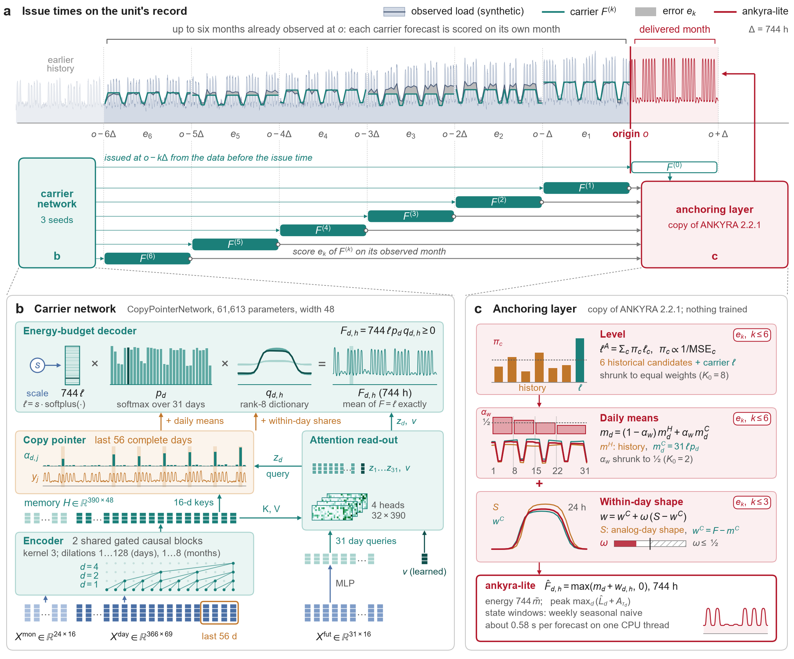

*Figure 1. Architecture, unrolled in time. a, The carrier network (six seeds, recipe Rw) is issued at the origin o and
at up to six pseudo-origins o − 744k (Δ = 744 h), each time from the data before that issue time only; each
pseudo-origin forecast covers a month that is already observed at o and is scored on it (e_k). b, The carrier network:
daily, monthly and future-day tokens, the dilated causal encoder, the attention read-out (31 day queries and a learned
global query), the copy pointer over the complete days within the unit's last 56 day positions and the energy-budget decoder
F(d, h) = 744 · ℓ · p_d · q_d(h). c, The anchoring layer (a copy of ANKYRA 2.2.1; nothing in it is trained) weights the
carrier's level, daily means and within-day shape against the unit's own history, with weights set from the scores
e_k; energy and peak are read from its trajectory, and the continuation layer then corrects the first hours and days
toward the last observed hours. The series and every curve, bar and weight in the figure are synthetic and schematic,
not results. The time per forecast is that of `results/cost_per_window.csv`.*

**How it works, in brief.** The terms are defined under [Terms used on this page](#terms-used-on-this-page).

- **The carrier** reads the unit's last 366 days as daily tokens, 24 older blocks of 744 hours as monthly tokens, and
  the calendar of the 31 forecast days. A causal dilated-convolution encoder and an attention read-out feed an
  energy-budget decoder: a positive monthly level times daily shares times hourly shares, so the forecast is
  nonnegative and its mean is its level. A copy pointer lets every forecast day borrow the within-day profile and the
  relative daily mean of the unit's own recent complete days.
- **The carrier is issued seven times per forecast**: at the origin o and at o − 744k, k = 1 … 6. Each pseudo-origin's
  month has already been observed at the origin, so the anchoring layer can score the carrier against the unit's own
  history on months that have happened.
- **The anchoring layer** splits a forecast exactly into a level, a centred daily path and a within-day shape. It
  weights the carrier's window mean against six historical level candidates, takes part of the daily means from the
  carrier week by week (the handover), and mixes the unit's analog-day shape into the carrier's within-day shape; every
  weight comes from the unit's own completed pseudo-forecasts and is shrunk towards a prior.
- **The continuation layer** compares the last 3 and the last 24 observed hours with the anchored forecast's own values
  on its first forecast day of the same workday class, and multiplies the month by a factor that starts at e^(±0.809)
  at most and decays with time constants of 12 hours and one week, to within ±0.4% at the last hour. State windows
  bypass it; energy, level and peak are read before it.
- **Six seeds, weighted training.** Six carriers trained with different seeds are averaged at every issue time. In the
  second stage of training each window's loss is weighted by the inverse square root of its own recent weekly-naive
  noise, so that windows dominated by unforecastable noise steer the carrier less.
- **The test set starts 186 days after the carrier's training cut**, so that every pseudo-origin forecast the layer
  scores is out of sample for the carrier.
- **Nothing is trained at forecast time.** The carrier is trained once per population; the layer estimates its
  per-unit weights at each origin from the unit's record.

## Contents

- **Use it:** [Repository layout](#repository-layout) · [Install and run](#install-and-run) · [Quickstart](#quickstart) ·
  [Inputs and outputs](#inputs-and-outputs) ([inputs](#the-inputs) · [what comes out](#what-comes-out) · [readouts](#readouts) ·
  [how much history](#how-much-history) · [when not to use it](#when-not-to-use-it)) · [Checkpoints](#checkpoints)
- **How it works:** [Model card](#model-card) ·
  [How the anchoring layer uses the carrier](#how-the-anchoring-layer-uses-the-carrier) ·
  [The continuation layer](#the-continuation-layer) ·
  [Training recipe Rw](#training-recipe-rw) · [Data splits](#data-splits) · [Terms used on this page](#terms-used-on-this-page) ·
  [No information after the origin](#no-information-after-the-origin) · [Baselines](#baselines)
- **Read the results:** [Evaluation](#evaluation) ([read this first](#read-this-first) ·
  [what 0.2.0 changes](#what-020-changes) · [overview](#overview) ·
  [zero-shot foundation models](#against-the-zero-shot-foundation-models) · [rank tests](#rank-tests) ·
  [conventional metrics](#conventional-metrics) · [by forecast day](#by-forecast-day) ·
  [the continuation layer by forecast hour](#the-continuation-layer-by-forecast-hour) ·
  [monthly energy](#monthly-energy-and-energy-through-the-month) · [peak](#peak-readout) ·
  [error blocks](#error-blocks-and-scaled-errors) · [intervals](#prediction-intervals) ·
  [what the parts add](#what-the-parts-add) · [seeds](#seeds) ·
  [carriers in the anchoring layer](#other-carriers-in-the-same-anchoring-layer) ·
  [history length](#history-length-and-the-anchoring-record) · [robustness](#robustness-to-corrupted-contexts) ·
  [training budget](#robustness-training-budget-of-the-trained-baselines) ·
  [a year of context](#foundation-models-with-a-year-of-context) ·
  [cost](#cost-per-window) · [recipe history](#recipe-history-how-r-was-chosen-and-its-negatives)) ·
  [Where ankyra-lite is weak](#where-ankyra-lite-is-weak) · [Limitations](#limitations) · [External tests](#external-tests)
- **Check it:** [Tests](#tests) · [Theory](#theory-exact-properties) · [Reproducibility](#reproducibility) ·
  [Version history](#version-history) · [Provenance, licence and citation](#provenance-licence-and-citation)

## Repository layout

```
ankyra_lite/                 the forecaster (import ankyra_lite)
  forecast.py                forecast(): carrier forecasts -> anchoring layer -> state rule -> readouts -> continuation layer;
                             ForecastResult; forecast(history, None) is the history-only configuration
  continuation.py            the origin-continuity layer: apply, apply_batch, the four frozen constants (CONSTANTS, DIGEST)
  _release.py                the release switches (version, layer default, recipe, seeds, checkpoint folder); checkpoint_paths
  readouts.py                readouts of a forecast: interval, blocks, raw_trajectory, projection_energy_increase,
                             continuation_energy_change, peak
  carrier/                   the carrier network
    model.py                 CopyPointerNetwork, build_carrier, load_carrier, forecast_loss, param_groups (61,613 parameters)
    features.py              the carrier's inputs at one issue time, from data before it only
    inference.py             carrier_forecasts (origin and pseudo-origins), forecast_windows (batched), pseudo_origins
    train.py                 the training recipes R and Rw: TrainConfig, NoiseWeights, recipe(), prepare_source, build_pool,
                             train_one, train_ensemble
  anchor/                    byte-identical copy of the ANKYRA 2.2.1 anchoring layer (17 files; PROVENANCE.md lists their hashes)
checkpoints/                 81 carriers: <population>/rw/seed0-5.pt (0.2.0, recipe Rw) and <population>/seed0-2.pt (0.1, recipe R),
                             and MANIFEST.json (hashes, cuts, source runs, loss weighting)
examples/quickstart.py       end to end on an artificial building with the shipped checkpoints
examples/own_unit.py         your own unit's record, on an artificial meter: a record that starts in the middle of a year,
                             holidays, gaps, the history-only call, the interval and the anchoring record
tests/                       275 tests: the anchoring layer's own tests, equivalence with the original package and the
                             research code, the carrier, the training recipes, the continuation layer, the forecast API
                             against 0.1.1, the evaluation module, the comparison script and the external-test table
theory/                      the exact properties: P1-P20 (anchoring layer), C1-C14 (carrier and recipe Rw) and O1-O9
                             (continuation layer), proofs, operators, 111 checks
evaluation/                  the scoring module, a runnable example, and the scripts that wrote results/ (need the study's data)
results/                     every scored statistic (CSV / JSON), SUMMARY.md, the reproduction record; README.md lists the columns
figures/                     make_figures.py, architecture.py (the drawing of Figure 1) and the figures (PDF and PNG), drawn
                             from results/ (Figure 7 also from theory/)
docs/                        METHOD.md (network, recipes, anchoring, continuation layer, constants), EVALUATION.md (protocol,
                             baselines, full tables), DATA.md (sources, preparation, splits, borrowed windows),
                             EXTERNAL_TESTS.md (the external tests and the 0.2.0 re-run)
tools/export_checkpoints.py  the export of the checkpoints with their verification (needs the study's data)
tools/products_for_configuration.py  the products mapping of one configuration (recipe, seeds, layer on or off)
.github/workflows/tests.yml  CI (Python 3.10-3.13, CPU): tests, theory checks, quickstart, own-unit example, evaluation
                             example; the figures regenerated from results/ on Python 3.11
pyproject.toml, LICENSE (MIT), CITATION.cff, README.zh-CN.md
```

Deliberately not included:

- **Raw data, prepared data stores and saved forecasts.** The nine populations are public; [docs/DATA.md](docs/DATA.md)
  gives each source and its preparation. `results/` holds the scored statistics, not the forecasts they were computed
  from, so the tables cannot be regenerated from this repository alone.
- **The code of the baselines.** Only three simple reference forecasters are included (`evaluation/baselines.py`); the
  other baselines are described in [docs/EVALUATION.md](docs/EVALUATION.md#baselines).
- **Foundation-model weights.** ankyra-lite uses none; zero-shot foundation models appear only as baselines.

## Install and run

Requires Python ≥ 3.10, NumPy, SciPy and PyTorch. A CPU is enough for forecasting, the quickstart, the tests and the
figures; the study trained the released carriers on a GPU.

```bash
git clone https://github.com/XinanQ/Building_load_ANKYRA_lite.git
cd Building_load_ANKYRA_lite
pip install -e .
python -B examples/quickstart.py
```

`pip install -e .` installs PyTorch if it is missing. For a CPU-only build, install that first:
`pip install torch --index-url https://download.pytorch.org/whl/cpu`. `pip install -e ".[figures]"` adds Matplotlib for
`figures/make_figures.py`. Nothing is downloaded at run time: the checkpoints are part of the repository.

**Software environment.** The repository records the following, and no more:

- `pyproject.toml` gives lower bounds only: Python ≥ 3.10, NumPy ≥ 1.26, SciPy ≥ 1.11, PyTorch ≥ 2.4; optionally
  Matplotlib ≥ 3.8 for the figures.
- CI (`.github/workflows/tests.yml`) runs both test suites, the quickstart, the own-unit example and the evaluation
  example on Python 3.10, 3.11, 3.12 and 3.13 (Ubuntu, CPU-only PyTorch) and regenerates the figures on Python 3.11.
  The tests that need the study's local data or the ANKYRA checkout skip there.
- The published figures were rendered with Python 3.11, Matplotlib 3.11.0 and NumPy 2.4.4
  ([figures/README.md](figures/README.md)). The quickstart and the code on this page were run on 21 October 2026 with
  Python 3.11, NumPy 2.4.4 and PyTorch 2.11 on the CPU, one thread.
- The released checkpoints come from the study's research runs on a GPU; the package versions of those runs are not
  recorded in this repository.

## Quickstart

```bash
python -B examples/quickstart.py                          # the release's checkpoints of Cambridge, an artificial building
python -B examples/quickstart.py --population households  # the release's checkpoints of another population
python -B examples/quickstart.py --checkpoints DIR        # every seed*.pt in DIR, averaged
python -B examples/quickstart.py --untrained              # an untrained network of the same shape (format only)
```

The script loads the six Cambridge checkpoints of the release (`checkpoints/cambridge/rw/seed0.pt` … `seed5.pt`),
builds an artificial office building with 16,000 hours of history (`ankyra_lite.anchor.synthetic`), computes the
carrier's forecasts at the origin and the six pseudo-origins, anchors them, applies the state rule and the
continuation layer, and prints the readouts and the weights behind the forecast. It needs no data, and the forecast
takes about a second on one CPU thread. An excerpt of its output (lists condensed to one line):

```
 "carrier": "6 checkpoint(s) in cambridge/rw/: seed0.pt, seed1.pt, seed2.pt, seed3.pt, seed4.pt, seed5.pt",
 "carrier_parameters": 61613,
 "carrier_issue_times_k": [0, 1, 2, 3, 4, 5, 6],
 "state_window": false,
 "energy_kwh": 17048.084,
 "level_kw": 22.9141,
 "peak_kw": 27.706,
 "continuation_x_fast_x_day": [0.0701, 0.0685],
 "continuation_energy_change_kwh": 95.644,
 "interval_pseudo_windows": 12,
 "lead_week_weights_on_carrier": [0.145, 0.125, 0.125, 0.125],
 "pseudo_origin_pairs": 6,
 "within_day_trust_on_analog_shape": [0.5, 0.5, 0.5, 0.5],
 "within_day_pseudo_origin_triples": 3,
```

The checkpoints belong to the Cambridge population and its training cut, and the artificial building is almost
exactly periodic (the within-day trust sits at its cap ½), so the output shows the format, not typical values. Here the
continuation layer added 95.6 kWh to the delivered month (0.56% of `energy_kwh`); `energy_kwh`, `level_kw` and `peak_kw`
are read before it. The lines are explained under [What comes out](#what-comes-out).

The same in Python (checked end to end, from the repository root, on 21 October 2026):

```python
import numpy as np
from ankyra_lite import checkpoint_paths, load_carrier, carrier_forecasts, forecast, readouts
from ankyra_lite.anchor.synthetic import synthetic_history      # an artificial building, for the example only

carriers = [load_carrier(p) for p in checkpoint_paths("cambridge")]   # checkpoints/cambridge/rw/seed0..5.pt, ascending
history = synthetic_history(16000)       # or ankyra_lite.anchor.History(load_kw, temperature_c, day_types, start_timestamp)

# step 1: the carrier's forecasts at the origin (k = 0) and at the pseudo-origins origin - 744 k (k = 1 ... 6)
load = np.asarray(history.load_kw, dtype=np.float64)
F = carrier_forecasts(carriers, load, history.temperature_c, history.day_types, "Office",
                      history.start_timestamp, unit=0, origin=len(load))
print(sorted(F))                         # [0, 1, 2, 3, 4, 5, 6]

# step 2: the anchoring layer, the state rule, the readouts and the continuation layer (on by default)
r = forecast(history, F, group="Office", temp_sigma_std=0.25, dst_region="EU")
print(r.trajectory_kw.shape, r.state_window, r.level_kw, r.energy_kwh, r.peak_kw)
print(r.continuation.x_fast, r.continuation.x_day, r.continuation.d_star)        # what the layer did
print(r.trajectory_kw.sum() - r.energy_kwh,                                      # generally not zero (rule A):
      readouts.projection_energy_increase(r) + readouts.continuation_energy_change(r))   # the same, up to rounding
off = forecast(history, F, group="Office", temp_sigma_std=0.25, dst_region="EU", continuation=False)
assert off.energy_kwh == r.energy_kwh and np.array_equal(off.trajectory_kw, r.trajectory_before_continuation_kw)
```

Steps 1 and 2 are one call: `forecast(history, carriers, group="Office", temp_sigma_std=0.25, dst_region="EU")`
gives the same trajectory. A list of carriers is an ensemble (the plain average of the members' forecasts, summed in
the order given); a single carrier also works. On a population's own record, pass that population's training cut as
`cut=` ([Checkpoints](#checkpoints)).

## Inputs and outputs

`ankyra_lite.forecast` forecasts the 744 hours that follow the last value of `load_kw`. Put the unit on one regular
hourly grid first: neither part resamples, fills the context at the origin, or converts time zones or daylight saving
([docs/DATA.md](docs/DATA.md#the-input-format)). An input that breaks the anchoring layer's contract raises an error.

### The inputs

The record, `ankyra_lite.anchor.History` (the anchoring layer's input record, unchanged from ANKYRA 2.2.1):

| Field | What to supply | How the carrier reads it | How the anchoring layer reads it |
|---|---|---|---|
| `load_kw` | hourly mean load in kW; index 0 is 1 January 00:00 of the first year; the last value is the hour before the origin; NaN where missing | only hours before each issue time; a negative or non-finite value counts as missing; a day with no observed hour is masked out | the normal carrier-inference path requires the last 1,344 hours completely observed (never filled); the precomputed-mapping off-state exception is described below; earlier gaps of at most 6 hours inside one 744-hour block are interpolated in the copy its estimator reads |
| `temperature_c` | hourly outdoor temperature in °C for the same hours | only hours before each issue time, through daily means and their coverage; missing hours allowed | finite everywhere before the origin; no future temperature is needed |
| `day_types` | one integer per hour for the history plus the 744 forecast hours: Monday = 0 … Sunday = 6, public holiday = 7 | through the forecast month of each issue time (the calendar is treated as known at the origin) | the same |
| `start_timestamp` | 1 January 00:00 of the first year with a `+00:00` offset, e.g. `"2019-01-01T00:00:00+00:00"` (a fixed-offset grid) | the annual phase of every token and the record's absolute time | the phase of the annual temperature harmonic and the daylight-saving state of analog days |
| `observed` (optional) | Boolean mask of the load | masked hours are treated as missing | `False` hours are ignored |

**A record that starts in the middle of a year.** Pad the load back to 1 January 00:00 of the first year with NaN, give
a finite temperature for the padded hours too (archive temperature where it exists), write the day types of the padded
days, and pass that 1 January 00:00 as `start_timestamp`. [`examples/own_unit.py`](examples/own_unit.py) does this end
to end for an artificial meter that starts on 18 March 2019, with public holidays and three gaps, and runs the forecast
with the shipped checkpoints (`cut=None`), the history-only configuration, the interval readout and the anchoring
record (`python -B examples/own_unit.py`; details in [docs/DATA.md](docs/DATA.md#how-much-history)).

The other arguments of `forecast(history, carriers, *, group, temp_sigma_std, dst_region="none", cut=None,
state_rule="seasonal_naive", continuation=True, device="cpu", **anchor_kwargs)`:

- `carriers`: one carrier network, a list of them (an ensemble, averaged at every issue time in the order given; pass
  the release's seeds in ascending order, `ankyra_lite.checkpoint_paths(population)`, and one training cut for all of
  them), or a precomputed mapping
  `{k: (744,) carrier forecast issued at origin − 744k}`; `None` gives the **history-only configuration** (the
  anchoring layer without a carrier: the historical level and daily path with the same-day-type within-day default; no
  state rule; `carrier` is `{}`), the reduced configuration of contrast (ii).
- `group`: `"Industrial"`, `"Office"`, `"Public"`, `"Residential"` or `"Commercial"`. It is both the carrier's category
  input and the anchoring layer's selector of a fixed temperature-signature prior. `"Commercial"` has no prior curve in
  the anchoring layer (a zero temperature signature), as in ANKYRA 2.2.1.
- `temp_sigma_std`: the population's temperature-anomaly scale, one positive number in units of 10 °C, fitted on the
  days before the training cut ([how the study fitted it](docs/DATA.md#the-input-format)).
- `dst_region`: `"EU"`, `"US"` or `"none"`; used only to take analog days from the same daylight-saving state.
- `cut`: the carrier's training cut as an hour index of the record. Pseudo-origins before it are not used (not
  computed, or dropped from a precomputed mapping), and an origin before it raises an error. Pass it whenever the
  record is one the carrier was trained on.
- `state_rule`: `"seasonal_naive"` (the evaluated configuration, below) or `None`.
- `continuation`: `True` (the release default, `ankyra_lite/_release.py`: the continuation layer with its frozen
  constants), `False` or `None` (the layer off: the trajectory before the layer is delivered), or an
  `ankyra_lite.continuation.Constants` (`continuation.ZERO` gives the trajectory before the layer bit for bit on every
  window with a finite trajectory, with the layer's record attached). The history-only configuration is never
  continued. Reproducing a version 0.1 forecast needs the 0.1 checkpoints (`checkpoints/<population>/seed0-2.pt`), the
  same inputs and `continuation=False`; the layer off on the six-seed Rw carrier is not version 0.1.
- `**anchor_kwargs`: passed to the anchoring layer (`gap_tolerance`, `single_trust`, `within_anchor`,
  `micro_load_rule`); the evaluation used their defaults (all `True`).

Importing `forecast` at the top level rebinds the attribute `ankyra_lite.forecast` to the function; import other
names of that module explicitly, e.g. `from ankyra_lite.forecast import ForecastResult, seasonal_naive`.

### What comes out

`forecast` returns a `ForecastResult`:

| Field | Meaning |
|---|---|
| `trajectory_kw` | (744,) delivered hourly forecast in kW, after the continuation layer; element 0 is the hour after the last load value |
| `trajectory_before_continuation_kw` | (744,) the trajectory before the continuation layer: the anchoring layer's output after the nonnegativity projection, or the seasonal naive on a state window. `peak_kw` is read from it; with the layer off it is the same array as `trajectory_kw` |
| `level_kw`, `energy_kwh` | the anchoring layer's level, read before its nonnegativity projection and before the continuation layer (on a state window with the seasonal-naive rule, that forecast's mean), and the month's energy, 744 × the level. With the layer on, the mean of `trajectory_kw` generally differs from `level_kw` ([Readouts](#readouts)) |
| `peak_kw` | the monthly peak readout of `trajectory_before_continuation_kw`: the largest, over the 31 days, of the day's forecast mean plus the largest recent excursion of the same day type (`anchor.readouts.peak_readout`); it need not equal that curve's maximum |
| `continuation` | what the continuation layer did (`ankyra_lite.continuation.ContinuationRecord`): `x_fast`, `x_day` (the clipped anomalies), `d_star` (the reference day), `matched`, `delta` (Δ(h)), `bypass` (`"state window"`, `"missing hours"`, `"nonpositive load"` or None), the flags `nonpositive_fast`, `nonpositive_day`, and the digest of its constants; None with the layer off or in the history-only configuration |
| `state_window`, `state_rule` | whether the anchoring layer reported an off-state or micro-load window, and the state rule applied (`"seasonal_naive"` or `None`) |
| `carrier` | {k: (744,)} the carrier forecasts given to the anchoring layer |
| `anchored` | the anchoring layer's own result; any other attribute is read from it |

Attributes read through to the anchoring layer, as the quickstart prints them:

| Quickstart line | Field | Meaning |
|---|---|---|
| `carrier_issue_times_k` | keys of `carrier` | the issue times o − 744k at which the carrier forecast; 0 is the origin |
| `continuation_x_fast_x_day` | `continuation.x_fast`, `continuation.x_day` | the continuation layer's two clipped anomalies (last 3 and last 24 observed hours against the forecast's reference day); 0 means no correction from that span |
| `continuation_energy_change_kwh` | `ankyra_lite.readouts.continuation_energy_change(r)` | the energy the layer added to the delivered month (negative: removed); not part of `energy_kwh` |
| `lead_week_weights_on_carrier` | `lead_week_weights` | the handover: the weight on the carrier's daily means in days 1–7, 8–14, 15–21 and 22–31; ½ means no evidence |
| `level_weights` | `level_weights` | the weight of each level candidate: `s`, `l` and `a` are the recent 7-day mean, the long-history mean and the mean of the window one year earlier (`_u` without, `_w` with weather adjustment); `fm` is the carrier's own window mean (the key keeps the anchoring layer's name) |
| `pseudo_origin_pairs` | `pseudo_pairs` | completed pseudo-origins behind the handover weights (at most 6) |
| `within_day_trust_on_analog_shape` | `within_trust` | the weight on the unit's own analog-day shape, between 0 and ½; one value per window, repeated for the four parts of the month |
| `within_day_pseudo_origin_triples` | `within_pseudo_pairs` | completed pseudo-origins behind the trust (at most 3) |
| `analog_shape_kept` | `analog_kept` | `False` when the analog shape was implausibly large and the carrier's shape was used for the whole window |
| — | `off_state`, `micro_load` | which state rule of the anchoring layer fired |
| — | `anchoring_record` | two statistics of the unit's pseudo-forecast record on the level, not used by the forecast: `carrier_level_weight` and `history_vs_carrier_log_ratio` ([table](#history-length-and-the-anchoring-record)) |
| — | `daily_means_kw` | (31,) the daily means after the handover, before the nonnegativity projection; `level_kw` is their mean |
| — | `fixed_division_daily_means_kw` | (31,) the **fixed division**: the historical level and daily path, without the carrier's level candidate and without the handover |
| — | `within_day_kw` | (744,) the delivered within-day block: the carrier's within-day block mixed with the analog-day shape by the trust |
| — | `foundation_within_day_kw` | (744,) the carrier's own within-day block (the field keeps the anchoring layer's name) |
| — | `analog_shape_kw` | (744,) the unit's analog-day shape (the carrier's block where the plausibility guard fell back) |
| `interval_80pct_first_hour_kw`, `interval_pseudo_windows` | `ankyra_lite.interval(history, r, group=..., temp_sigma_std=...)` | the 80% and 90% intervals (rows 1 and 3, 0 and 4 of the (5, 744) bands) from residual quantiles of the unit's history-only pseudo-forecasts, added to the trajectory; a separate readout, not part of the forecaster ([Readouts](#readouts)) |

On a state window these fields describe the anchoring layer's return (the carrier's forecast, with the weights, the
fixed division and the analog fields at their defaults), not the seasonal naive delivered by the default state rule.
`np.repeat(r.daily_means_kw, 24) + r.within_day_kw` is the forecast before the projection
(`ankyra_lite.readouts.raw_trajectory`), and `ankyra_lite.readouts.blocks` splits any trajectory into its three blocks.
Every field is listed in [docs/METHOD.md](docs/METHOD.md#output-fields).

**State windows.** The precomputed-forecast mapping path can enter the inherited off-state branch before complete-context validation, using only the observed last-week maximum; missing last-week hours are then zero-filled by the seasonal-naive rule. This inherited rule does not establish that missing hours represent a shutdown. The normal carrier-inference path rejects an incomplete context. When the last 168 hours are at or below 10⁻⁶ kW (off-state) or the whole 1,344-hour context stays
within 10⁻³ kW of zero (micro-load), the anchoring layer hands back the carrier's forecast unchanged. With the default
`state_rule="seasonal_naive"` ankyra-lite delivers the last observed week repeated instead (missing hours as 0); this is
the evaluated configuration. `state_rule=None` keeps the anchoring layer's return
([docs/METHOD.md](docs/METHOD.md#state-windows-and-the-seasonal-naive-rule)).

### Readouts

Three readouts come with a forecast, each from information available at the origin
([docs/METHOD.md](docs/METHOD.md#readouts)):

Readout rule A: energy, level and peak are read **before** the continuation layer. For a fixed carrier, switching the
layer on or off leaves them unchanged bit for bit; the hourly curve that is delivered is the one after the layer.

- **Energy** (`r.energy_kwh`): 744 × the level, read before the nonnegativity projection (P3) and before the
  continuation layer (O6). Two known-at-the-origin terms separate it from the delivered curve:
  `ankyra_lite.readouts.projection_energy_increase(r)` (where the projection binds, the trajectory holds more energy;
  P11–P12) and `ankyra_lite.readouts.continuation_energy_change(r)` (what the layer added or removed), with
  `r.trajectory_kw.sum()` = `r.energy_kwh` + the two. The terms can be zero or cancel, so the sum differs from the
  energy readout in general, not on every window.
  **Disclosure.** On the 5,390 test windows the layer acts on (state windows excluded), the relative difference
  between the delivered curve's mean and the level readout had a median of 0.77%, a 99th percentile of 7.8% and a
  maximum of 310% (`results/continuation_record.csv`, row `all nine populations`; per population the maximum is 6.5%
  to 13.3% except GoiEner non-household, 89.9%, and GoiEner households, 309.8%). The layer's own change of the month's
  energy lay between −14.8% and +33.4% (columns `layer_energy_change_pct_min`, `_max`), so every larger gap is a window
  where the nonnegativity projection binds and the trajectory before the layer already held more energy than 744 × the
  level. On the development windows used to choose the layer the figures had been 0.6%, 7% and 9% (re-used
  evaluation, read before the test windows). For a flat trajectory the layer can change the
  month's energy by −7.34% to +9.31% at most; a trajectory with more of its energy in the first days can change by more,
  at most −55.5% to +124.6% (rounded outward; theory O6).
  The evaluation scores, for ankyra-lite, the energy of the trajectory before the continuation layer, and for every
  baseline its own trajectory; the level readout is reported as a sensitivity
  ([Monthly energy](#monthly-energy-and-energy-through-the-month)).
- **Peak** (`r.peak_kw`), read from `trajectory_before_continuation_kw`: U = max over days d of (L̂_d + A_τd), each forecast day's mean plus the largest excursion
  (daily maximum minus daily mean) among the four most recent context days of the same day type. A day type absent
  from the 56 context days takes the largest excursion of all of them, and an absent holiday type takes Sunday's.
  Because maxima commute, U is an hour-wise envelope; U ≥ max_d L̂_d ≥ the level, and its error splits into level,
  daily-path, amplitude and selection terms, so gains in the level carry into the peak (P15–P17).
  `ankyra_lite.readouts.peak` applies the same readout to any trajectory ([results](#peak-readout)).
- **Interval** (`ankyra_lite.interval(history, r, group=..., temp_sigma_std=...)`, a separate call): the hourly
  residuals of the unit's own history-only pseudo-forecasts at up to 12 completed pseudo-origins, each divided by its
  window's origin scale and pooled by hour of day and workday, give quantiles that are scaled by the origin scale and
  added to the delivered trajectory, after the continuation layer (clipped at zero, monotone across levels). The
  residuals do not involve the carrier ([results](#prediction-intervals)).

### How much history

- **The anchoring layer** normally needs the 1,344 hours before the origin completely observed, with the precomputed-mapping off-state exception above. Its weights leave their priors
  as completed pseudo-origins accrue (one 744-hour step each): with 2,088 complete hours the handover weights leave ½
  (one completed pseudo-origin), with 2,832 the level weights leave equal weights (two), and the candidates that use
  the window one year earlier need 10,248 hours ([the full list](docs/DATA.md#how-much-history)). Every test window
  of the evaluation had at least 9 complete 744-hour pseudo-origin windows (`results/history_length.csv`: `K_eff`
  9–11 on 451 windows, 12 on 5,265).
- **Gaps.** Gaps of at most 6 hours inside one 744-hour block of the earlier record are interpolated in the copy the
  anchoring layer's estimator reads (the short-gap rule); `ankyra_lite.fill_short_gaps(load_kw)` returns that copy for
  a record of your own. The 1,344-hour context at the origin is never filled.
- **The carrier** reads at most the last 366 days (daily tokens) and the 24 blocks of 744 hours before them; missing
  days and blocks are masked, so it runs on shorter records.
- **With a checkpoint**, use origins at least 186 days after its training cut: then every pseudo-origin forecast the
  anchoring layer scores is issued after the carrier's training period ([why](#how-the-anchoring-layer-uses-the-carrier)).

What was observed by history length is descriptive and is reported [below](#history-length-and-the-anchoring-record).

### When not to use it

On the evidence of this repository ankyra-lite is not the better choice in these cases:

- **A unit of a population without its own carrier.** The checkpoints were evaluated only on their own population's
  test windows. For new data, train a carrier with the [recipe](#training-recipe-rw).
- **Households, when the hourly trajectory matters.** On GoiEner households zero-shot TimesFM has resolvably lower
  hourly error (−4.6%), and TimesFM-X, Chronos-2 and Chronos-2-X have lower point estimates (−0.9% to −2.9%, not
  resolved). If the monthly energy or the peak matters, ankyra-lite's errors there are resolvably lower than those of
  all four zero-shot variants.
- **The first days of the month.** On forecast day 1 zero-shot foundation models are ahead on every test population,
  with the continuation layer.
- **When the hourly curve must integrate to the energy readout.** With the continuation layer on, the sum of
  `trajectory_kw` differs from `energy_kwh` by a further amount known at the origin (`continuation_energy_change`);
  `trajectory_before_continuation_kw`, or `continuation=False`, removes that part and leaves only the projection's
  `projection_energy_increase` (zero where the projection does not bind).
- **Net-metered records.** The continuation layer needs a positive mean of the last 3 and 24 observed hours (plus a
  small offset). Where a span's mean is at or below that, the layer sets that span's anomaly to zero and flags the
  window (`nonpositive_fast`, `nonpositive_day`): the layer then does not correct from that span. This release rule was
  added after the study (whose code raised an error there); no test window reached it.
- **A context with a single large spike.** One spike at ten times the context maximum raises the hourly error by 52.5%
  and ruins the peak readout ([robustness](#robustness-to-corrupted-contexts)).
- **Units that switch off, for intervals.** The interval readout's width carries no information there.
- **Data that are not hourly or not in kW.** The state thresholds are absolute values in kW; the horizon is fixed at
  744 hours.
- **Sites in the southern hemisphere.** The anchoring layer's annual temperature harmonic has a fixed phase with its
  coldest day in January (inherited, unchanged); none of the nine populations is in the southern hemisphere.

## Model card

Every entry was checked against the code (`ankyra_lite/carrier/model.py`, `features.py`, `inference.py`, `train.py`,
`ankyra_lite/forecast.py`, `ankyra_lite/continuation.py`); the full description is [docs/METHOD.md](docs/METHOD.md#the-carrier-network).

| Item | Value |
|---|---|
| Task | month-ahead hourly load forecast: the 744 hours (31 days × 24 hours) after a forecast origin, for one unit |
| Architecture | copy-pointer structured load network (`CopyPointerNetwork`, `build_carrier()`), feeding the anchoring layer, followed by the state rule and the continuation layer |
| Parameters | **61,613** trainable (`CARRIER_PARAMETERS`; counted again on every shipped checkpoint in `checkpoints/MANIFEST.json`); no pretrained weights; no unit-identifier embedding |
| Daily tokens | **366 × 69**, the last 366 days, oldest first: 24 × arcsinh(load / s), 24 hourly observation flags, arcsinh of the daily mean and standard deviation / s, arcsinh(daily mean temperature / 30) and its coverage, 8 day-type one-hot (Monday … Sunday, holiday), annual phase (sin, cos), relative position, load coverage, 5 category one-hot |
| Monthly tokens | **24 × 16**: 744-hour blocks older than the daily span (mean, standard deviation, 10th and 90th percentile, workday and weekend means, zero-load share, coverage, temperature and its coverage, annual phase, position, a constant, change of the mean, validity) |
| Future-day tokens | **31 × 16**: the calendar of the forecast days, known at the origin (8 day-type one-hot, annual phase, relative day position, 5 category one-hot) |
| Scale s | max(mean of the observed hours among the last 744, mean of the observed hours among the last 8,760); 1 if not a finite positive number |
| Encoder | width **48**; token, age and resolution embeddings; **two shared gated causal blocks** (layer normalisation, depthwise causal convolution with kernel 3, gate tanh · σ, residual) reused with **dilations 1, 2, …, 128** over the 366 daily tokens and **1, 2, 4, 8** over the 24 monthly tokens |
| Read-out | one multi-head attention (**4 heads**) from one global query and 31 calendar-conditioned day queries over the 390 memory positions, then a 48 → 96 → 48 MLP |
| Decoder | positive energy budget F(d, h) = 744 · L · p_d · q_d(h): monthly level L = s · softplus(·), daily shares p (softmax over 31 days), hourly shares q_d (softmax over 24 hours); the hour logits come from a **rank-8 dictionary** on the 23 zero-mean hourly directions (a learned base plus a bounded origin-conditioned change, 0.1 · tanh), shared by the 31 days, with per-day coefficients |
| Copy pointer | every forecast day attends over the **complete days within the unit's last 56 day positions** (16-dimensional queries and keys, a learned bonus for the same day type) and adds the attended within-day share profile to its hour logits and the attended relative daily mean to its day logits, through gates initialised at zero |
| Output | the carrier: 744 hours, nonnegative, its mean equal to L (in real arithmetic), level, daily path and within-day shape the exact blocks of the trajectory. ankyra-lite: 744 nonnegative hours after the continuation layer; energy, level and peak read before that layer, so the delivered curve's mean is not the energy readout ([Readouts](#readouts)) |
| Continuation layer | F′(h) = F(h) e^(Δ(h)), Δ(h) = 0.479 x_f e^(−h/12) + 0.330 x_d e^(−h/168); x_f, x_d = clipped log ratios of the last 3 and 24 observed hours to the forecast's reference day; four constants fitted once on development windows, never refitted; bypassed on state windows ([section](#the-continuation-layer)) |
| Training | per population, from scratch, then 8 epochs with the validation span returned and inverse-noise loss weights ([recipe Rw](#training-recipe-rw)); seeds 0–5; the forecast is the plain average of the six seeds |
| Training data | the population's own windows before its training cut (the validation span joins them in stage 2) plus windows borrowed from other study populations, each ending before the population's validation span ([docs/DATA.md](docs/DATA.md#windows-borrowed-from-other-populations)) |
| Checkpoints | 81 files: 54 of this version (`checkpoints/<population>/rw/seed0–5.pt`, recipe Rw) and the 27 of version 0.1 (`checkpoints/<population>/seed0–2.pt`, recipe R), `{"model": state_dict, "epoch": 8}`, 265,653 bytes each |
| Inference cost | At most 42 member predictions per forecast (7 issue times × 6 seeds, batchable; fewer when pseudo-origins are unavailable); the six-Oslo-window measurement: 0.135 s; with the anchoring layer, the continuation layer and the peak readout 0.655 s per window, one CPU thread (`results/cost_per_window.csv`) |
| Intended use | month-ahead hourly forecasts for units of a population the carrier was trained for, at origins at least 186 days after its training cut |
| Not evaluated | other populations without retraining; sub-hourly data; horizons other than 744 hours; prediction intervals designed for this carrier |
| Evidence | one more read of test windows read many times before, which sets direction only ([Read this first](#read-this-first)) |
| Licence | MIT |

## How the anchoring layer uses the carrier

`ankyra_lite.anchor.forecast(history, foundation={k: forecast issued at o − 744k}, ...)` is the anchoring layer of
ANKYRA 2.2.1, unchanged; it takes the carrier's forecasts where its code and docstrings speak of the foundation model.

- **Pseudo-origins.** The layer reads the carrier's forecast issued at the origin o (k = 0) and at q = o − 744k for
  k = 1 … 6, one 31-day step apart, wherever the 1,344-hour context before q is completely observed. The target month
  [q, q + 744) of a pseudo-origin is already observed at o, so the layer can score the carrier against the unit's own
  history on months that have happened. `carrier_forecasts(..., origin=o, cut=C′)` computes exactly these forecasts,
  each from data before its own issue time, and drops any pseudo-origin before the cut.
- **What it estimates per unit** ([docs/METHOD.md](docs/METHOD.md#how-the-anchoring-layer-uses-the-carrier)):
  - the **level weights**: the carrier's window mean as a seventh candidate beside six historical level candidates
    (recent, long-history and one-year-earlier means, with and without weather adjustment), inverse-error weights
    shrunk towards equal weights;
  - the **handover weights**: the weight of the carrier's daily means against the history side's in days 1–7, 8–14,
    15–21 and 22–31, least-squares weights shrunk towards ½;
  - the **within-day trust**: how much of the unit's own analog-day shape to mix into the carrier's within-day shape,
    one value per window, shrunk towards zero and capped at ½.
- **Why the test set starts 186 days after the cut.** Each carrier forecast at a pseudo-origin must be a genuine
  forecast for the carrier: issued at or after its training cut C′, so that the month it forecasts was never a
  training label. With test origins at least 6 × 744 hours = 186 days after C′, q = o − 744k ≥ C′ for every k ≤ 6
  (property C10). Without the gap the per-unit weights would be estimated on in-sample carrier errors and would trust
  the carrier too much. The price is a carrier at least half a year older than it would be in use.
- **How the handover works on these populations** (`handover_granularity.csv`, `lead_weeks.csv`, Figure 4d–f;
  descriptive, on test windows read before). The weekly weights are estimated on the unit's completed pseudo-origins
  from the **fixed division** (the history side's level and daily path) against the carrier, and are then applied to
  the history side's daily means that include the carrier's level candidate
  ([details](docs/METHOD.md#week-by-week-handover)).
  - Here the carrier alone is better than the fixed division in nearly every forecast week: resolvably in at least one
    week on seven populations (BDG2, Cambridge, HEEW, EWELD, the GoiEner households, Oslo, Drammen; −3.4% to −15.7% by
    week), not resolved on GoiEner non-household and CINELDI. The layer accordingly puts more than half of the daily
    means on the carrier: the mean weekly weight is 0.48–0.56 on BDG2 and 0.53–0.76 elsewhere (½ without evidence).
  - ankyra-lite improves on the fixed division on all nine populations in hourly error (+2.7% to +8.4%, each resolved)
    and on five in monthly energy (Cambridge +20.2%, HEEW +16.3%, EWELD +25.4%, Oslo +20.7%, Drammen +12.5%). The fixed
    division also lacks the carrier's level candidate and the within-day anchoring, so the gain is not the handover's
    alone (`ablation.csv`, `fixed division ...`).
  - **Which part matters.** Mixing in the carrier's daily means at a fixed weight of one half already gives most of the
    gain of the weekly weights over no handover: on the eight populations where that gain is resolved (+1.3% to +6.2%)
    the fixed half weight gives 44% (BDG2) to 99% (CINELDI) of it in log terms. Estimating the weights per unit from its
    own pseudo-forecasts adds −0.1% to +1.2% over the fixed half (resolved on BDG2, +0.9%, and Drammen, +1.0%; never
    resolvably worse), and separate weights for each week add nothing over one weight per window (−0.5% to −0.1%, none
    resolved). What carries the gain is mixing the carrier's daily means into the history side, weighted by the unit's
    own errors; the weekly weights describe how the balance shifts with lead time.
  - **By forecast week** against the carrier alone, ankyra-lite (with the continuation layer) is resolvably better in
    weeks 1, 2 and 4 on BDG2, week 1 on GoiEner non-household and HEEW and week 4 on CINELDI, resolvably worse in weeks 2
    and 3 on the GoiEner households (−2.9% and −4.5%), and within −3.0% to +3.7% without resolution elsewhere.
  - **By forecast week against TimesFM** (same file), ankyra-lite is resolvably worse in week 1 on HEEW (−11.5%) and
    GoiEner non-household (−7.8%), in week 2 on BDG2 (−13.1%) and in every week on the households (−12.2% to −19.2%), and
    resolvably better in later weeks on Cambridge, Oslo, Drammen and CINELDI. The BDG2 point estimates of weeks 1 and 2
    (−81.2%, not resolved, and −13.1%) describe a few meters, not the population: in week 1 three meters
    (Lamb_office_Vasiliki, Lamb_assembly_Bertie, Lamb_office_Velma) read the same small non-zero value over the whole
    week, which TimesFM repeats almost exactly, so their error ratios dominate the unit mean; in week 2 two other meters
    with a constant reading play the same role
    ([details](results/README.md#handover-within-day-trust-and-combinations)).

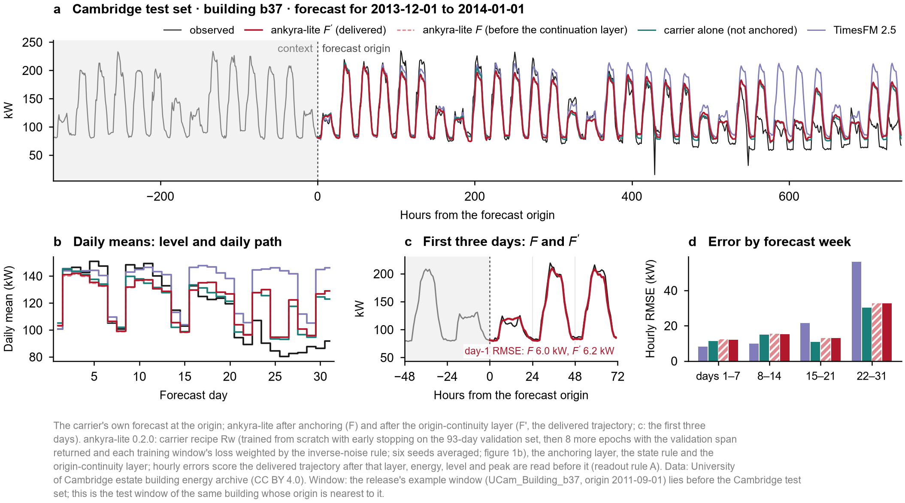

*Figure 6. One Cambridge test window (building b37, December 2013): the observed load, ankyra-lite before (F) and
after (F′, delivered) the continuation layer, the carrier alone and zero-shot TimesFM 2.5, with a panel on the first
three days, the daily means and the error by forecast week. None of the forecasts anticipates the low load of the
Christmas weeks. One window illustrates the mechanics; it is not evidence. Data: University of Cambridge estate
archive (CC BY 4.0); `results/example_window_cambridge.csv`.*

## The continuation layer

The carrier forecasts the month from daily and monthly summaries of the record; it has no path that continues from
the last observed hours, and the anchoring layer's history side pulls a forecast back toward the unit's past. On the
development windows the anchored forecast's log error at the first hour rose almost one for one with how far the last
observed hours lay from the forecast's own curve, and that dependence faded over about a day (a fast part) and a week
(a slow part). The continuation layer (`ankyra_lite.continuation`, applied by `forecast` after the state rule and the
readouts) corrects exactly that, after the anchoring layer, so that the correction is not diluted and the anchoring
layer stays byte-identical.

- **Two anomalies.** x_f compares the mean of the last 3 observed hours with the forecast's same clock hours on its
  reference day d* (the first forecast day, of days 0–6, of the last observed day's workday class); x_d compares the
  last 24 observed hours with the forecast's reference day. Both are log ratios with a small offset (1% of the unit's
  mean load over the last four weeks), clipped to ±1, and set to 0 when one of their hours is unobserved.
- **One correction.** F′(h) = F(h) e^(Δ(h)) with Δ(h) = 0.479 x_f e^(−h/12) + 0.330 x_d e^(−h/168): the fast term
  fades within a day, the slow term within about a week.
- **Bounded.** Each hour moves by a factor between e^(−E(h)) and e^(E(h)), E(h) = 0.479 e^(−h/12) + 0.330 e^(−h/168):
  between ×0.445 and ×2.246 at the first hour, between ×0.885 and ×1.130 from day 8, and within ±0.4% at the last hour
  (O2). For accepted finite outputs, nonnegativity is preserved and exact zeros, including signed zero, are
  restored (O1). Nonzero floating-point values can underflow to zero; custom constants that produce a non-finite
  non-state correction or final output raise `ValueError`. The real-arithmetic positive-factor bound does not
  guarantee strict floating-point positivity for arbitrary constants.
- **Causal and switchable.** It reads only the forecast itself, the 672 hours of load before the origin and the day
  types of the last observed day and of the first forecast week (O3); state windows bypass it (O4);
  `continuation=False` turns it off.
- **Constants.** Fitted once, pooled over the earlier development windows of six populations, and shared by every
  population, including the three without development windows, and by the external tests; never refitted on test
  windows. They are identified by `continuation.DIGEST`.
- **Readouts.** Energy, level and peak are read before the layer (readout rule A); for a fixed carrier the layer
  changes none of them, and the delivered curve's mean differs from the energy readout ([Readouts](#readouts)).
- **Two release rules** that change no study number. Where no forecast day 0–6 shares the last observed day's workday
  class, the reference day is d* = 6, the fallback of the layer's design (the study's development code used d* = 0; the
  two agree wherever a day of the class exists, which was every development window); on the test windows this fallback
  was used on 33 EWELD windows, whose first forecast week holds no day of the last observed day's class, and on no
  other window (`continuation_record.csv`, `no_match_reference_day`). Where the mean of the last 3 or 24 hours plus the
  offset is at or below zero (negative loads), that anomaly is set to 0 and the window is flagged instead of raising an
  error; no test window reached this case (`nonpositive_fast_span`, `nonpositive_day_span` = 0).

On the test windows, the layer on against off on the same carrier (1,891 units of the nine populations pooled;
`continuation_layer.csv`, row `all nine populations`): +0.46% [+0.33, +0.70] over the month, +28.0% at hour 0, +23.4% in
hours 0–2, +11.1% on day 1, +1.9% on days 2–7 and +0.17% on days 8–31, each resolved; the energy of the delivered
trajectory +1.9%, not resolved. On the development windows that chose its form (re-used evaluation) the same contrast
was +0.48% over the month and +9.49% on day 1 (`recipe_history.csv`, `Rw6_c vs Rw6`, development rows). The details,
the choice of the form and the full list of guarantees are in [docs/METHOD.md](docs/METHOD.md#the-continuation-layer)
and [theory/PROOFS.md](theory/PROOFS.md#exact-properties-of-the-continuation-layer).

## Training recipe Rw

The released recipe Rw has two stages, applied identically to every population (train, select the stopping epoch,
then add a density-matched sample from the validation period and weight the windows). Stage 1 is that of recipe R (version 0.1); stage 2 differs from R's
only by the loss weights. Every constant is a field of `ankyra_lite.carrier.train.TrainConfig`; `recipe(name,
init_checkpoint)` builds the named configurations ([docs/METHOD.md](docs/METHOD.md#training)).

**Stage 1: from scratch, with early stopping** (`TrainConfig()` = `recipe("from_scratch")`).

1. **Windows.** A window is (unit, origin o): context [o − 1344, o), labels [o, o + 744). Only data before the training
   cut C′ is used (o + 744 ≤ C′; load and temperature at and after C′ are set to missing before any feature is
   computed). Training origins lie on a daily grid; a window is eligible when at least 75% of its context hours and of
   its label hours are observed.
2. **Split.** The validation span is the last 93 days before the cut, from v0 = max(2,088, C′ − 2,232). Training windows
   end at or before v0; validation windows start at or after v0 and end by C′; the validation set for early stopping is
   the target's own validation windows on a weekly grid.
3. **Caps.** At most 16,000 training and 2,000 validation windows per population, chosen unit-balanced.
4. **Pooled training set.** Every study source (the nine populations and the Suzhou industrial park) contributes its
   windows whose labels end at or before the target's validation start in absolute time; for the target these are its
   training windows, for the others "borrowed" windows from their own training set or validation span (never their
   test period). Per source, the count is matched to its weekly-grid windows.
5. **Sampler.** Each epoch draws 16,000 windows with replacement: half from the target (each unit with equal weight),
   half from the borrowed sources (a source chosen uniformly, then each unit with equal weight).
6. **Loss.** Per window, log(1 + MSE + 0.1 · KL) on the scale-normalised observed hours (MSE plus a generalised
   Kullback–Leibler term), averaged over windows.
7. **Optimisation.** AdamW, learning rate 3 × 10⁻⁴, weight decay 10⁻⁴, batch 64; gradient-norm clipping at 1.0,
   separately for the base parameters and the copy-pointer parameters.
8. **Early stopping.** Validation criterion: the mean over units of log(1 + unit mean of the squared error divided by
   the squared scale). The best epoch is kept; at most 30 epochs, patience 5.

**Stage 2: the validation span returned, with inverse-noise loss weights**
(`recipe("span_return_weighted", <stage-1 checkpoint>)`, also `recipe("Rw", ...)`).

9. **Check.** The stage-1 criterion of the start weights is recomputed and must reproduce the recorded value.
10. **Returned span.** The target's own daily-grid windows of the span [v0, C′) whose labels end at least 24 hours
    before the cut are added to its training windows, at the population's own sampling density.
11. **Loss weights.** Each training window gets the weight max(σ̂², f)^(−½), where σ̂² is its own weekly-naive relative
    squared error over the last 21 days before its origin (hours paired with the same hour a week earlier, both
    observed; undefined below 168 pairs, which gives the median weight) and f the 25th percentile of σ̂² over the pool,
    both weighted by the sampler's draw probabilities; the weights are then scaled so that every source population's
    mean weight under those probabilities is 1. The loss of a batch is Σ w ℓ / Σ w with ℓ the per-window term of step 6.
    The weights read only each window's context before its origin, use no label and no random number, and with equal
    weights the step is recipe R's bit for bit (C11–C14). On the released pools the largest weight is 1.6 (Cambridge) to
    6.2 (GoiEner non-household) times the draw-weighted median, and the effective sample size of the draws is 0.69–0.82
    of the unweighted one (`checkpoints/MANIFEST.json`, `kish_ess_ratio_draws`, and the weights records it names).
12. **Training.** A fresh AdamW, the same borrowed windows and time limit, exactly 8 epochs, final weights kept; there
    is no selection in this stage.
13. **Seeds and ensemble.** Seeds 0 to 5: seeds 0–2 continue the stage-1 runs behind version 0.1, seeds 3–5 were
    trained for this version by the same stage-1 recipe. The carrier forecast is the plain average of the six seeds'
    forecasts at every issue time.

```python
from ankyra_lite.carrier.train import TrainConfig, recipe, prepare_source, train_ensemble

stage1 = TrainConfig()                                                    # from scratch, early stopping
sources = {n: prepare_source(n, data[n], cut[n], stage1, seed_index=i) for i, n in enumerate(names)}
first = train_ensemble(target, sources, stage1, seeds=range(6), checkpoint_dir=f"runs/{target}/stage1")

stage2 = recipe("span_return_weighted", "runs/{target}/stage1/seed{seed}.pt")   # recipe Rw: span returned, weighted
sources = {n: prepare_source(n, data[n], cut[n], stage2, seed_index=i, with_validation=(n == target))
           for i, n in enumerate(names)}
final = train_ensemble(target, sources, stage2, seeds=range(6), checkpoint_dir=f"runs/{target}/rw")
```

`data[name]` holds `load` (units × hours, kW, NaN where missing), `temp`, `day_types`, `groups` and `start_iso`. The
example writes into `runs/` (ignored by git), never into `checkpoints/`.

**What the training records show** (`results/training_curves.csv`; stage-1 best epoch for seeds 0–5): BDG2 12, 9,
27, 16, 24, 29; GoiEner non-household 15, 3, 16, 5, 19, 9; households 15, 16, 5, 6, 10, 7; Cambridge 16, 12, 16, 29, 21,
29; HEEW 27, 20, 23, 27, 27, 30; EWELD 10, 9, 7, 6, 14, 10; Oslo 14, 9, 30, 30, 15, 12; Drammen 21, 4, 23, 3, 2, 13;
CINELDI 14, 6, 6, 6, 5, 13. Three runs (Oslo seeds 2 and 3, HEEW seed 5) selected the 30th and last epoch; every
stage-1 checkpoint was reproduced by its stage-2 start check. The stage-2 criterion is computed on windows that are back
in the training set, so it is a description, not a held-out score.

**What the package reproduces.** On small runs the package reproduces the research training row for row (the
windows, splits, caps, pools and returned span of Oslo and BDG2) and one optimisation step of each stage with zero
parameter difference (`tests/test_train.py`, needs the study's data). The weights of recipe Rw equal the study's rule
bit for bit, and with equal weights the weighted step equals recipe R's (`tests/test_train_rw.py`). The released
checkpoints are the study's GPU runs, not a full-size run of this package, and GPU training is not bitwise repeatable.

**Other recipes in the package.** `recipe("span_return", ...)` is recipe R, the released recipe of version 0.1; its 27
checkpoints are shipped, and R and Rw differ only by `noise_weighting`. `recipe("plain_continuation", ...)` (stage 2
without the returned span) and `recipe("proportional_validation", ...)` are the two other arms of the study that chose
R; they are kept for reproduction ([Recipe history](#recipe-history-how-r-was-chosen-and-its-negatives)).

## Data splits

**The rule, the same for every population.**

- **Test start C**: the first month start at or after the population's median evaluation origin. It is the training
  cutoff of the trained baselines of the ANKYRA 2.2.1 release, so every baseline has a forecast on every test window.
  The test set is the population's month-start origins from C on (the release's `late` windows).
- **Training cut C′ = C − 186 days** (4,464 hours). Nothing at or after C′ fits the carrier's weights.
- **Validation span**: the 93 days before C′. It decides when stage 1 stops and is then returned to the training set in
  stage 2, except for labels ending within 24 hours of C′.
- **Training set**: the population's own windows ending before the validation span, plus borrowed windows of other
  populations ending before the same instant.

```
 first training origin ...... training set ...... | validation span (93 days) | C' | 186-day gap | C: test set ...
 stage 1:  trained on ............................  | early stopping only       |
 stage 2:  trained on ................................................ returned, up to 24 h before C'
```

The newest label used to update the weights ends at least 186 days and 24 hours before the first test origin; the
forecast inputs always use the load up to the origin.

**Dates.** True calendar dates (CINELDI on the corrected store), from [`results/datasets.csv`](results/README.md#populations-and-splits):

| Population | Tier | First training origin | Validation span from | Training cut C′ | Test start C (first test origin) | Last test origin |
|---|---|---|---|---|---|---|
| BDG2 2017 | test | 2016-02-26 | 2016-10-26 | 2017-01-27 | 2017-08-01 | 2017-12-01 |
| GoiEner non-household | test | 2018-02-26 | 2018-07-26 | 2018-10-27 | 2019-05-01 | 2019-12-01 |
| GoiEner households | test | 2018-02-26 | 2018-09-25 | 2018-12-27 | 2019-07-01 | 2019-12-01 |
| Cambridge | test | 2000-02-26 | 2012-09-25 | 2012-12-27 | 2013-07-01 | 2022-12-01 |
| HEEW Arizona | test | 2014-02-26 | 2018-02-25 | 2018-05-29 | 2018-12-01 | 2022-12-01 |
| EWELD | test | 2016-07-15 | 2018-10-26 | 2019-01-27 | 2019-08-01 | 2022-07-01 |
| Oslo | preview | 2012-11-12 | 2018-12-26 | 2019-03-29 | 2019-10-01 | 2024-06-01 |
| Drammen | preview | 2018-02-26 | 2019-11-27 | 2020-02-28 | 2020-09-01 | 2022-02-01 |
| CINELDI | preview | 2019-04-12 | 2020-06-26 | 2020-09-27 | 2021-04-01 | 2022-02-01 |

**Counts** (same file):

| Population | Development windows | Store | Test windows / units | Test origin months / months spanned | Days of training origins before C′ | Validation share of own windows | Own training windows (stage 1) | Validation windows returned (stage 2) |
|---|---|---|---:|---:|---:|---:|---:|---:|
| BDG2 2017 | no | original | 474 / 142 | 5 / 5 | 336 | 23.7% | 16,000 | 5,042 |
| GoiEner non-household | no | original | 890 / 481 | 8 / 8 | 243 | 38.3% | 8,272 | 5,381 |
| GoiEner households | no | original | 696 / 696 | 6 / 6 | 304 | 28.2% | 16,000 | 6,292 |
| Cambridge | yes | original | 730 / 108 | 107 / 114 | 4,688 | 1.9% | 16,000 | 312 |
| HEEW Arizona | yes | original | 658 / 138 | 39 / 49 | 1,553 | 4.5% | 16,000 | 749 |
| EWELD | yes | original | 523 / 197 | 36 / 36 | 926 | 11.0% | 16,000 | 1,969 |
| Oslo | yes | original | 581 / 41 | 52 / 57 | 2,328 | 3.6% | 8,158 | 304 |
| Drammen | yes | corrected | 689 / 43 | 18 / 18 | 732 | 9.2% | 3,898 | 396 |
| CINELDI | yes | corrected | 475 / 45 | 11 / 11 | 534 | 13.7% | 2,447 | 389 |

- **Development windows**: the study checked the carrier's design choices on windows between a development cut 279
  days before the training cut and the training cut. The three short-record populations had too little record for
  them, so no design choice was checked on them before their test windows were read.
- **Store**: `corrected` marks the carriers trained with the corrected CINELDI store. The store as first built
  labelled CINELDI's first hour 1 January 2019 although the data begin on 1 March 2019, so its dates were 59 days early;
  the corrected store pads the 1,416 missing hours in front. CINELDI is trained, anchored and scored on it; Drammen's
  own data are unaffected, but its pooled training set holds CINELDI windows, so its carrier was retrained from scratch
  with the corrected store too ([docs/DATA.md](docs/DATA.md#9-cineldi-industrial-customers-norway)).
- **The same rule has different consequences.** BDG2 2017 and the two GoiEner populations have 243–336 days of
  training origins before the cut; the 93-day validation span takes 23.7–38.3% of their own windows (1.9–13.7% on the
  other six), and their test sets cover 5–8 months of a single year (read them as the second half of that year). On
  these three populations the validation span holds the season that the training set otherwise lacks, which is why the
  second stage of the recipe exists ([Recipe history](#recipe-history-how-r-was-chosen-and-its-negatives)).
- **Borrowed windows.** Which populations each pool borrows from is listed in
  [docs/DATA.md](docs/DATA.md#windows-borrowed-from-other-populations); Cambridge borrows none.

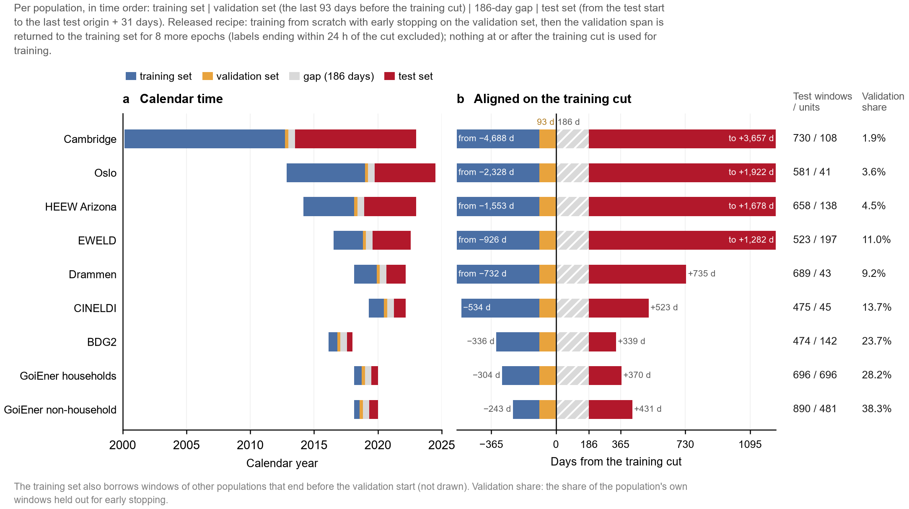

*Figure 1b. Training set, validation span, training cut, 186-day gap and test set of each population, in calendar time
(a) and aligned on the training cut (b) (`results/datasets.csv`).*

## Terms used on this page

- **Unit**: one metered series: a building, a meter, a supply point or a household.
- **Origin**: the hour at which a forecast is issued; the forecast covers the 744 hours (31 days) that follow.
- **Window**: one origin of one unit, with its 1,344-hour **context** and its 744-hour target.
- **Carrier**: the small carrier network whose forecasts the anchoring layer anchors. **The carrier alone** is its
  six-seed forecast at the origin, without the anchoring layer, the state rule and the continuation layer.
- **Continuation layer**: the origin-continuity layer after the anchoring layer and the state rule
  ([section](#the-continuation-layer)). **Readout rule A**: energy, level and peak are read before it.
  **Development windows**: windows before the training cut on which the design was checked ([Data splits](#data-splits)).
- **Pseudo-origin**: an earlier origin o − 744k (k = 1 … 6) inside the unit's record, whose month is already observed
  at o; the carrier's forecast there is a **pseudo-forecast**.
- **Blocks**: the three exact parts of a 744-hour forecast: the **level** (its mean), the **daily path** (the 31 daily
  means minus the level) and the **within-day shape** (each hour minus its day's mean). Their squared errors add.
- **Handover**: the share of the daily means taken from the carrier instead of the history side, one weight per
  forecast week (days 1–7, 8–14, 15–21, 22–31). **Trust**: the weight on the unit's analog-day shape in the within-day
  block (0 to ½).
- **State window**: a window on which the anchoring layer's off-state or micro-load rule fires; ankyra-lite delivers the
  weekly seasonal naive there.
- **Training cut C′, test start C**: see [Data splits](#data-splits). **Test windows**: the month-start origins from C
  on, `late` in the result files.
- **Recipe Rw** (released in 0.2.0: the span return with inverse-noise loss weights), **recipe R** (the span return,
  released in 0.1), **F** (the same 8-epoch continuation without the returned span), **V** (a proportional validation
  set with early stopping), **P3s** (stage 1 alone): the recipes and the arms of version 0.1's recipe study. In the
  0.2.0 rows of `recipe_history.csv`, a configuration is named by recipe and seeds (R3: recipe R, seeds 0–2; R6, Rw3,
  Rw6: recipe R or Rw with three or six seeds) and `_c` marks the continuation layer on; 0.2.0 is Rw6_c, 0.1.0 is R3.
- **Short-record populations**: BDG2 2017, GoiEner non-household and GoiEner households. **Switch layer**: their test
  windows whose target month had no same-season training labels before the span return and has them after it.
- **History-only configuration**: the anchoring layer without a carrier (`foundation=None`). **Carrier-free control**:
  the unchanged anchoring layer called with the history-only configuration's own forecasts in the carrier's place.
- **Fixed division**: the history side alone for the level and the daily path (the historical estimator's level and
  daily path, without the carrier's level candidate and without the handover) and the carrier's within-day block,
  projected onto nonnegative load. The handover weights are estimated on it at the pseudo-origins
  (`fixed_division_daily_means_kw`).
- **Contrast (i)**: anchored against the carrier alone (does the unit's history help the carrier?). **Contrast (ii)**:
  anchored against the history-only configuration (is the carrier-enabled configuration better than history only?).
- **Resolved**: the 95% interval of a contrast excludes zero. **Not resolved** does not mean equally good.
- **Tier**: the role the population had in the ANKYRA 2.2.1 release: `test` (six populations) or `preview` (Oslo,
  Drammen, CINELDI). Here every population has its own training cut and test set and is scored the same way; the tier
  only groups the tables.

## No information after the origin

This heading concerns code access to load and temperature. Calendar inputs are supplied as known: the documented
post-origin holiday announcements mean it is not a certification that every supplied input was available at issue
time. The audit found no added future-load read; it did not rebuild every historical source file.

A forecast at origin o is a function of the following, and nothing else ([docs/METHOD.md](docs/METHOD.md#information-at-the-origin)):

- load and temperature at hours before o (the carrier reads at most the last 366 days and the 24 blocks of 744 hours
  before them; the anchoring layer reads the whole pre-origin record);
- the day types of the 31 forecast days, treated as known at the origin;
- the unit's category, the population's fixed temperature-anomaly scale (fitted on days before the training cut) and
  the daylight-saving rule of its region;
- the carrier's weights: final gradient-training labels end at least 186 days and 24 hours before the first test origin; first-stage early stopping also reads validation labels ending by the training cut;
- the carrier's forecasts at o and at each pseudo-origin q, each built from data before q only;
- for the continuation layer, the anchored forecast itself, the 672 hours of load before o and the day types of the
  last observed day and of the first forecast week (O3).

**Checked by tests.** `tests/test_carrier_unit.py` (no read at or after the issue time, the pseudo-origin rule), the
anchoring layer's own `tests/anchor/test_no_future_information.py`, `tests/test_forecast_v2.py` (no information after
the origin with the continuation layer) and properties C4, C10, C14 and O3 in [theory/](theory/README.md).
These establish input isolation in the implementation. They do not show that the inputs are free of later
information: two calendars announced holidays after some test origins ([Limitations](#limitations)), and providers'
gap filling and later revisions of weather archives lie upstream of the package.

## Baselines

ankyra-lite is compared with **21 baselines** (22 forecasters in all): the 20 external baselines of the ANKYRA 2.2.1
release, scored from their saved forecasts, and LSTM-T-KAN-M. ANKYRA itself and its versions are not among them. All
21 are ordinary baselines in every table and every rank ([docs/EVALUATION.md](docs/EVALUATION.md#baselines)).

| Information | Forecasters (model id in the result files) |
|---|---|
| Given the release's shared covariate set (11 past, 10 future, 6 static features; no observed future weather); each uses what its architecture accepts | Linear-context (TiDE implementation) (`TiDE`, trained), iTransformer-X (trained), GBT-T (trained gradient boosting on 21 derived features), Chronos-2-X (zero-shot), TimesFM-X (zero-shot, covariates through linear regression) |
| Load and calendar, trained | LSTM-T-KAN-M |
| Load only, zero-shot foundation models | TimesFM 2.5 (`TimesFM`), Chronos-2 |
| Load only, trained per population | DLinear, PatchTST, iTransformer, LSTM |
| Load only, statistical | Holt–Winters, MSTL |
| Calendar and climatological temperature | per-unit ridge regression refitted at every origin (`RIDGE-L`) |
| Simple | previous-month, last-year and 4-week profiles; seasonal naive with a period of one day and one week; zero-shot gradient boosting (`GBT`) |

- **The release's trained baselines** were trained once per population with all targets before C (up to half a year
  more recent than ankyra-lite's carrier), at most 15 epochs with patience 3, three seeds averaged. On CINELDI the
  baselines are those re-scored on the corrected store: re-forecast where the start date enters, and the
  calendar-reading trained baselines (GBT-T, the linear-context model, iTransformer-X) retrained with the same code and
  seeds.
- **Linear-context (TiDE implementation).** The release's TiDE implementation ends its temporal decoder in a layer
  normalisation over a single output, which is constant. Its forecast is therefore a linear map of the 1,344-hour load
  context plus a constant, and its covariates have no effect. It keeps the model id `TiDE`, is labelled
  `Linear-context (TiDE implementation)`, and stays among the baselines given the shared covariate set because it
  received them.
- **GBT-T** is the release's corrected version; on EWELD its per-window scaling still overshoots on many windows.

**LSTM-T-KAN-M.** The multivariate LSTM-T-KAN of Shen, Yang, Song and Liang (2026, doi:10.1016/j.scsadv.2026.100065):
**model and training code copied line by line from the authors' public repository (commit `ce24938`, MIT licence),
plus the authors' exp2 feature list** (16 channels from the past load and the past calendar; no temperature). It is
**not a strict reproduction of the paper**. The ten deviations:

| # | The paper / the authors' code | LSTM-T-KAN-M here |
|---|---|---|
| 1 | horizons of 1–30 days, one model per horizon, longest 720 steps | one model, all 744 steps |
| 2 | one model per building | one model per population, trained across its units |
| 3 | Min-Max scaling fitted on the first 70% | per-unit z-score from hours before the cutoff |
| 4 | 70 / 10 / 20 chronological split, stride-1 windows | the release's cutoff, last 20% of training origins for selection, origin step 24 h, at most 16,000 training pairs |
| 5 | 3-point smoothing of the series (paper) | none |
| 6 | up to 100 epochs, early-stopping patience 10 | at most 30 epochs, patience 8 (Addendum A of the protocol, set before any forecast was scored; the protocol first set 50 and 10) |
| 7 | learning rate 10⁻⁴ (configuration) or 10⁻³ (paper) | chosen from {10⁻⁴, 3 × 10⁻⁴, 10⁻³} on the selection pairs |
| 8 | a single run, seed 42 | the mean of seeds 0, 1 and 2 |
| 9 | pre-engineered feature columns, per-horizon feature selection | one fixed list of the 16 exp2 channels with this study's definitions; no weather |
| 10 | validation windows inside the validation split | selection pairs = the last 20% of training origins |

Its budget (30 epochs, patience 8, a plateau schedule, best-weight restoration) is larger than that of the release's
other trained baselines. On CINELDI it was retrained on the corrected store with the same code, protocol,
learning-rate grid and seeds, like the release's calendar-reading baselines; before that, the same code on the original
store reproduced its stored forecast bit for bit, and the retrain passed its checks (`results/compare_baselines.json`,
`populations` → `cineldi` → `extra_baselines`). Details: [docs/EVALUATION.md](docs/EVALUATION.md#lstm-t-kan-m).

**What each side may know.** ankyra-lite reads pre-origin load and temperature, the forecast month's calendar and the
category. The covariate-informed baselines receive future temperature only as its climatological expectation. The
zero-shot foundation models have no local training; their pretraining corpora are the one exposure no forecaster here
controls ([Limitations](#limitations)).

## Evaluation

Every number in this section is a row of a file in [`results/`](results/README.md), written by the full regeneration
of 21 October 2026 with ankyra-lite 0.2.0 (recipe Rw, six seeds, the continuation layer; the supplementary analyses
of 0.1.1 are part of the same run); each block names its file, and [`results/SUMMARY.md`](results/SUMMARY.md) is the
readable summary of the same run. Hourly, rank, conventional, per-day and block tables score the delivered trajectory,
after the continuation layer; the energy tables and the peak readout read ankyra-lite before the layer (readout rule A). The figures are drawn from the same
files by [`figures/make_figures.py`](figures/README.md). The complete tables and the protocol are in
[docs/EVALUATION.md](docs/EVALUATION.md).

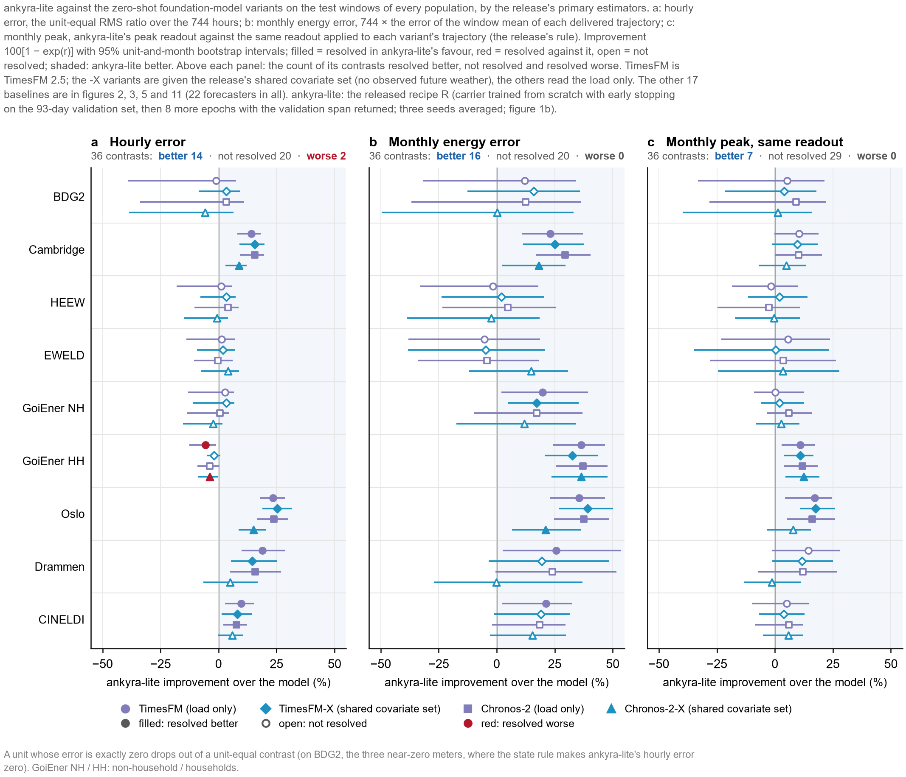

*Figure 0. ankyra-lite 0.2.0 against the four zero-shot foundation-model variants (TimesFM, TimesFM-X, Chronos-2,
Chronos-2-X) on the test windows of every population, by the release's primary estimators: hourly error of the
delivered trajectory (a), monthly energy error read before the continuation layer (b) and the monthly peak against the
same readout on each variant's trajectory (c). Improvement with 95% unit-and-month intervals; filled = resolved better,
open = not resolved, red = resolved worse.*

On monthly energy and on the monthly peak, no contrast with the four variants (36 per readout) is resolved against
ankyra-lite: energy is resolved better in 19 (+17.7% to +38.6%; all four variants on Cambridge, the GoiEner households
and Oslo, three on Drammen, two on GoiEner non-household and CINELDI) and the peak in 9 (+9.8% to +16.8%; all four on
the households, three on Oslo, two on Cambridge), and the point estimates favour ankyra-lite in 31 of the 36 for each.
Hourly error is resolved better against all four variants on Cambridge (+10.0% to +16.8%), Oslo (+14.6% to +25.0%) and
CINELDI (+6.7% to +10.5%) and against three on Drammen (+16.6% to +20.9%; Chronos-2-X +7.3%, not resolved), not
resolved either way on BDG2, HEEW, EWELD and GoiEner non-household (−4.0% to +5.4%), and resolved worse on the GoiEner
households against TimesFM (−4.6%; TimesFM-X −0.9%, Chronos-2 −2.8% and Chronos-2-X −2.9% not resolved)
(`benchmark_pairwise.csv`, `energy_error.csv`, `peak_readout.csv`). How the hourly error moves from day to day, and why
the per-day panels read differently, is under [By forecast day](#by-forecast-day); the continuation layer's part in
the first days is under [The continuation layer by forecast hour](#the-continuation-layer-by-forecast-hour).

### Read this first

- **One more read for 0.2.0.** The configuration of 0.2.0 (the recipe, the seeds, the continuation layer and its
  constants, the readout rule) was frozen before this version read the test windows, from development windows only:
  the development check (re-used evaluation on the development windows that also chose the layer's form) gave the
  layer +0.48% over the month and +9.49% on day 1, and the full 0.2.0 configuration against version 0.1 +0.97% over the
  month and +10.17% on day 1; there the loss weights made the peak readout resolvably worse (Rw6 against R6 −0.92%),
  within the guard written before the read (`recipe_history.csv`, development rows). The test windows were then read once, by rules written before the read,
  and no rule for dropping a change was triggered; they had been read many times before (below), so the read sets the
  direction of each change, not a confirmed effect.
- **Re-evaluation, not a first test.** The test windows are the late windows of the ANKYRA 2.2.1 release's panel, scored
  there for its baselines. The study then scored earlier versions of the small carrier on them, made an hourly-only
  comparison with the baselines, and read them once more in the study that chose the recipe. The direction of the copy
  pointer came from an analysis of the carrier's errors on these windows, and the seasonal-naive state rule was written
  after an earlier scoring of them. The tables describe how the released forecaster performs on these windows; they do
  not estimate how it would perform on windows that played no part in its design.
- **Recipe R was chosen on these windows**, after one directional reading of four recipe arms
  ([Recipe history](#recipe-history-how-r-was-chosen-and-its-negatives)); recipe Rw adds loss weights to it.
- **No model was trained or tuned for the comparison.** Saved forecasts were scored with the release's scoring
  functions, after a check that they reproduce the release's published tables ([Reproducibility](#reproducibility)).
- **State windows.** ankyra-lite delivers the weekly seasonal naive on 33 BDG2, 13 GoiEner non-household, 35 household and
  245 of the 523 EWELD test windows (`results/compare_baselines.json`); on these windows its forecast equals the
  `SN-week` baseline's, and the continuation layer is bypassed. On the three BDG2 meters that read near zero in every window (10 windows) its error is exactly
  zero, so they drop out of the unit-equal contrasts and count in the mean rank
  ([details](docs/EVALUATION.md#state-windows-and-the-three-near-zero-bdg2-meters)).
- **The Suzhou park** of the release has no ankyra-lite forecast and is in no table; it contributes borrowed training
  windows only.

### How to read the numbers

- **Improvement** = 100[1 − exp(r)], with r the unit-equal log RMS ratio: for each unit the RMS of its errors over its
  test windows, r the mean over units of log(RMS of ankyra-lite / RMS of the baseline). Positive favours ankyra-lite.
- **Intervals**: 95%, from 2,000 bootstrap replicates that resample units and target months. `*` marks a contrast
  resolved in favour of ankyra-lite, `(−)` one resolved against it.
- **Hourly**: errors over the 744 hours of the delivered trajectory (after the continuation layer). **Energy**: the
  monthly energy error, 744 × the error of the window mean of the trajectory, for ankyra-lite the trajectory before the
  continuation layer (readout rule A) and for every baseline its own. **Peak**: ankyra-lite's peak readout (on the
  trajectory before the layer) against the same readout applied to each baseline's trajectory (the release's rule),
  and against each baseline's own trajectory maximum.
- **Rank**: position among the 22 forecasters by mean per-unit rank (forecasters ranked within each unit by RMSE).
- Several summaries are reported because pooled and unit-equal summaries can disagree in sign (P19 in
  [theory/](theory/README.md)), and absolute-error metrics favour median-type forecasts while squared-error metrics
  favour mean-type ones.

### What 0.2.0 changes

Each change against version 0.1 (recipe R, three seeds, no continuation layer), nine populations with equal weight,
hourly improvement (`recipe_history.csv`, rows with `reading` = the 0.2.0 test read; the 0.2.0-against-0.1 and
weighting rows combine the unit-and-month bootstrap with the spread of the two three-seed groups, the others are
unit-and-month only; every contrast below is resolved unless marked "nr"):

| Contrast | Whole window | Hours 0–2 | Day 1 | Days 2–7 | Days 8–31 |
|---|---|---|---|---|---|
| **0.2.0 against 0.1** (`primary: 0.2.0 vs 0.1.0`) | **+1.15% [+0.60, +1.71]** | +28.46% | +13.97% | +2.67% | +0.67% |
| six seeds against three (recipe R, no layer; `R6 vs R3`) | +0.41% [+0.15, +0.70] | +0.84% nr | +0.57% | +0.75% | +0.32% |
| loss weights: recipe Rw against R (six seeds, no layer; `Rw6 vs R6`) | +0.31% [+0.06, +0.56] | +0.76% nr | +0.81% | +0.39% nr | +0.30% |
| continuation layer on against off (same Rw6 carrier) | +0.43% [+0.14, +0.78] | +27.30% | +12.77% | +1.55% | +0.04% nr |

- **By population**, 0.2.0 against 0.1 over the month: BDG2 +1.71%, GoiEner non-household +1.91%, GoiEner households
  +0.94% (resolved, [+0.37, +1.51]), Cambridge +1.42%, HEEW +1.44%, EWELD +0.19%, Oslo −0.50%, Drammen +2.42%, CINELDI
  +0.81% (`by_population_pct`; `component_contributions.csv` has each with its interval). The three populations
  without development windows: +1.52% [+0.61, +2.42]; the six with them: +0.97% [+0.28, +1.65].
- **Energy and peak against 0.1**: monthly energy (the curve before the layer) +1.03% [−1.77, +3.74], energy by the
  level readout +1.04% [−1.77, +3.76], peak −0.35% [−2.18, +1.45]; none resolved, and no credible harm by the rule
  written before the read. For a fixed carrier the continuation layer changes neither (they are read before it), so
  these differences come from the carrier.
- The parts are not additive, the three contrasts were read on the same windows and are not independent, and the seed
  and weighting contrasts carry retraining noise that the layer contrast does not. The pooled-units version of the
  layer contrast (`continuation_layer.csv`: +0.46%) weights units, not populations.

### Overview

Resolved better / resolved worse, out of the 21 baselines (`benchmark_pairwise.csv`, `energy_error.csv`,
`peak_readout.csv`; ranks from `benchmark_mean_unit_rank.csv`; state windows from `compare_baselines.json`):

| Population | Tier | Windows / units | State windows | Rank of 22 (mean unit rank) | Next by mean unit rank | Hourly | Energy | Peak (same readout) | Peak (vs the baseline's trajectory maximum) |
|---|---|---|---:|---|---|---|---|---|---|
| BDG2 2017 | test | 474 / 142 | 33 | 1 (4.68) | per-unit ridge (7.01) | 13 / 0 | 7 / 0 | 4 / 0 | 17 / 0 |
| GoiEner non-household | test | 890 / 481 | 13 | 1 (5.02) | iTransformer (7.20) | 14 / 0 | 13 / 0 | 2 / 0 | 19 / 0 |
| GoiEner households | test | 696 / 696 | 35 | 1 (5.34) | per-unit ridge (7.06) | 17 / 1 | 16 / 0 | 11 / 0 | 21 / 0 |
| Cambridge | test | 730 / 108 | 0 | 1 (3.04) | iTransformer-X (5.99) | 21 / 0 | 20 / 0 | 12 / 0 | 21 / 0 |
| HEEW Arizona | test | 658 / 138 | 0 | 1 (5.11) | Chronos-2-X (6.80) | 14 / 0 | 7 / 0 | 7 / 0 | 16 / 0 |
| EWELD | test | 523 / 197 | 245 | 1 (7.09) | TimesFM (8.16) | 13 / 0 | 6 / 0 | 5 / 0 | 19 / 0 |
| Oslo | preview | 581 / 41 | 0 | 1 (1.78) | GBT-T (2.63) | 20 / 0 | 19 / 0 | 17 / 0 | 17 / 0 |
| Drammen | preview | 689 / 43 | 0 | 1 (1.67) | Chronos-2-X (3.58) | 20 / 0 | 13 / 0 | 6 / 1 | 19 / 0 |
| CINELDI | preview | 475 / 45 | 0 | 1 (2.89) | per-unit ridge (5.69) | 21 / 0 | 13 / 0 | 3 / 0 | 19 / 0 |

- **Hourly.** The only resolved loss is on GoiEner households, to TimesFM (−4.6%). The resolved gains range from
  +4.3% (the per-unit ridge, households) to +54.0% (Oslo). Not resolved, for example: GBT-T on Oslo (+2.9%),
  Chronos-2-X on Drammen (+7.3%) and BDG2 (−4.0%).
- **BDG2 without the three near-zero meters**: 12 instead of 13 hourly contrasts are resolved better (iTransformer is
  not), and the mean unit rank is 4.683 on the 139 units, first of 22 (`bdg2_near_zero_sensitivity.csv`).
- **Energy** is not resolved worse than any baseline on any population. Replacing the energy of ankyra-lite's
  trajectory before the layer by its level readout gives the same counts (`energy_level_readout.csv`); the two differ
  only where the nonnegativity projection binds (BDG2 1, GoiEner non-household 138, households 21, Cambridge 10, EWELD
  18, Drammen 2, CINELDI 27 windows).
- Counts of resolved contrasts are descriptive summaries over hundreds of intervals, not a multiplicity-adjusted test.

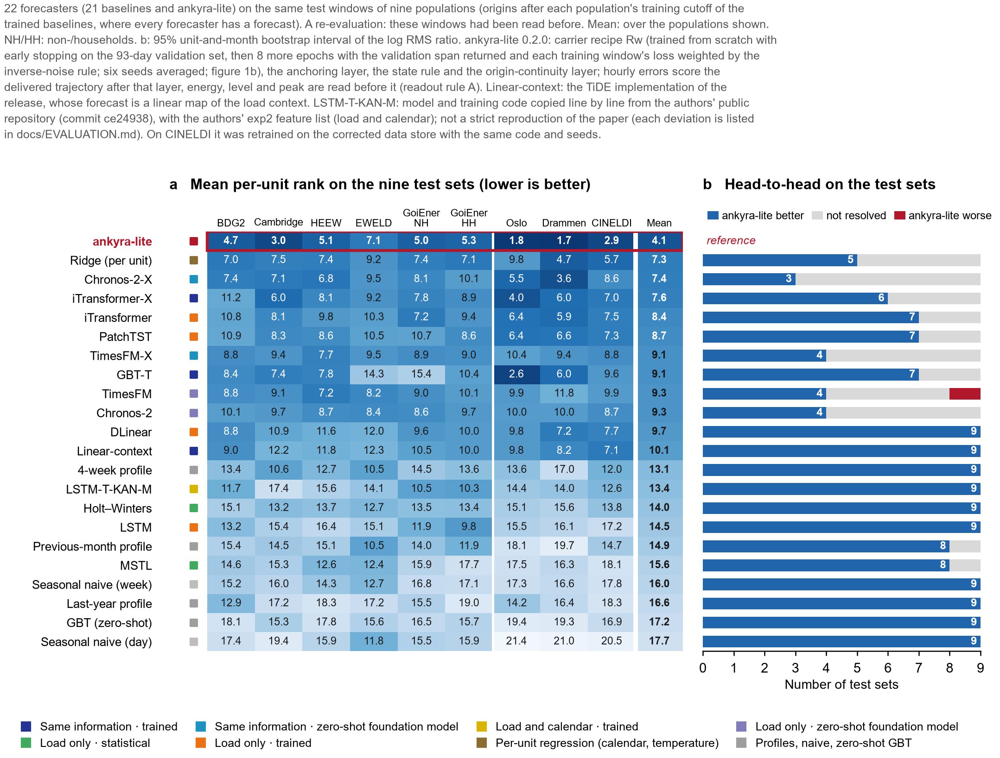

*Figure 2. Mean per-unit rank of every forecaster on each population's test windows (a) and the head-to-head count
over the populations (b).*

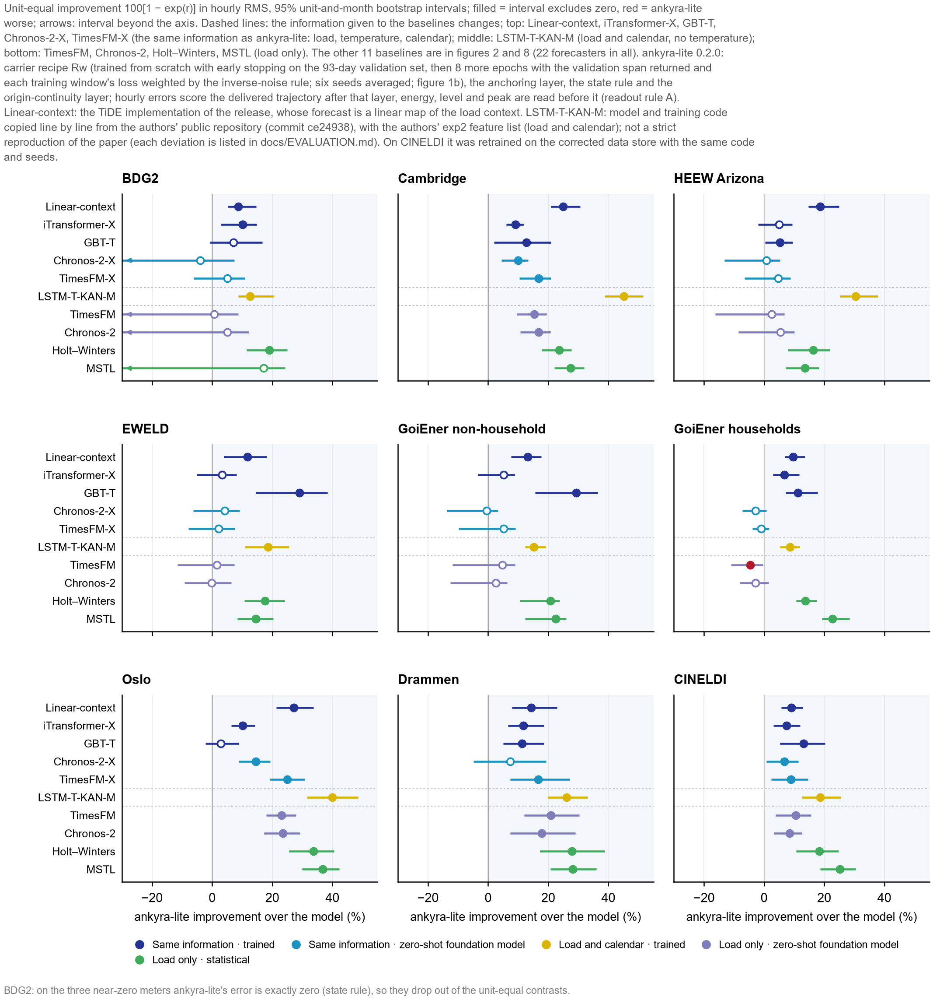

*Figure 3. Unit-equal hourly improvement of ankyra-lite with 95% unit-and-month intervals, against the baselines given
the same information, LSTM-T-KAN-M and a selection of load-only baselines; the other baselines are in Figures 2 and 8.*

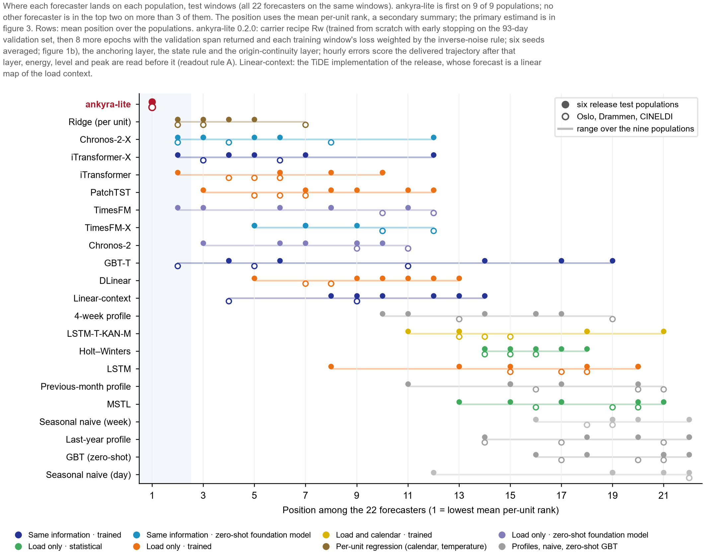

*Figure 12. Position of each forecaster among the 22 on each population (mean per-unit rank), coloured by model class.*

### Against the zero-shot foundation models

Improvement in % (`benchmark_pairwise.csv`, `energy_error.csv`, and `peak_readout.csv` with the same readout):

| Population | Hourly vs TimesFM | Energy vs TimesFM | Peak vs TimesFM | Hourly vs Chronos-2-X | Energy vs Chronos-2-X | Peak vs Chronos-2-X |
|---|---|---|---|---|---|---|
| BDG2 2017 | +0.7 | +14.7 | +4.0 | −4.0 | +3.3 | −0.2 |
| GoiEner non-household | +4.7 | +20.2 * | +0.8 | −0.5 | +12.4 | +3.4 |
| GoiEner households | −4.6 (−) | +32.8 * | +10.2 * | −2.9 | +32.8 * | +11.7 * |
| Cambridge | +15.4 * | +24.6 * | +10.0 * | +10.0 * | +19.7 * | +4.5 |
| HEEW Arizona | +2.5 | −0.1 | −1.2 | +0.8 | −0.8 | +0.0 |
| EWELD | +1.5 | −2.8 | +2.9 | +4.2 | +16.8 | +0.6 |
| Oslo | +23.0 * | +34.9 * | +16.4 * | +14.6 * | +20.4 * | +7.1 |
| Drammen | +20.9 * | +29.0 * | +14.6 | +7.3 | +4.3 | −1.1 |
| CINELDI | +10.5 * | +22.4 * | +6.9 | +6.7 * | +16.7 | +7.6 |

- On BDG2, GoiEner non-household, HEEW and EWELD no hourly contrast with the four zero-shot variants (TimesFM,
  TimesFM-X, Chronos-2, Chronos-2-X) is resolved, and some point estimates are negative (BDG2 against Chronos-2-X
  −4.0%, GoiEner non-household against Chronos-2-X −0.5%, EWELD against Chronos-2 −0.2%).
- On the households the energy contrasts are resolved in favour of ankyra-lite against all four variants (+28.7% to
  +33.6%), and the hourly one against it for TimesFM (−4.6%; TimesFM-X −0.9%, Chronos-2 −2.8% and Chronos-2-X −2.9% are
  not resolved).
- Seven BDG2 sites are listed in TimesFM 2.5's pretraining collection, which may favour TimesFM and TimesFM-X on BDG2
  ([Limitations](#limitations)).

### Rank tests

Per-unit RMSE, units as blocks (`rank_tests.csv`; computed after scoring, descriptive):

- **Six test populations pooled** (1,762 units): Friedman p < 10⁻³⁰⁰; Nemenyi critical difference 0.786. ankyra-lite's
  mean rank is 5.234 of 22, against 7.451 for the next forecaster (the per-unit ridge) and 8.568 for the third
  (iTransformer-X), a gap larger than the critical difference. Holm-corrected Wilcoxon tests find it better than all
  21 baselines and worse than none.
- **Per population** it is significantly better than 21 of the 21 baselines on seven populations, than 20 on Oslo
  (GBT-T not significantly different) and than 19 on EWELD (TimesFM and Chronos-2 not significantly different). No
  baseline is significantly better on any population.

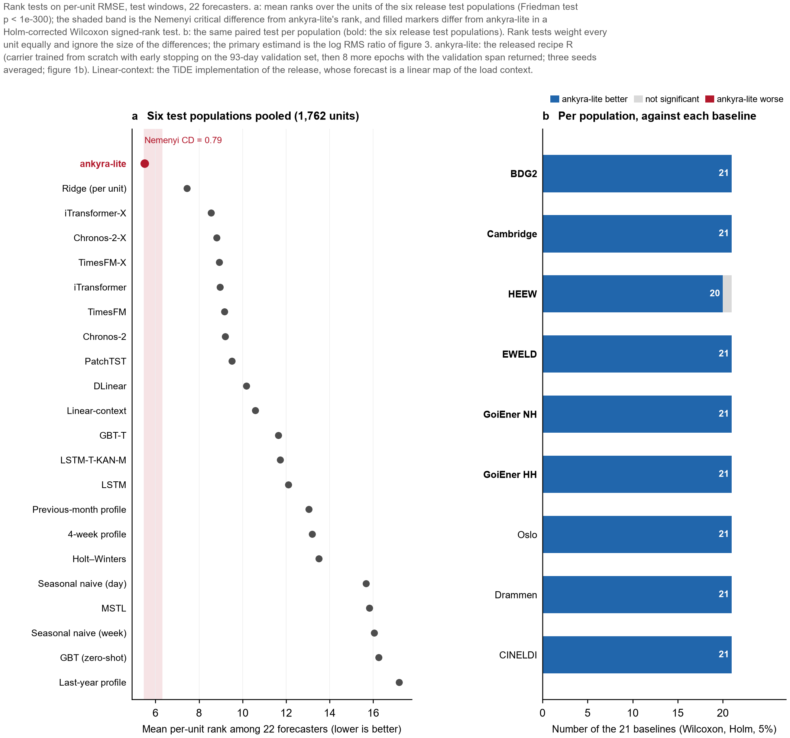

*Figure 15. Pooled mean ranks with the Nemenyi critical difference and Holm-corrected Wilcoxon tests (a); the paired
tests per population (b).*

### Conventional metrics

ankyra-lite's position among the 22 forecasters (`conventional_metrics_late.csv`; RMSE and MAE are unit means in kW,
CV(RMSE) and WAPE are taken at the median unit):

| Metric | BDG2 | GoiEner NH | GoiEner HH | Cambridge | HEEW | EWELD | Oslo | Drammen | CINELDI |
|---|:---:|:---:|:---:|:---:|:---:|:---:|:---:|:---:|:---:|
| RMSE (unit mean) | 1 | 1 | 1 | 1 | 2 | 2 | 1 | 1 | 1 |
| MAE (unit mean) | 2 | 2 | 4 | 1 | 4 | 4 | 1 | 1 | 4 |
| CV(RMSE) (median unit) | 3 | 1 | 1 | 1 | 1 | 3 | 1 | 1 | 1 |
| WAPE (median unit) | 2 | 4 | 5 | 1 | 4 | 5 | 1 | 1 | 2 |
| WAPE (pooled) | 2 | 2 | 5 | 1 | 5 | 6 | 1 | 1 | 4 |

A position is one plus the number of forecasters strictly ahead at the file's two decimals. Ties at two decimals: on
the households the per-unit ridge has the same RMSE (position 1, or 2 if the tie went to it) and the per-unit ridge and
TimesFM-X the same MAE (position 4, or up to 6); on HEEW TimesFM-X has the same MAE (position 4, or 5).

The forecasters ahead of it are mostly the zero-shot foundation models (Chronos-2-X, Chronos-2, TimesFM, TimesFM-X).
GBT-T is ahead on BDG2's CV(RMSE), HEEW's RMSE, MAE and pooled WAPE and CINELDI's MAE and pooled WAPE, and the daily
seasonal naive on EWELD's pooled WAPE. MAE and WAPE are minimised by the median of the predictive distribution,
squared-error metrics by its mean; ankyra-lite's carrier is trained, and its anchoring weights are estimated, on
squared error.

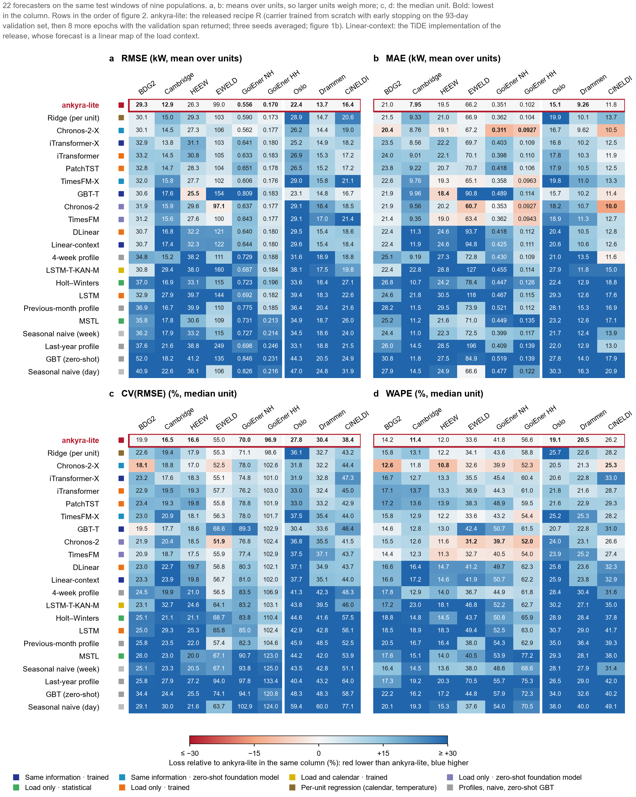

*Figure 8. RMSE, MAE, CV(RMSE) and WAPE of every forecaster on every population, coloured by the loss relative to
ankyra-lite.*

### By forecast day

Six test populations, 22 forecasters (`lead_day_metrics.csv`: each day's CV(RMSE) over its 24 hours, geometric mean
over a fixed set of units; computed after scoring, descriptive):

| | BDG2 | GoiEner NH | GoiEner HH | Cambridge | HEEW | EWELD |
|---|:---:|:---:|:---:|:---:|:---:|:---:|
| position on day 1 | 6 | 2 | 5 | 4 | 5 | 5 |
| days of 31 on which it is lowest | 8 | 0 | 0 | 27 | 11 | 0 |
| worst position on any day | 6 | 6 | 5 | 4 | 6 | 11 |

There are no ties for the lowest at the file's two decimals.

- **The first days of the month are still its weakest.** On day 1 zero-shot foundation models are ahead of it on
  every population (Chronos-2-X alone on GoiEner non-household; TimesFM, Chronos-2 and Chronos-2-X on Cambridge; all
  four variants on BDG2, the households, HEEW and EWELD), and on BDG2 also the daily seasonal naive; no trained
  baseline is ahead on day 1 (in version 0.1 trained baselines were ahead on five of the six). The continuation layer
  is what moved day 1 ([below](#the-continuation-layer-by-forecast-hour)); it narrows the gap, it does not close it.
- **After the first week** its hourly loss is the lowest on all 24 days from day 8 on Cambridge, on 11 on HEEW, 8 on
  BDG2, and on none on EWELD or either GoiEner population, where zero-shot Chronos-2-X or Chronos-2 is lowest.
- **What the per-day loss measures.** The table and Figures 9 and 10 use the release's per-day CV(RMSE) geometric
  mean: each unit's RMS error over one day's 24 hours across its windows (on the households, one window per unit), in %
  of its mean load, averaged over a fixed set of units on the log scale. It behaves more like an absolute-error measure
  and favours lower, median-type forecasts, while the primary estimator, the hourly RMS over all 744 hours of each
  unit's windows, weights days with large errors more. By the unit-mean RMSE in kW of the same file, ankyra-lite is the
  lowest of the 22 on 22 of the 31 days on the GoiEner households, 30 on Cambridge, 12 on BDG2, 12 on GoiEner
  non-household, 7 on HEEW and 2 on EWELD; by the unit-mean MAE in kW it is the lowest on none of the 31 days on the
  households and on one on GoiEner non-household. On the households the four zero-shot variants forecast below the
  observed load (median-unit NMBE, observed minus forecast: +17.7% to +22.4%, against +4.3% for ankyra-lite;
  `conventional_metrics_late.csv`).

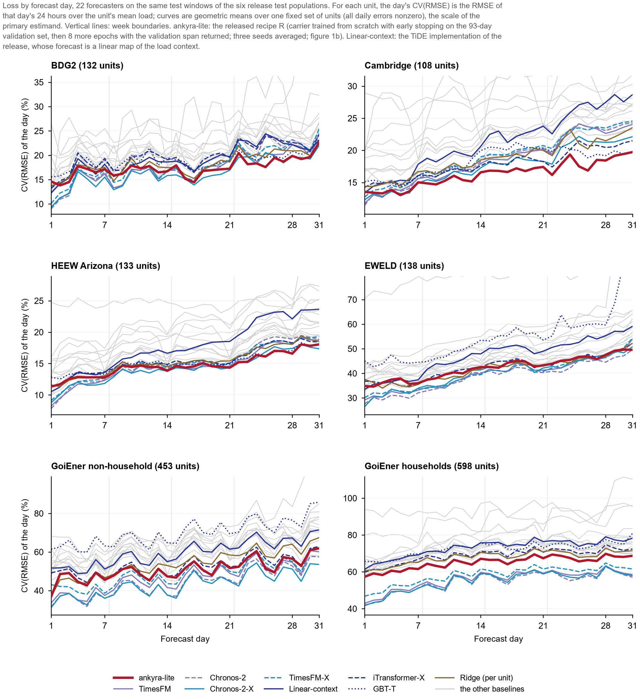

*Figure 9. Hourly CV(RMSE) by forecast day 1–31, geometric mean over a fixed set of units, six test populations;
ankyra-lite's delivered trajectory, after the continuation layer. Figure 9c, beside it, shows what the continuation
layer adds by lead time.*

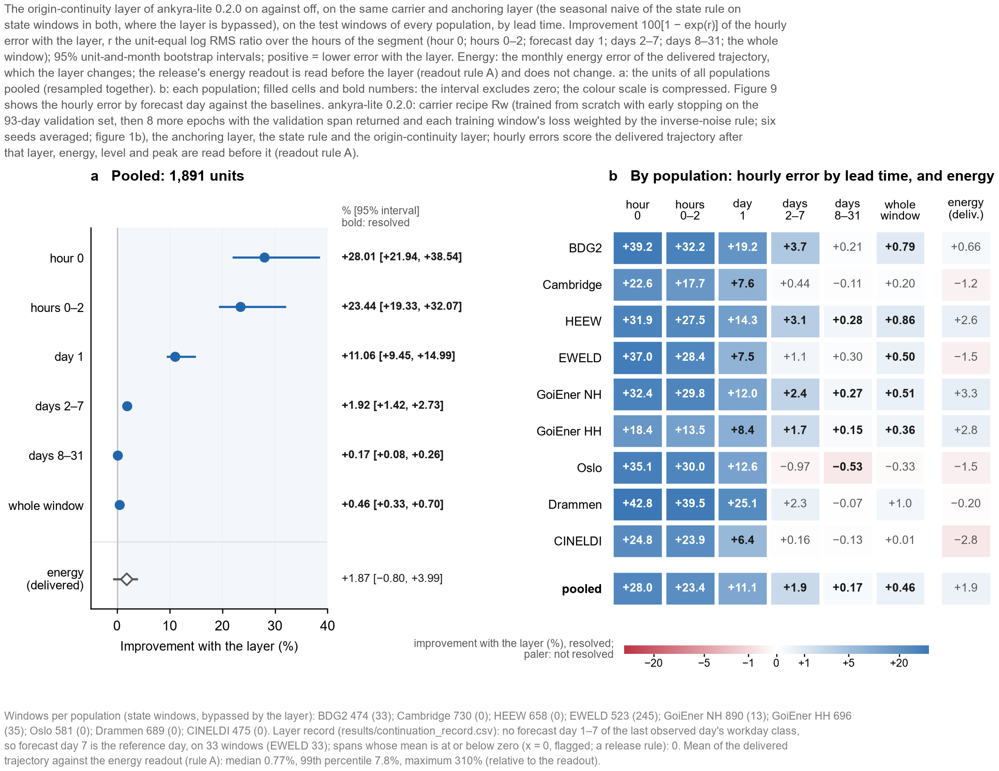

*Figure 9c (beside Figure 9). The continuation layer on against off, on the same carrier and anchoring layer (the
seasonal naive on state windows in both, where the layer is bypassed), by lead time: a, the 1,891 units of the nine
populations pooled (hour 0; hours 0–2; day 1; days 2–7; days 8–31; the whole window; and the monthly energy of the
delivered trajectory); b, each population. Improvement with 95% unit-and-month intervals; filled and bold = resolved.*

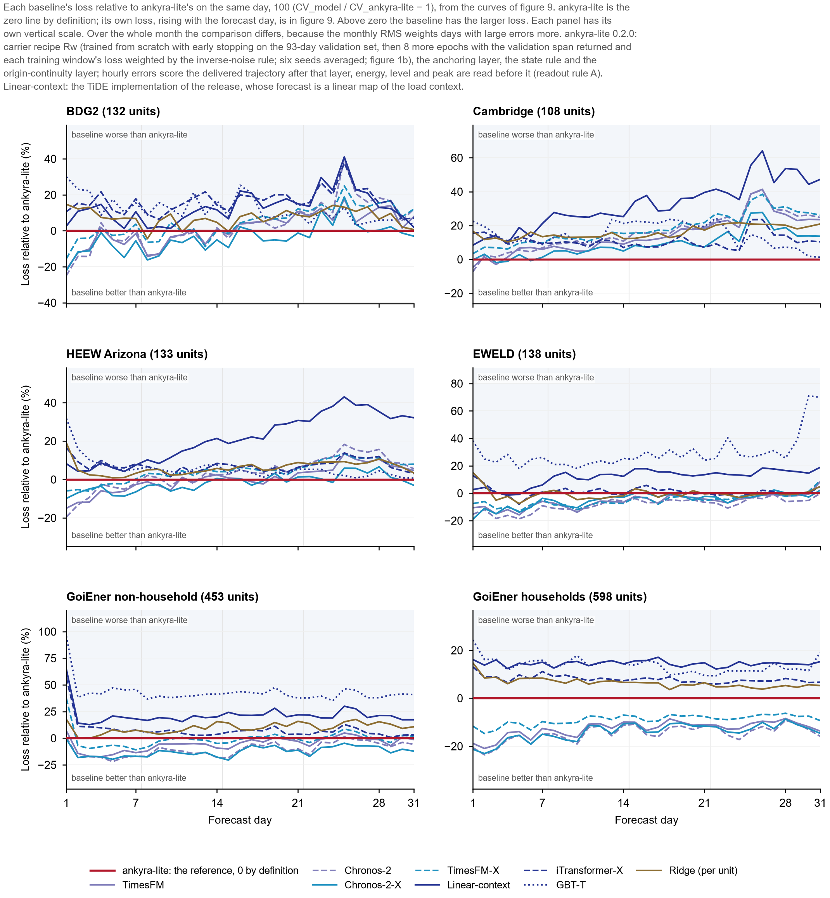

*Figure 10. Each named baseline's daily loss relative to ankyra-lite's (ankyra-lite = 0).*

### The continuation layer by forecast hour

Figure 9c, beside Figure 9 above, draws these contrasts. `continuation_layer.csv` (unit-and-month intervals;
descriptive, the same carrier on both sides):

| Population | Hour 0 | Hours 0–2 | Day 1 | Days 2–7 | Days 8–31 | Whole window |
|---|---|---|---|---|---|---|
| BDG2 2017 | +39.2 * | +32.2 * | +19.2 * | +3.7 * | +0.2 | +0.8 * |
| GoiEner non-household | +32.4 * | +29.8 * | +12.0 * | +2.4 * | +0.3 * | +0.5 * |
| GoiEner households | +18.4 * | +13.5 * | +8.4 * | +1.7 * | +0.1 * | +0.4 * |
| Cambridge | +22.6 * | +17.7 * | +7.6 * | +0.4 | −0.1 | +0.2 |
| HEEW Arizona | +31.9 * | +27.5 * | +14.3 * | +3.1 * | +0.3 * | +0.9 * |
| EWELD | +37.0 * | +28.4 * | +7.5 * | +1.1 | +0.3 | +0.5 * |
| Oslo | +35.1 * | +30.0 * | +12.6 * | −1.0 | −0.5 (−) | −0.3 |
| Drammen | +42.8 * | +39.5 * | +25.1 * | +2.3 | −0.1 | +1.0 |
| CINELDI | +24.8 * | +23.9 * | +6.4 * | +0.2 | −0.1 | +0.0 |
| nine populations pooled (1,891 units) | +28.0 * | +23.4 * | +11.1 * | +1.9 * | +0.2 * | +0.5 * |

- The layer helps on day 1 on every population; after the first week its effect is close to zero, and on Oslo it is
  resolvably negative on days 8–31 (−0.5%) with a whole-window point estimate of −0.3%.
- The energy of the delivered trajectory changes by +1.9% pooled (not resolved; −2.8% to +3.3% by population, none
  resolved); the energy readout itself does not change (rule A).
- `continuation_record.csv`: 326 state windows bypassed the layer; 33 EWELD windows used the reference-day fallback
  d* = 6; no window had an unobserved or nonpositive span; the anomalies were clipped on 6.4% (fast) and 4.2% (day) of
  the windows; the largest |Δ| was 0.809; the delivered mean differed from the energy readout by 0.77% at the median,
  7.8% at the 99th percentile and 310% at most ([Readouts](#readouts)).

### Monthly energy and energy through the month

For ankyra-lite the energy is that of the trajectory before the continuation layer (readout rule A); for every
baseline, that of its own trajectory.

- **Monthly energy** (`energy_error.csv`, nine populations): resolved better than 6 (EWELD) to 20 (Cambridge) of the 21
  baselines, resolved worse than none. By the median-unit absolute percentage energy error it is first of 22 on
  GoiEner non-household (12.09%), the households (12.99%), Oslo (7.61%) and Drammen (7.72%), second on BDG2, third on
  Cambridge and CINELDI, fifth on HEEW and eighth on EWELD.
- **Against TimesFM** the energy error is resolvably lower on six populations (+20.2% to +34.9%), not resolved on BDG2
  (+14.7%), and higher, not resolved, on HEEW (−0.1%) and EWELD (−2.8%).
- **Through the month** (`lead_day_energy.csv`: the error of the energy from day 1 through day d, six test
  populations; descriptive):

  | | BDG2 | GoiEner NH | GoiEner HH | Cambridge | HEEW | EWELD |
  |---|:---:|:---:|:---:|:---:|:---:|:---:|
  | days of 31 on which it is lowest | 12 | 12 | 4 | 24 | 6 | 0 |
  | position on day 31 (the monthly energy) | 1 | 1 | 3 | 1 | 1 | 6 |
  | days 8–31 below all four zero-shot variants (of 24) | 12 | 20 | 24 | 24 | 6 | 0 |

  On HEEW the day-31 lead over Chronos-2-X is small (7.546 against 7.671). On the households it is third at day 31,
  behind the per-unit ridge and the `SP-profile` baseline; on EWELD sixth, behind PatchTST, TimesFM-X, Chronos-2,
  TimesFM and the weekly seasonal naive.

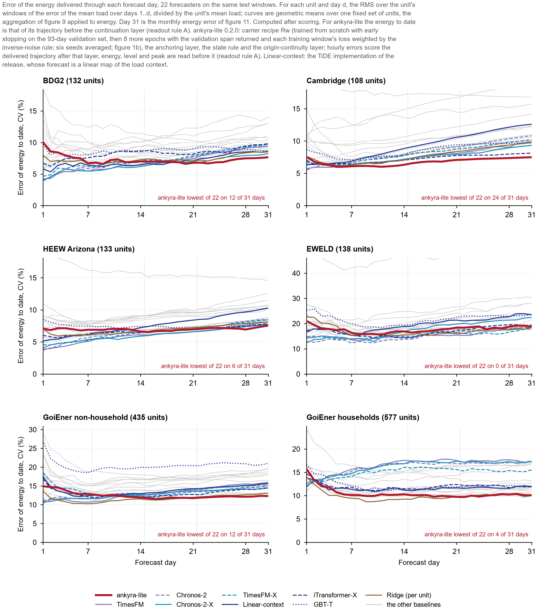

*Figure 9b. Error of the energy through each forecast day, the same aggregation as Figure 9; ankyra-lite's energy to
date is read from its trajectory before the continuation layer (readout rule A).*

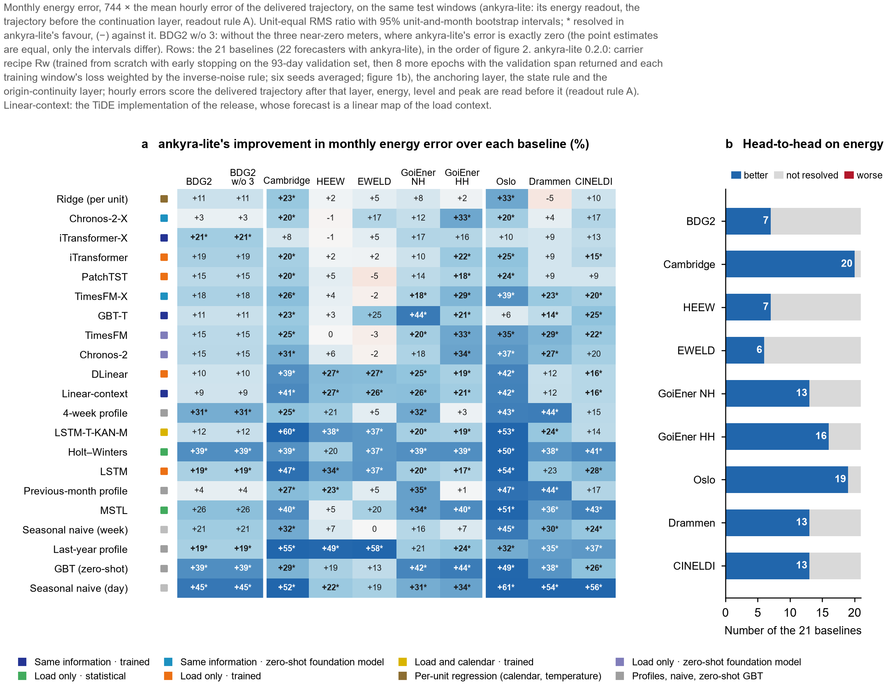

*Figure 11. Improvement in the monthly energy error over each baseline, per population (BDG2 also without the three
near-zero meters) (a), and the head-to-head count (b); ankyra-lite's energy is its readout before the continuation
layer.*

### Peak readout

ankyra-lite's peak readout is the anchoring layer's envelope operator on the daily means of its trajectory before the
continuation layer: U = max over days d of (L̂_d + A_τd), the day's forecast mean plus the largest recent excursion of
the same day type (P15–P17). `peak_readout.csv`:

- **Against the same readout on each baseline's trajectory** (the release's rule): resolved better against 2 (GoiEner
  non-household) to 17 (Oslo) of the 21 per population; the one resolved loss is to GBT-T on Drammen (−10.6%).
- **Against each baseline's own trajectory maximum**: resolved better against 16–21 of the 21 per population, worse
  against none.
- **Against its own trajectory maximum** (the maximum of the delivered trajectory, after the continuation layer):
  resolved better on all nine populations, from +21.3% (Oslo) to +68.2% (the households).
- **Against last month's observed peak** (the maximum of the last 744 context hours): resolved better on Oslo (+26.8%)
  and resolved worse on CINELDI (−18.2%); elsewhere not resolved, from −34.7% (GoiEner non-household) to +15.7%
  (Drammen).
- **Against the same readout on the carrier alone** (the six-seed carrier forecast at the origin, comparator `same
  readout on the carrier alone`): not resolved on seven populations (−6.9% on HEEW to +5.6% on GoiEner
  non-household) and resolved worse on Oslo (−2.5%) and Drammen (−2.9%). The readout carries the daily means' gains
  into the peak (P16), but the anchoring layer's gain over the carrier in the level is small here (monthly energy
  resolved on no population, contrast (i)), and it does not show in the peak.

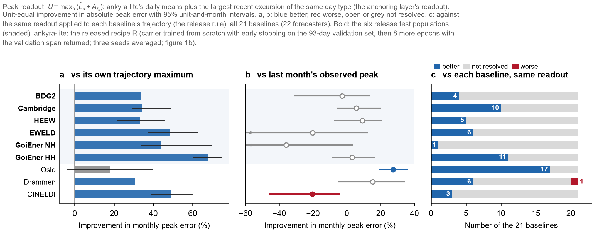

*Figure 5. The peak readout against its own delivered trajectory's maximum (a) and against last month's observed peak
(b); the head-to-head count against the same readout on each baseline's trajectory (c).*

### Error blocks and scaled errors

The hourly squared error of every window splits exactly into a level, a daily-path and a within-day part (P1).
`block_shares.csv` (six test populations, the delivered trajectory, descriptive; the block contrasts carry no
interval):

| | BDG2 | GoiEner NH | GoiEner HH | Cambridge | HEEW | EWELD |
|---|:---:|:---:|:---:|:---:|:---:|:---:|
| share of ankyra-lite's error, pooled: level | 36.6% | 12.4% | 14.5% | 15.9% | 38.8% | 48.9% |
| daily path | 43.2% | 32.4% | 16.2% | 20.1% | 32.2% | 35.4% |
| within-day | 20.2% | 55.2% | 69.3% | 64.0% | 29.1% | 15.7% |
| improvement over TimesFM: level | +15.3 | +22.8 | +34.7 | +23.7 | +2.5 | −4.3 |
| daily path | −2.4 | −0.4 | −9.8 | +12.0 | +3.2 | +3.5 |
| within-day | −1.8 | +5.6 | −3.1 | +12.1 | +2.0 | +3.0 |

On the households the hourly deficit to TimesFM sits in the daily path and the within-day block, not in the level.
The level block here is that of the delivered trajectory, after the continuation layer; the energy readout is in
`energy_error.csv`.

`scaled_errors.csv` (each window's error divided by the in-sample error of the weekly seasonal naive over its context;
descriptive): by median-unit RMSSE ankyra-lite is first on seven populations (GoiEner non-household, the households,
Cambridge, HEEW, Oslo, Drammen, CINELDI) and second on BDG2 and EWELD. By median-unit MASE, an absolute-error scale, it
is first on Cambridge, Oslo, Drammen and CINELDI, fifth on BDG2, GoiEner non-household, the households and HEEW and
sixth on EWELD.

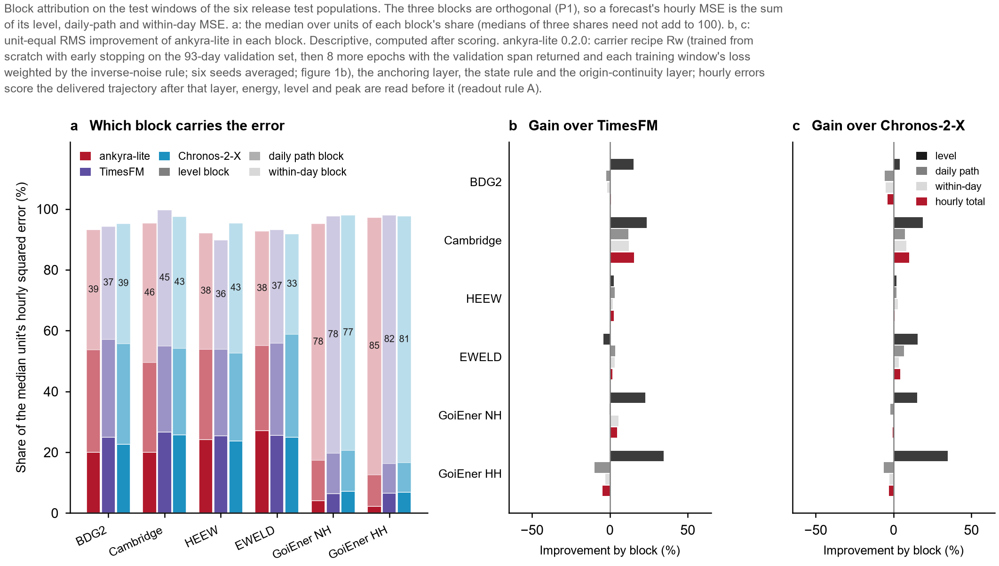

*Figure 14. Median-unit share of each block in the hourly squared error of ankyra-lite, TimesFM and Chronos-2-X (a);
ankyra-lite's improvement over TimesFM (b) and over Chronos-2-X (c) by block.*

### Prediction intervals

ankyra-lite produces no interval of its own. For a description, the anchoring layer's interval readout is placed around
its delivered trajectory (after the continuation layer): residual quantiles of the **history-only** forecaster at up to
12 completed pseudo-origins of the unit, which do not depend on the carrier. It is compared with the native quantiles
of TimesFM 2.5 and Chronos-2 (`intervals_by_population.csv`, `intervals_winkler_contrasts.csv`,
`intervals_households.json`; descriptive):

| Population | 80% coverage: ankyra-lite / TimesFM / Chronos-2 | 90% coverage: ankyra-lite / Chronos-2 | Winkler 80 vs TimesFM | vs Chronos-2 |
|---|---|---|---|---|
| BDG2 2017 | 0.766 / 0.349 / 0.629 | 0.858 / 0.776 | −2.7 | −17.2 |
| GoiEner non-household | 0.792 / 0.430 / 0.720 | 0.876 / 0.851 | +6.2 | −9.1 (−) |
| GoiEner households | 0.782 / 0.345 / 0.680 | 0.874 / 0.815 | +6.8 * | −1.4 |
| Cambridge | 0.790 / 0.393 / 0.710 | 0.880 / 0.836 | +15.3 * | −1.1 |
| HEEW Arizona | 0.776 / 0.373 / 0.726 | 0.863 / 0.848 | +9.3 | −2.5 |
| EWELD | 0.844 / 0.606 / 0.804 | 0.894 / 0.883 | −3.7 | −39.6 (−) |
| Oslo | 0.847 / 0.379 / 0.678 | 0.920 / 0.813 | +21.0 * | +4.5 * |
| Drammen | 0.855 / 0.388 / 0.725 | 0.917 / 0.841 | +20.6 * | +3.2 |
| CINELDI | 0.818 / 0.438 / 0.736 | 0.901 / 0.859 | +15.5 * | −4.3 (−) |

- The 80% band covers 0.766–0.855 of the hours, against 0.345–0.606 for TimesFM's native quantiles and 0.629–0.804 for
  Chronos-2's. Its coverage falls with lead time (first week 0.808–0.884, fourth week 0.718–0.829), because the
  residuals are pooled over the whole window.
- On the 80% Winkler score it is resolved better than TimesFM's band on five populations and worse on none; against
  Chronos-2's quantiles it is resolved better on Oslo and worse on EWELD, GoiEner non-household and CINELDI.
- On EWELD the band carries no information on units that switch off (mean 80% width 388,321 kW).
- On the households the same interval around the carrier alone changes the Winkler score by 0.10% (not resolved): the
  interval comes from the history-only residuals, not from the carrier.

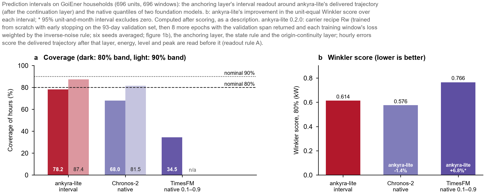

*Figure 13. Coverage and Winkler score of the intervals on GoiEner households.*

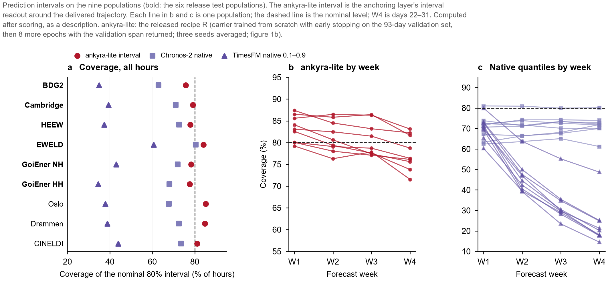

*Figure 16. Coverage of the nominal 80% interval on every population and by forecast week.*

### What the parts add

Hourly improvement of ankyra-lite 0.2.0 over the version without the part, or over the named alternative
(`component_contributions.csv`, `ablation.csv`; "identical": the two forecasts are the same on every window). The rows
of switched-off parts of the anchoring layer re-run the unchanged layer on the saved six-seed carrier forecasts; the
re-run reproduces the evaluated forecast bit for bit before any of them is used. The recipe and carrier rows compare
the whole 0.2.0 configuration with saved study products, so they include the weights, the six seeds and the
continuation layer as well.

| Part | BDG2 | GoiEner NH | GoiEner HH | Cambridge | HEEW | EWELD | Oslo | Drammen | CINELDI |
|---|---|---|---|---|---|---|---|---|---|
| anchoring layer, state rule and continuation layer together (against the carrier alone) | +3.6 * | +3.3 | −1.3 | +0.1 | +2.2 * | +0.5 | −0.5 | +0.8 | +1.3 |
| the carrier inside the anchoring layer (against the history-only configuration) | +8.0 * | +21.1 * | +11.9 * | +15.0 * | +13.8 * | +16.8 * | +20.1 * | +17.4 * | +6.2 * |
| continuation layer (same carrier and anchoring layer) | +0.8 * | +0.5 * | +0.4 * | +0.2 | +0.9 * | +0.5 * | −0.3 | +1.0 | +0.0 |
| within-day anchoring | +0.7 * | +2.4 | −0.0 | +0.3 | +0.8 * | −0.0 | +0.6 * | +0.9 * | +0.9 * |
| seasonal-naive state rule | +0.3 | −0.0 | +0.3 | identical | identical | +2.1 | identical | identical | identical |
| **0.2.0 against 0.1** (every change together) | +1.7 | +1.9 * | +0.9 * | +1.4 * | +1.4 * | +0.2 | −0.5 | +2.4 * | +0.8 |
| loss weights (recipe Rw against R, six seeds, with the layer) | +0.2 | +0.9 | +0.3 | +0.5 | +0.5 | −0.3 | −0.2 | +0.1 | +0.6 * |
| six seeds against seeds 0–2 (recipe Rw, with the layer) | +0.7 | +0.4 | +0.2 | +0.8 | −0.0 | +0.0 | −0.3 | +0.9 | +0.5 |
| six-seed ensemble against a three-seed group (mean of the two groups; point estimate) | +0.5 | +0.2 | +0.1 | +0.3 | +0.4 | +0.2 | +0.3 | +0.5 | +0.2 |
| 0.2.0 against the from-scratch stage alone (0.1 recipe study) | +2.9 * | +4.6 * | +2.3 * | +3.1 * | +2.3 * | +1.3 | +1.7 * | +0.2 | +1.6 |
| 0.2.0 against the plain continuation F (0.1 recipe study) | +2.2 * | +4.1 | +1.7 * | +2.0 * | +1.2 * | −0.2 | −0.4 | −0.4 | +1.1 |
| the carrier's level candidate, the handover and the within-day anchoring (against the fixed division) | +2.9 * | +4.3 * | +2.9 * | +7.9 * | +6.8 * | +8.4 * | +8.3 * | +7.5 * | +2.7 * |
| weekly handover weights (against a fixed half weight) | +0.9 * | −0.1 | +0.4 | +1.2 | +0.9 | +1.0 | +0.4 | +1.0 * | +0.0 |
| block-wise weights (against one whole-window weight of the same two forecasts) | −0.2 | −0.2 | +1.5 * | +0.4 | +0.4 | +0.5 | +0.4 | −0.0 | −0.2 |
| block-wise weights (against a half-and-half average of the same two forecasts) | +1.0 | +1.7 | +4.0 * | +3.9 * | +2.9 * | +3.1 * | +2.5 * | +1.5 * | +0.3 |

- In `component_contributions.csv` the two rows of version 0.1's recipe study keep their 0.1 names
  (`continuation with the span return (from-scratch stage -> released recipe)`, `span return (...)`); in 0.2.0 they
  compare the whole 0.2.0 configuration with the study's saved three-seed products of the from-scratch stage and of F,
  so they are not the span return's own contribution. That contribution, R against F with the same seeds, is in
  [Recipe history](#recipe-history-how-r-was-chosen-and-its-negatives).
- **Contrast (i)**, the anchoring layer against the carrier alone (before the continuation layer,
  `carriers_in_anchoring_layer.csv`), is resolved on two populations in hourly error (BDG2 +2.8%, CINELDI +1.3%) and on
  none in monthly energy; on the households it is −1.7% (not resolved). **Contrast (ii)**, against the history-only
  configuration, is resolved on all nine in hourly error (+6.1% to +20.6%) and on five in monthly energy (Cambridge
  +20.0%, HEEW +14.5%, EWELD +34.8%, Oslo +20.7%, Drammen +12.7%).
- **Small switches.** One within-day trust value per window (against one per lead block), the short-gap rule and the
  micro-load rule each change the hourly error by at most 0.2%. The state rule matters only where state windows exist;
  no energy contrast of the small switches is resolved.
- **Earlier carriers** (eight populations; none exists on the corrected CINELDI store; `ablation.csv`): against the same
  network without the copy pointer, trained with the from-scratch recipe, ankyra-lite 0.2.0 is better by +1.8% to
  +5.0% (resolved on seven, not on Drammen, +2.2%); against the earlier structured network without the pointer, trained
  on weekly windows, by +2.0% to +11.7% (resolved on all eight). These rows too include every 0.2.0 change.
- The intervals of these rows resample units and months only; the 0.2.0 rows with the seed layer are under
  [What 0.2.0 changes](#what-020-changes).
- **Where the within-day anchoring acts** (`within_day_trust.csv`). On the eight non-household populations the trust on
  the unit's analog-day shape averages 0.13–0.21 (cap ½) and is positive on 76–88% of the anchored windows; on the
  GoiEner households it averages 0.05 (median 0, positive on 43%), so there the carrier's within-day shape is mostly
  kept, consistent with the −0.0% of that row. The plausibility guard keeps the analog shape on 94–100% of the windows.
- The handover rows are rebuilt from the anchoring layer's own fields of every window (`evaluation/lite_reanchor.py`,
  mode `fields`; the rebuilt weekly weights, trust, level weights and daily means equal the layer's own exactly, and the
  arm with the weekly weights reproduces the anchored forecast bit for bit); they compare forecasts before the
  continuation layer. They are discussed under
  [How the anchoring layer uses the carrier](#how-the-anchoring-layer-uses-the-carrier).

**Block-wise weighting against one whole-window weight.** This control takes up one alternative explanation of the
gain: that it comes from weighting the level, daily path and within-day blocks separately. It combines the same two
forecasts as the anchoring layer, the history side (the fixed-division daily means plus the analog-day shape) and the
carrier, with **one** least-squares weight per window for the whole 744 hours, set from the unit's own completed
pseudo-forecasts (the handover pairs and the trust triples) and shrunk towards ½; the ANKYRA 2.2.1 release calls it B2,
and the half-and-half average B1. The mean weight on the carrier is 0.56–0.73.

- In hourly error the one whole-window weight is within −0.2% to +1.5% of ankyra-lite: ankyra-lite is resolvably better
  only on the GoiEner households (+1.5%), and the other eight populations are not separated. In monthly energy no
  population is separated (−3.9% to +3.0%).
- The half-and-half average is weaker: ankyra-lite is resolvably better than it on six populations in hourly error
  (+1.5% to +4.0%) and on none in monthly energy.
- Read: block-wise weighting is not a necessary explanation of the gain on these populations. What the comparison
  leaves standing is the history-side forecast and the weighting by the unit's own pseudo-forecast errors; the block
  decomposition remains the exact identity used for interpretation, the readouts and diagnosis (P1). The control tests
  the layer's own block-wise weighting against its own whole-window special case; it says nothing about other ways of
  weighting by block.

**Generic combination partners** (`generic_combinations.csv`). Does the history side supply more than a generic local
forecast would? B2(X) is the same whole-window combination with the history side replaced by X: the weekly seasonal
naive, the four-week profile or the last-year profile, each computed from the load before every pseudo-origin; EW(X)
is the equal-weight average of the carrier and X (X also the per-unit ridge or MSTL). Populations, of nine, first-named
resolved better / not resolved / resolved worse:

| Contrast | Hourly | Monthly energy |
|---|---|---|
| B2(history side) vs B2(seasonal naive, week) | 1 / 8 / 0 | 0 / 9 / 0 |
| B2(history side) vs B2(four-week profile) | 0 / 9 / 0 | 0 / 9 / 0 |
| B2(history side) vs B2(last-year profile) | 1 / 8 / 0 | 0 / 9 / 0 |
| B2(history side) vs the best B2(X) | 0 / 9 / 0 | 0 / 9 / 0 |
| B2(history side) vs the best equal-weight average | 2 / 7 / 0 | 0 / 8 / 1 |
| ankyra-lite vs the best of all of them | 0 / 9 / 0 | 0 / 9 / 0 |

"Best" was picked after scoring, per population and error, which favours the generic side. Against each of the three
generic forecasters in the same combination the history side is resolvably better (two contrasts) or not separated;
against the best of them it is not separated on any population. The one resolved loss is monthly energy on Drammen,
for B2(history side) against the equal-weight average of the carrier and the per-unit ridge (−13.4%).

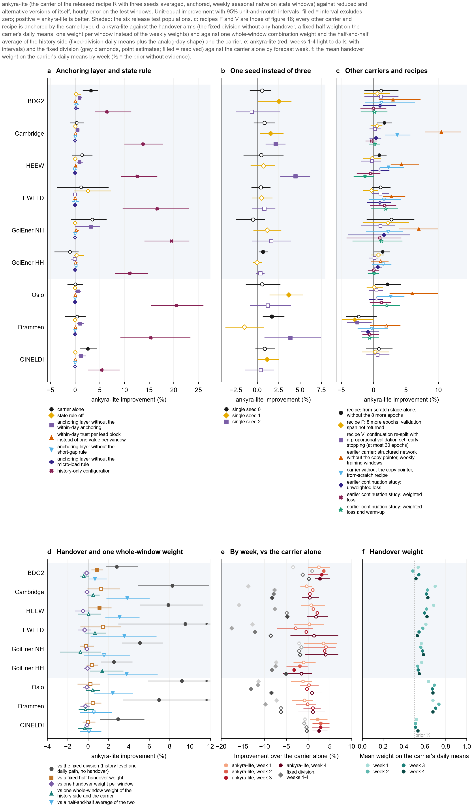

*Figure 4. ankyra-lite 0.2.0 against reduced and alternative versions of itself (hourly error): parts of the anchoring
layer, the state rule and the continuation layer switched off, the carrier alone and the history-only configuration
(a); one three-seed group instead of the six seeds (b); other carriers, the recipe arms of version 0.1 and the 0.2.0
configurations (recipe R or Rw, three or six seeds, with or without the layer) inside the same anchoring layer (c); the
handover arms and one whole-window weight (d); ankyra-lite and the fixed division against the carrier alone by forecast
week (e); the mean handover weight on the carrier by week (f).*

### Seeds

`seed_spread.csv`: hourly improvement against TimesFM of each group of three seeds anchored alone (seeds 0–2, seeds
3–5, both with the continuation layer) and of the six-seed ensemble:

| Population | Seeds 0–2 | Seeds 3–5 | Six seeds |
|---|---|---|---|
| BDG2 2017 | +0.0 | +0.4 | +0.7 |
| GoiEner non-household | +4.3 | +4.6 | +4.7 |
| GoiEner households | −4.9 (−) | −4.7 (−) | −4.6 (−) |
| Cambridge | +14.7 * | +15.6 * | +15.4 * |
| HEEW Arizona | +2.5 | +1.8 | +2.5 |
| EWELD | +1.5 | +1.2 | +1.5 |
| Oslo | +23.2 * | +22.3 * | +23.0 * |
| Drammen | +20.2 * | +20.8 * | +20.9 * |
| CINELDI | +10.1 * | +10.5 * | +10.5 * |

The two groups differ by at most 0.97 points; the verdict is the same for both groups and the ensemble on every
population. The same file holds each seed's carrier alone. The seed spread is the only measure of retraining noise in
`results/` besides the seed layer of the 0.2.0 rows of `recipe_history.csv`; the intervals of the main tables do not
include it.

### Other carriers in the same anchoring layer

`carriers_in_anchoring_layer.csv`: the same anchoring layer with three other trained carriers (LSTM, PatchTST and
LSTM-T-KAN-M, trained on their own population only with the same training cut as the small carrier; on state windows
the layer returns their own forecasts, and on CINELDI they were trained on the original store and anchored on the
corrected one; none of them gets the continuation layer). Populations, of nine, resolved better / not resolved /
resolved worse; the small carrier's contrasts (i) and (ii) are before the continuation layer, the last two columns
compare the delivered ankyra-lite in hourly error and its energy readout (before the layer):

| Carrier | (i) anchored vs carrier alone: hourly | energy | (ii) anchored vs history only: hourly | energy | ankyra-lite vs this anchored carrier: hourly | energy |
|---|---|---|---|---|---|---|
| small carrier network (ankyra-lite) | 2 / 7 / 0 | 0 / 9 / 0 | 9 / 0 / 0 | 5 / 4 / 0 | — | — |
| LSTM | 8 / 1 / 0 | 6 / 3 / 0 | 3 / 5 / 1 | 0 / 7 / 2 | 9 / 0 / 0 | 6 / 3 / 0 |
| PatchTST | 7 / 2 / 0 | 3 / 6 / 0 | 7 / 2 / 0 | 3 / 6 / 0 | 7 / 2 / 0 | 1 / 8 / 0 |
| LSTM-T-KAN-M | 8 / 1 / 0 | 7 / 2 / 0 | 1 / 6 / 2 | 0 / 5 / 4 | 9 / 0 / 0 | 6 / 3 / 0 |

- The anchoring layer improves the weaker carriers more (contrast (i)). With the small carrier the combination improves
  on the history-only configuration on all nine populations in hourly error, with the LSTM on three and LSTM-T-KAN-M on
  one. The resolved losses of contrast (ii) include EWELD for both (hourly −83.1% and −104.4%), where the layer returns
  those carriers' own forecasts on its 245 state windows, and Cambridge for LSTM-T-KAN-M (−10.3%).
- No anchored carrier is resolved better than ankyra-lite on any population.

**Contrast (ii) by block, and the carrier-free control** (`contrast_ii_blocks.csv`, `contrast_ii_control.csv`;
descriptive). Contrast (ii) compares two complete configurations: the history-only configuration uses a day-type
default instead of the analog-day shape and has no state rules. The carrier-free control runs the same procedure with
the history-only forecasts in the carrier's place. Populations, of nine, resolved better / not resolved / resolved
worse, all test windows ("anchored": ankyra-lite before the continuation layer):

| Contrast | Hourly | Level | Daily path | Within-day |
|---|---|---|---|---|
| anchored vs history only | 9 / 0 / 0 | 5 / 4 / 0 | 6 / 3 / 0 | 8 / 1 / 0 |
| anchored with the continuation layer vs history only | 9 / 0 / 0 | 5 / 4 / 0 | 5 / 4 / 0 | 8 / 1 / 0 |
| anchored vs carrier alone | 2 / 7 / 0 | 0 / 9 / 0 | 1 / 6 / 2 | 6 / 3 / 0 |
| carrier alone vs history only | 7 / 2 / 0 | 3 / 6 / 0 | 5 / 3 / 1 | 8 / 1 / 0 |
| anchored vs carrier-free control | 9 / 0 / 0 | 5 / 4 / 0 | 5 / 4 / 0 | 8 / 1 / 0 |
| carrier-free control vs history only | 8 / 1 / 0 | 0 / 9 / 0 | 1 / 8 / 0 | 8 / 1 / 0 |

Against the carrier-free control ankyra-lite is resolved better in hourly error on all nine populations (+3.8% on
CINELDI to +15.6% on Oslo). The two sides run the same procedure and differ in the forecast that stands in the
carrier's place (and on state windows, where ankyra-lite delivers the seasonal naive). That forecast enters the level
candidates, the handover and the within-day mixture at once, so the split by block locates the difference only
roughly.

### History length and the anchoring record

`history_length.csv`, all nine populations pooled (descriptive; the strata are confounded with the population):

| Hours since the unit's first observation, at the origin | Windows | vs carrier alone | vs TimesFM | vs Chronos-2-X |
|---|---:|---|---|---|
| < 10,248 h (no annual candidate) | 450 | −0.6 | −2.4 | −2.6 |
| 10,248 h – 2 years | 1,715 | +1.7 | +0.4 | −2.7 |
| 2–3 years | 829 | +2.5 | +11.8 | +7.2 |
| ≥ 3 years | 2,722 | +0.3 | +9.1 * | +5.8 |

Against the zero-shot foundation models the point estimates are negative below 10,248 hours, mixed up to two years
and positive above; only the ≥ 3-year stratum against TimesFM is resolved. This is a description, not a threshold
common to the populations.

`anchoring_gain_deciles.csv` (the two statistics of `anchoring_record` against the realised gain of ankyra-lite over
its carrier alone; deciles of 538–539 windows over the nine populations, state windows and units with a near-zero
mean load excluded; descriptive): the monthly-level gain is largest in the lowest decile of the carrier's level weight
(+8.8%) and negative in the seventh and eighth (−7.2%, −3.7%); by `history_vs_carrier_log_ratio` it is largest in the
two lowest deciles, where the unit's history beat the carrier at earlier pseudo-origins (+10.5%, +9.4%; the hourly gain
is resolved there, +3.1% and +2.4%). Neither statistic orders the gain monotonically, and the carrier weight is the
layer's own weight, so its association with the gain is partly mechanical.

**How often the pseudo-forecasts pick the best level candidate** (`level_candidate_hit_rate.csv`, P20; descriptive).
The level candidate with the largest weight, i.e. the smallest error at the unit's completed pseudo-origins, is the
candidate whose window mean is closest to the realised one on 21.7% of the windows pooled over the nine populations,
against 14.4% by chance among the seven candidates (difference +7.3 points, 95% unit bootstrap +6.1 to +8.4); 17.5% to
25.7% per population, with the difference resolved on seven (not on EWELD and CINELDI). Among the six historical
candidates alone it is 23.3% against 16.9%. The carrier's window mean has the largest weight on 40–71% of the windows
and is the closest candidate on 15–29%. The pseudo-origin errors thus carry some information about which candidate
will be best, little in absolute terms, which is what the strong shrinkage of the level weights assumes.

### Robustness to corrupted contexts

`robustness.csv`: 64 Drammen test windows (43 units) re-forecast on the CPU with the released checkpoints from a
corrupted context (the carrier at every issue time, the anchoring layer, the state rule, the continuation layer); the
targets are untouched. Change of the hourly RMS error against the clean context (positive = worse):

| Corruption of the context | ankyra-lite | carrier alone | ankyra-lite vs carrier alone, corrupted |
|---|---:|---:|---:|
| 5% of hours missing, filled by linear interpolation | +0.0% | −0.1% | −2.9% |
| 20% of hours missing, filled | +0.2% | +0.1% | −2.9% |
| a 24-hour zero-filled block in the last week | +2.3% | +2.4% | −3.0% |
| one spike at 10 × the context maximum, 36 hours before the origin | +52.5% | +40.7% | +5.2% |
| context shifted by +1 hour | +10.8% | +10.8% | −2.9% |
| context shifted by −1 hour | +13.3% | +13.9% | −3.4% |
| whole history scaled by 0.5 | +0.0% | +0.0% | −2.9% |
| whole history scaled by 2 | +0.0% | +0.0% | −2.9% |

- Scaling the whole history by 0.5 or 2 leaves the forecast exactly scale-equivariant (largest deviation 0), as long as
  no record crosses a state threshold (the thresholds are absolute values in kW).
- The spike moves the peak readout by a median of +997%: the readout takes the largest recent excursion. A spike or a
  zero block in the last 24 hours also enters the continuation layer's anomalies, which are clipped at ±1.
- No state rule fired on any corrupted context.

### Robustness: training budget of the trained baselines

One explanation of the comparisons with trained models would be that they were held back by a small training budget.
The ANKYRA 2.2.1 release retrained DLinear, iTransformer, LSTM and PatchTST on each population with at most 30 epochs and
early-stopping patience 8 in place of 15 and 3 (one relaxation, fixed before training; cutoff, training pairs,
selection set, learning-rate grid and seeds unchanged). `results/training_budget_sensitivity.csv` scores those saved
forecasts against ankyra-lite on the same test windows (nothing was retrained here):

- **Hourly error:** 35 of 36 verdicts (nine populations × four models) are unchanged; on HEEW the contrast with
  iTransformer becomes not resolved (+8.3% → +6.5%). No point estimate changes sign, and with the four relaxed models in
  place of the originals ankyra-lite is still first by mean unit rank on every population.
- **Monthly energy:** 33 of 36 verdicts unchanged. Three contrasts become not resolved: LSTM on BDG2 (+18.9% → +15.8%)
  and CINELDI (+28.1% → +11.4%), PatchTST on the households (+17.8% → +12.4%); no point estimate changes sign.
- **The models themselves** (relaxed against original, hourly; independent of ankyra-lite): 8 resolvably better, 11 not
  resolved, 3 resolvably worse (DLinear on EWELD and the households, iTransformer on EWELD), and 14 repeat the original
  forecast (same learning rate and epoch). The LSTM gains most, and on Cambridge and GoiEner non-household its
  selected epoch is the 30th, so the larger budget may still be too small for it.

The verdicts mostly held under this one relaxation. It is one alternative budget, not a search over budgets; the
covariate-informed trained models were not retrained, and LSTM-T-KAN-M was trained with 30 epochs and patience 8
already ([details](docs/EVALUATION.md)).

### Foundation models with a year of context

Zero-shot TimesFM 2.5 with an 8,736-hour (52-week) context and Chronos-2 with 8,192 hours, the limit of its
configuration, scored as two further baselines outside the 22 forecasters and their ranks
(`results/long_context_baselines.csv`; saved forecasts of the ANKYRA 2.2.1 release; where the record is shorter the
longest completely observed run of hours ending at the origin, at least 5,809 hours on these windows). Populations, of
nine, ankyra-lite resolved better / not resolved / resolved worse:

| Against | Hourly | Monthly energy |
|---|---|---|
| TimesFM-8736 | 4 / 4 / 1 | 5 / 4 / 0 |
| Chronos-2-8192 | 4 / 4 / 1 | 4 / 5 / 0 |
| TimesFM (1,344 hours, main tables) | 4 / 4 / 1 | 6 / 3 / 0 |
| Chronos-2 (1,344 hours, main tables) | 4 / 5 / 0 | 4 / 5 / 0 |

- With a year of context TimesFM has resolvably lower hourly error than ankyra-lite on the GoiEner households (−5.3%),
  and so has Chronos-2 (−5.2%); on BDG2 TimesFM-8736 is ahead without resolution (−6.1%). ankyra-lite is resolvably
  better than both on Cambridge, Oslo, Drammen and CINELDI (+7.7% to +24.8%).
- The longer context helps TimesFM resolvably on four populations (Cambridge, GoiEner non-household, Drammen, CINELDI:
  +3.1% to +6.6% hourly) and Chronos-2 on the households (+4.4%); Chronos-2 with 8,192 hours is resolvably worse than
  with 1,344 on BDG2 and EWELD.
- On BDG2 ankyra-lite's contrasts leave out the three near-zero meters, on which its error is exactly zero, as in the
  main tables; the contrasts of the two TimesFM contexts keep them.

### Cost per window

`cost_per_window.csv`: this repository's package with the released checkpoints, 6 Oslo test windows after one untimed
warm-up, CPU, one thread, no GPU:

| Step | Time |
|---|---:|
| one forecast in all (carrier forecasts, anchoring layer with the state rule, continuation layer, peak readout) | 0.655 s per window |
| carrier forecasts at the origin and the pseudo-origins (7.0 issue times on average) × 6 seeds | 0.135 s per window |
| one carrier forecast (one issue time, one seed; mean) | 0.0032 s |
| anchoring layer with the carrier forecasts supplied, with the state rule and the continuation layer | 0.520 s per window |
| peak readout | 0.0003 s per window |
| loading the six checkpoints (once) | 0.057 s |

The anchoring layer, not the carrier, takes most of the time; six seeds take about twice the carrier time of three
(0.075 s in version 0.1). A checkpoint is 0.2657 MB. The stored evaluation forecasts were computed on a GPU; on the CPU
the package reproduces them to a largest relative difference of 1.89 × 10⁻⁶ for the carrier forecasts, 1.09 × 10⁻⁶ for
the trajectory before the continuation layer and 9.8 × 10⁻⁷ for the delivered trajectory (the `check:` rows of the
file).

### Recipe history: how R was chosen, and its negatives

This is version 0.1's recipe study; its rows are unchanged in 0.2.0, whose recipe Rw is recipe R with loss weights in
the second stage (the 0.2.0 study is under [What 0.2.0 changes](#what-020-changes)). The recipe was the last part of
ankyra-lite 0.1 to be fixed. Its first stage (from scratch, early stopping on the fixed
93-day validation span) took 23.7–38.3% of the own windows of the three short-record populations out of training, and
with them the season that part of their test months needed. The study compared continuations of the same stage-1
checkpoints (three seeds each, on the test windows of all nine populations; Drammen and CINELDI on the corrected
store). The plan and its predictions were written before the one reading of the arms; the test windows had been read
many times before, so the reading gives directions and is not a confirmation. The author chose R on 19 October 2026,
with the losses below disclosed.

| Arm | What it does | Code in `recipe_history.csv` |
|---|---|---|
| from-scratch stage alone | stage 1 only | `P3s` |
| plain continuation (control) | stage 1, then 8 more epochs with a fresh optimiser, the validation set still held out | `F` |
| span return (**released in 0.1**; the base of Rw) | as F, plus the validation span returned to the training set | `R` |
| proportional validation set | stage 1, then a continuation with a validation span of 10% of the population's record (38–93 days) and early stopping | `V` |

Span return against the plain continuation (`R vs F`; unit-equal log RMS ratio, populations equally weighted; Welch 95%
intervals that combine the unit-and-month bootstrap of the three-seed ensembles with the spread of the three
single-seed contrasts; positive favours R). Every number is a row of `results/recipe_history.csv`:

| Reading (hourly unless stated) | R vs F |
|---|---|
| three short-record populations pooled | +1.17% [−0.64, +2.94], not resolved |
| their switch layer (150 BDG2, 406 GoiEner non-household, 415 household windows) | **+3.11% [+0.98, +5.21], resolved** |
| their non-switch layer | −0.52% [−2.08, +1.02], not resolved |
| nine populations pooled | +0.11% [−0.82, +1.03], not resolved |
| six populations with development windows | −0.42% [−1.22, +0.37], not resolved |
| **six populations with development windows, forecast days 2–7** | **−1.35% [−2.43, −0.28], resolved against R** |
| **Drammen** (per-population point estimate) | **−2.90%** (monthly energy −8.76%, peak −4.24%) |
| three short-record populations: monthly energy (delivered trajectory), peak | +3.95% [−3.93, +11.23]; +0.67% [−3.88, +5.02]; neither resolved |
| nine populations: monthly energy (delivered trajectory), peak | +0.32% [−3.30, +3.81]; −0.61% [−2.52, +1.27]; neither resolved |

- **The span return is not uniformly better.** Its gain sits where the training set lacked the season of the test
  month, as the plan predicted; pooled over the nine populations it is not distinguishable from the plain
  continuation, it is worse on Drammen (the largest point loss, in hourly error, energy and peak), and over the six
  populations with development windows it is resolvably worse on forecast days 2–7. These losses are part of recipe R
  and so of recipe Rw, which keeps the span return.
- **The mechanism is not isolated.** Returning the span adds same-season data, but it also changes the recency and
  diversity of the training data and the replay of older windows; the readings support the season explanation and do
  not prove it.
- **The proportional validation set brought no gain**: against the plain continuation −0.35% [−1.15, +0.43] on the four
  long-record populations and +0.39% [−0.89, +1.65] on the three short-record ones, neither resolved; on the switch
  layer it is resolvably worse than the span return (−2.15% [−3.96, −0.36]).
- **Continuation alone.** Against the from-scratch stage alone (nine populations; unit-and-month intervals only, no seed
  layer): plain continuation +0.97% [+0.55, +1.52], span return +1.08% [+0.36, +1.86], proportional validation +0.86%
  [+0.56, +1.32]. Pooled over the nine populations, most of the difference between R and the from-scratch stage comes
  from training longer, not from the returned span. On Drammen R is 2.30% worse than the from-scratch stage alone.

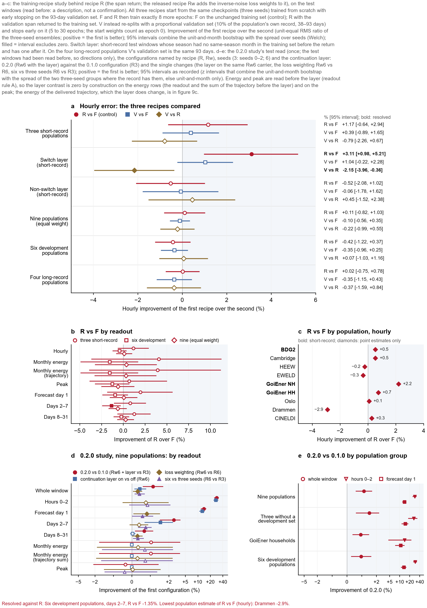

*Figure 18. a–c: the training-recipe study behind recipe R (the span return, to which recipe Rw adds the loss
weights), on the test windows (read before: a description, not a confirmation): R vs F, V vs F and V vs R by population
group and layer (a), R vs F by readout (b) and by population (c); the footer lists every contrast resolved against R.
d–e: the 0.2.0 study's one test read (directions only): 0.2.0 against 0.1 and the single changes (the layer on the
same Rw6 carrier, the loss weighting Rw6 vs R6, six vs three seeds R6 vs R3) by readout (d), and 0.2.0 against 0.1 by
population group (e); energy and peak read before the layer.*

## Where ankyra-lite is weak

Against the external baselines, on these test windows:

- **Households, hourly.** On GoiEner households TimesFM has resolvably lower hourly error (−4.6%), the other three
  zero-shot variants lower point estimates (−0.9% to −2.9%, not resolved), and ankyra-lite ranks fourth by MAE and
  fifth by WAPE behind the zero-shot variants. Version 0.2.0 narrowed the gap to TimesFM (−5.6% in 0.1.1) without
  closing it. Its monthly energy and peak errors there are resolvably lower than those of all four.
- **The first days of the month.** On day 1 it ranks 2nd to 6th of 22 on the six test populations (6th on BDG2),
  behind zero-shot foundation models on all of them. The continuation layer narrows the gap on day 1 (+11.1% against
  the same carrier without it, pooled); it does not close it.
- **Short records and the zero-shot foundation models.** On BDG2 and GoiEner non-household, which had no development
  windows and the shortest training records, and on HEEW and EWELD, the hourly contrasts with the four zero-shot
  variants are not resolved, with negative point estimates on BDG2 (Chronos-2-X −4.0%), GoiEner non-household
  (Chronos-2-X −0.5%) and EWELD (Chronos-2 −0.2%). Its hourly loss is lowest on no forecast day of either GoiEner
  population or of EWELD.
- **Energy on HEEW and EWELD.** The monthly energy against TimesFM is −0.1% on HEEW and −2.8% on EWELD (not resolved),
  and on EWELD the energy at day 31 ranks sixth of 22.
- **Absolute-error metrics.** By MAE it is fourth on four populations (the households, HEEW, EWELD, CINELDI), by
  median-unit WAPE fourth or fifth on four (GoiEner non-household, the households, HEEW, EWELD), and by median-unit MASE
  fifth or sixth on five, mostly behind the zero-shot foundation models.
- **Peak against simple references.** The same readout on GBT-T's trajectory is resolvably closer on Drammen (−10.6%),
  and last month's observed peak is resolvably closer on CINELDI (−18.2%); on GoiEner non-household and EWELD the point
  estimates against last month's peak are −34.7% and −23.7%.
- **Intervals against Chronos-2.** The interval placed around ankyra-lite is resolvably worse than Chronos-2's native
  quantiles on EWELD, GoiEner non-household and CINELDI (80% Winkler score).
- **A year of context for the foundation models.** Zero-shot TimesFM 2.5 with an 8,736-hour context and Chronos-2 with
  8,192 hours have resolvably lower hourly error on the households (−5.3% and −5.2%)
  ([details](#foundation-models-with-a-year-of-context)).

Weaknesses of its own design are reported where they arise: recipe R's losses on Drammen and on forecast days 2–7
([Recipe history](#recipe-history-how-r-was-chosen-and-its-negatives)), the continuation layer's resolved loss on Oslo
days 8–31 ([continuation layer](#the-continuation-layer-by-forecast-hour)), the gap between the delivered curve and the
energy readout ([Readouts](#readouts)) and the effect of a spike in the context
([Robustness](#robustness-to-corrupted-contexts)).

## Limitations

- **Re-evaluation only on the nine populations.** No test set of the nine-population comparison is unseen by the
  design; recipe R was chosen after a reading of these windows, and 0.2.0 was read on them once more (directions only).
  The external re-run reads test sets that the frozen external test of 0.1 had read once, previously read populations
  and one same-source out-of-time check, not unseen populations ([External tests](#external-tests)).
- **The continuation layer's form was chosen on development windows, partly after reading them,** and its four
  constants were fitted on six populations' development windows; the three populations without development windows
  received the same constants untested before the read. Its reference-day fallback (d* = 6) differs from the study's
  development code (d* = 0) and was used on 33 EWELD test windows; its rule for negative loads was added after the study.
- **Readout rule.** Energy, level and peak are read before the continuation layer; the delivered hourly curve does not
  integrate to the energy readout (median 0.77%, at most 310% on the test windows; [Readouts](#readouts), theory O6).
- **The loss weights' effect is small.** Recipe Rw against R is +0.31% [+0.06, +0.56] over the month on the test windows,
  of the order of the spread between seed groups; on the development windows the weights made the peak readout
  resolvably worse (−0.92%), on the test windows the peak is +0.04% (not resolved). It is reported as a direction.
- **One carrier per population.** Each checkpoint was trained for one population and scored only on that population's
  test windows. Transfer of a checkpoint to another building or population has not been evaluated.
- **Borrowed windows.** A carrier's pooled training set holds windows of other study populations (up to eight others
  and the Suzhou park; none for Cambridge), each from that population's own training period or validation span and
  ending before the target's validation start; no borrowed window lies in another population's test period
  ([docs/DATA.md](docs/DATA.md#windows-borrowed-from-other-populations)). The nine carriers therefore share data and
  are not independent of each other, and an origin less than 186 days after a checkpoint's cut would let its
  pseudo-origins fall into its training period.
- **Calendar caveat.** The day types of the forecast month are treated as known at the origin, by ankyra-lite (the
  carrier and the continuation layer's reference day) and by every baseline that reads the calendar. On **26 of the
  523 EWELD** test windows (origin 2020-01-01) the holiday calendar contains the extension of the 2020 Spring Festival
  holiday announced on 27 January 2020, and on **10 of the 730 Cambridge** test windows (origin 2022-09-01) the bank
  holiday of 19 September 2022, announced on 10 September 2022. The forecasts were not remade with the calendar as
  known at the origin; the result files include these windows
  ([docs/DATA.md](docs/DATA.md#calendar-caveat-holidays-announced-after-the-origin)).
- **BDG2 pretraining overlap with TimesFM 2.5.** Seven BDG2 sites (Bear, Bull, Cockatoo, Fox, Hog, Panther, Rat) are
  listed in the GIFT-Eval pretraining collection that the TimesFM 2.5 model card names as training data. This can
  favour TimesFM and TimesFM-X in the BDG2 comparisons; how much has not been measured. ankyra-lite has no pretrained
  weights ([docs/DATA.md](docs/DATA.md#bdg2-and-the-pretraining-collection-of-timesfm-25)).
- **Short records.** BDG2 2017 and both GoiEner populations have the shortest training records, no development windows
  and test sets of 5–8 months of one year.
- **Recency.** The carrier's training labels end at C′, the trained baselines' at C, 186 days later; this is the price
  of out-of-sample pseudo-origins.
- **Baselines.** The release's trained baselines have a budget of 15 epochs with patience 3, LSTM-T-KAN-M 30 and 8.
  Under one relaxed budget (30 epochs, patience 8) 35 of the 36 hourly verdicts of DLinear, iTransformer, LSTM and
  PatchTST were unchanged and three of 36 energy verdicts changed to not resolved
  ([training budget](#robustness-training-budget-of-the-trained-baselines)); it is one alternative budget, not a search,
  and the covariate-informed trained models were not retrained. With a year of context zero-shot TimesFM 2.5 and
  Chronos-2 are resolvably better in hourly error on the households
  ([a year of context](#foundation-models-with-a-year-of-context)). The linear-context model's covariates are inert. GBT-T
  overshoots on EWELD. LSTM-T-KAN-M is not a strict reproduction of its paper ([ten deviations](#baselines)).
- **Intervals** are descriptive; the interval readout was not designed or tuned for this carrier, and it is placed
  around the delivered trajectory, after the continuation layer.
- **Training is not bitwise repeatable** on a GPU. Six seeds are averaged and the spread of their two groups is
  reported, but the intervals of the main tables resample units and months only, not retraining.
- **Multiplicity.** 21 baselines × 9 populations × several quantities give hundreds of intervals; counts of resolved
  contrasts are descriptive, not a multiplicity-adjusted test.
- **Inherited from the anchoring layer**: hourly data only, a 744-hour horizon only, a complete 1,344-hour context at
  the origin, no temperature-signature prior for the category Commercial (13 BDG2 units carry it), and an annual
  temperature harmonic with a northern-hemisphere phase.

## External tests

**Version 0.2.0: re-run once (20 October 2026).** The 0.2.0 configuration was re-run on the four scored test sets of
the frozen external test of 0.1 (the same windows, comparators and estimators, read there once with the frozen
candidate, recipe R with six seeds) and scored once. For each test set the stage-1 carriers of that test (six seeds)
were continued with recipe Rw on the test set's own training pool, averaged, anchored by the unchanged layer with the
seasonal-naive state rule, corrected by the continuation layer with its frozen constants (no refit), read out by rule A
and scored with the frozen estimators; the shipped checkpoints were not used. This is a second read of each test set,
the first of this version. Full report: [docs/EXTERNAL_TESTS.md](docs/EXTERNAL_TESTS.md); every number is a row of
[`results/external_tests.csv`](results/external_tests.csv), copied from the score records by
`evaluation/external_tables.py`.

- **LCL, UNICON and HKUST** are previously read populations: earlier forecasters, earlier versions of the small network
  among them, had been scored there, the anchoring layer was fixed after those readings, and the frozen external test
  of 0.1 read them once. HKUST is a secondary test set with a small sample.
- **GoiEner households, out of time: a same-source out-of-time supplementary check** (new households and a later period
  of study population 6's source), not a new population.
- **Helsinki (retrospective): trained, anchored and sealed, not scored**, and not touched by the re-run.
  **UCI370: skipped.**

Primary readouts, hourly error, six seeds (\* resolved better; no pass line). They are 12 of 15 pre-specified nominal
95% intervals (3 contrasts × 5 test sets, Helsinki's sealed), with no multiplicity correction; with no true difference,
about 0.75 of the 15 would be resolved by chance. LCL is in the pretraining data of TimesFM 2.5, Chronos and Chronos-2;
whether GoiEner is in it is not verified; UNICON and HKUST are not on the published lists, which does not establish
absence. The last column gives the 0.1 frozen candidate's estimate against TimesFM 2.5 on the same windows (history).

| Test set | Windows / units / months | vs TimesFM 2.5 | vs seasonal naive (week) | vs carrier-free control with the state rule | 0.1 candidate vs TimesFM 2.5 |
|---|---|---|---|---|---|
| LCL households (London) | 710 / 710 / 5 | +2.74% [−1.16, +6.48] | +24.37% [+17.71, +30.48] * | +3.13% [+2.06, +4.19] * | +2.68% |
| UNICON (La Trobe University campuses) | 450 / 59 / 23 | −2.42% [−14.33, +8.24] | +11.83% [+0.73, +21.68] * | +10.71% [+5.51, +15.62] * | −5.54% |
| HKUST campus incomer meters (secondary) | 89 / 29 / 8 | +10.88% [−9.01, +27.14] | +26.18% [+6.34, +41.81] * | +4.63% [−2.96, +11.67] | +10.24% |
| GoiEner households, out of time (supplementary) | 1,417 / 282 / 6 | +4.25% [+1.88, +6.57] * | +26.04% [+23.82, +28.20] * | +5.55% [+3.49, +7.57] * | +4.19% * |

- Over the four scored test sets, 8 of the 12 primary intervals are resolved in ankyra-lite's favour (7 for the 0.1
  candidate; UNICON against the weekly seasonal naive is newly resolved), 4 are not resolved and none against it.
- **Against zero-shot TimesFM 2.5** only the GoiEner check is resolved (+4.25%); on LCL (+2.74%; LCL is in TimesFM 2.5's
  pretraining data), UNICON (−2.42%) and HKUST (+10.88%) the intervals include zero; not resolved is not a finding of
  no difference.
- **Against the 0.1 frozen candidate** (recipe R, six seeds, no layer) 0.2.0 is resolved better over the month on UNICON
  (+2.95%) and not resolved on the other three (+0.06% to +0.72%); on day 1 it is resolved better on LCL (+4.89%) and
  UNICON (+16.67%).
- **Forecast day 1.** Zero-shot TimesFM 2.5 still has resolvably lower day-1 error on LCL (−10.43%; it was −16.63% for
  the 0.1 configuration); on UNICON (−13.29%, before −37.30%), HKUST (−1.43%) and GoiEner (−1.99%) the day-1 contrast is
  not resolved. In forecast hours 0–2 TimesFM 2.5 is resolvably ahead on LCL (−25.38%), UNICON (−73.88%) and GoiEner
  (−18.26%). On UNICON ankyra-lite's mean unit rank is third of 14.
- **Day-1 rule, written before the read.** If the external test sets' mean day-1 log gap to TimesFM 2.5 shrank, from
  the 0.1 configuration to 0.2.0, by less than a third of the shrinkage on the development windows, this README would
  make no claim that 0.2.0 narrows the short-term gap. Outcome: claim allowed (external mean shrinkage +0.085 in log
  units, line +0.036, development shrinkage +0.107; per test set LCL +0.055, UNICON +0.192, HKUST +0.088, GoiEner
  +0.004; `external_tests.csv`, blocks `day-1 rule (design 3.3)` and `day-1 gap to TimesFM 2.5`). The claim is only
  that the day-1 gap to TimesFM 2.5 narrowed; ankyra-lite does not lead TimesFM 2.5 on day 1.


*Figure 17. External tests of ankyra-lite 0.2.0, the 0.2.0 configuration re-run on the test sets of the frozen external
test and scored once: the three primary readouts (a–c), the same contrasts by lead time, forecast hours 0–2 included
(d–f), and descriptive contrasts between ankyra-lite's own configurations by lead time (g: 0.2.0 against the 0.1
configuration; h: the continuation layer on against off; i: the loss weighting of recipe Rw against recipe R, without
the layer). Filled: the 95% interval excludes zero; an interval end beyond the axis is drawn as an arrow. LCL, UNICON,
HKUST: previously read populations; GoiEner households out of time: same-source out-of-time supplementary check;
Helsinki: sealed, not scored.*

**Version 0.1 (19 October 2026), history.** The frozen external test of 0.1 trained recipe R carriers (six seeds,
the three-seed release configuration as a secondary readout) and scored each test set once; its numbers are in the
last column above and in [docs/EXTERNAL_TESTS.md](docs/EXTERNAL_TESTS.md#version-01-external-test-19-october-2026). It
had 7 of 12 primary intervals resolved in ankyra-lite's favour and none against it.

## Checkpoints

The repository ships 81 carriers, the stage-2 final weights of the study's research runs, copied byte for byte by
`tools/export_checkpoints.py --out checkpoints`:

```
checkpoints/<population>/rw/seed<s>.pt  version 0.2.0 (the default): recipe Rw, s in {0, 1, 2, 3, 4, 5}
checkpoints/<population>/seed<s>.pt     version 0.1: recipe R, s in {0, 1, 2} (unchanged)
                                        population in {bdg2, cambridge, heew, eweld, goiener_confirm, households,
                                                       oslo, drammen, cineldi}
checkpoints/MANIFEST.json               per file: SHA-256, bytes, parameters, recipe and seed group, loss weighting and
                                        its weights record, training cut (hour index and date), hour 0 of the record,
                                        store, source run, training record and stage-1 run with their SHA-256; the two
                                        configurations (release: Rw, six seeds, layer on; 0.1.x: R, three seeds, layer off)
```

- **Format.** Each file is `{"model": state_dict, "epoch": 8}` (265,653 bytes). `ankyra_lite.load_carrier(path)` builds
  the network and loads it strictly, on the CPU, in eval mode; it also accepts a bare state dict.
- **Verification.** The export checks every copy against the SHA-256 in its run record, loads it strictly and counts
  61,613 parameters. For three test windows each of Oslo and CINELDI (corrected store) per seed of the release
  configuration it reproduces the stored GPU carrier forecasts on the CPU at the same issue times; the rule is a
  relative difference below 10⁻⁴, and the largest recorded in `MANIFEST.json` (`verification`) is 2.0 × 10⁻⁵ (CINELDI,
  seed 2). The 27 files of version 0.1 are byte-identical to those of 0.1.1.
- **Six seeds, one cut.** Load the six files in ascending seed order (`ankyra_lite.checkpoint_paths(population)`; the
  release switches are in `ankyra_lite/_release.py`) and pass the population's cut once; the ensemble average sums the
  members in that order.
- **Use with the population's own cut.** A checkpoint belongs to one population and its training cut. Pass the cut as
  `cut=` (an hour index of a record whose hour 0 is the one below) and use origins at least 186 days after it:

| Folder | Population | Hour 0 of the record | Training cut (`training_cut_hour`) | Training cut (date) | Store |
|---|---|---|---:|---|---|
| `bdg2` | BDG2 2017 | 2016-01-01 | 9,408 | 2017-01-27 | original |
| `goiener_confirm` | GoiEner non-household | 2018-01-01 | 7,176 | 2018-10-27 | original |
| `households` | GoiEner households | 2018-01-01 | 8,640 | 2018-12-27 | original |
| `cambridge` | Cambridge | 2000-01-01 | 113,856 | 2012-12-27 | original |
| `heew` | HEEW Arizona | 2014-01-01 | 38,616 | 2018-05-29 | original |
| `eweld` | EWELD | 2016-01-01 | 26,928 | 2019-01-27 | original |
| `oslo` | Oslo | 2012-01-01 | 63,456 | 2019-03-29 | original |
| `drammen` | Drammen | 2018-01-01 | 18,912 | 2020-02-28 | corrected (CINELDI windows in its pool) |
| `cineldi` | CINELDI | 2019-01-01 | 15,240 | 2020-09-27 | corrected (hour 0 truly 2019-01-01) |

```python
from ankyra_lite import checkpoint_paths, forecast, load_carrier
carriers = [load_carrier(p) for p in checkpoint_paths("oslo")]                # checkpoints/oslo/rw/seed0..5.pt
# history: an Oslo school's ankyra_lite.anchor.History whose hour 0 is 2012-01-01, ending at an origin >= 63,456 + 4,464;
# sigma: Oslo's temperature-anomaly scale fitted on days before the cut
r = forecast(history, carriers, group="Public", temp_sigma_std=sigma, dst_region="EU", cut=63456)

# version 0.1 (recipe R, three seeds, no continuation layer):
old = [load_carrier(f"checkpoints/oslo/seed{s}.pt") for s in (0, 1, 2)]
r01 = forecast(history, old, group="Public", temp_sigma_std=sigma, dst_region="EU", cut=63456, continuation=False)
```

- Do not write your own training runs into `checkpoints/`: `.gitignore` ignores every weights file except the 81
  shipped ones.

## Tests

`pytest` is not required; the tests use `unittest`. From the repository root:

```bash
python -m unittest discover -s tests -t .      # 275 tests
python -m unittest discover -s theory -t .     # 111 checks of the exact properties
```

| Module | Tests | What it checks |
|---|---:|---|
| `tests/anchor/` | 62 | the anchoring layer's own tests, ported to the copy (no information after the origin, the handover, the state rules, gap tolerance, analog shapes, readouts, the reference estimator) |
| `tests/test_anchor_equivalence.py` | 14 | the copy is byte-identical to ANKYRA 2.2.1 and gives bit-identical forecasts, readouts and metrics (needs the ANKYRA checkout) |
| `tests/test_carrier_unit.py` | 14 | parameter count, shapes, no read at or after the issue time, the pseudo-origin rule, the ensemble, the end-to-end forecast, the state rule |
| `tests/test_carrier_equivalence.py` | 7 | features, initialisation and forecasts against the research code and the stored forecasts (needs the study's data) |
| `tests/test_train.py` | 19 | sampler, splits, caps, pools, the returned span and one optimisation step of each stage against the research training loop (part needs the study's data) |
| `tests/test_train_rw.py` | 19 | recipe Rw: the reduction to recipe R with equal weights, the weights against the study's rule bit for bit, the row-alignment check (part needs the study's research folder or the 0.1.1 checkout) |
| `tests/test_continuation.py` | 24 | the continuation layer against its definition, the frozen constants and digest, the release rules, and the study's reference implementation bit for bit (part needs the study's research folder) |
| `tests/test_forecast_v2.py` | 17 | the forecast with the layer off against version 0.1.1 field by field (in the same process and in a separate one; needs the 0.1.1 checkout), readout rule A, the bypasses, six-seed ensembles and the release switches |
| `tests/test_store_arrays.py` | 9 | the evaluation's store reader against the study's loader, per population (needs the study's data) |
| `tests/test_compare_baselines.py` | 42 | the comparison script's guards, the products (and the continued products against the release layer), the checkpoint export, and the result files: columns, forecaster set, flags, labels, no absolute paths, the added rows, the gates of the fields cache and of the handover rebuild (part needs the ANKYRA release files, the study's data or `results/`) |
| `tests/test_readouts_lite.py` | 13 | the readouts around a forecast (interval, blocks, raw trajectory, energy added by the projection and by the continuation layer, peak), the history-only configuration, the fields read through to the anchoring layer, no information after the origin end to end, the top-level names and the two examples (synthetic data, untrained carrier) |
| `tests/test_evaluation.py` | 15 | the scoring module on artificial data |
| `tests/test_external_tables.py` | 12 | the external-test table: columns, forecaster names, no absolute path, the sealed Helsinki set never read, equality with the score records field by field, no contrast of the scorer's other output files, the primary table of docs/EXTERNAL_TESTS.md (part needs the study's score records) |
| `theory/test_operators.py`, `theory/test_carrier_properties.py`, `theory/test_weighting_properties.py`, `theory/test_continuation_properties.py` | 31, 27, 15, 36 | P1–P20, C1–C10, C11–C14 and O1–O9, counterexamples included |

On 22 October 2026 (version 0.2.1; CPU, one thread) the full run passed: 269 of the 275 collected tests ran (a class
skipped as a whole counts once), none failed, 14 were skipped, and the 111 theory checks passed. The comparisons with
version 0.1 ran against a 0.1.1 checkout exported from commit c27affc (`ANKYRA_LITE_REFERENCE_REPO`,
`ANKYRA_LITE_REFERENCE_TRAIN`) and passed. The skips: 9 store-array checks for free memory (they need 5, 6.5 or 11 GB;
in the run of 21 October, 7 passed when run separately, EWELD and the households were not run) and 5 tests whose
research records or files were not available in this run. Tests that need the ANKYRA checkout, the 0.1.1 checkout or the study's data skip with a reason
where those are absent (as on CI). Environment variables: `ANKYRA_ORIGINAL_ROOT` (the ANKYRA checkout),
`ANKYRA_LITE_RESEARCH_ROOT` (the study's research folder), `ANKYRA_LITE_REFERENCE_REPO` (a 0.1.1 checkout of this
repository), `ANKYRA_LITE_REFERENCE_TRAIN` (the `ankyra_lite/carrier/train.py` of version 0.1), `ANKYRA_LITE_RESULTS` (another result directory to check) and `ANKYRA_LITE_TEST_MIN_FREE_GB` (the free
memory a data-loading test waits for).

## Theory: exact properties


*Figure 7. Exact properties of the anchoring layer on the Cambridge window of Figure 6: block replacement from the
carrier alone to ankyra-lite's anchored trajectory F before the continuation layer (a, P4), historical support (b, P7),
shrinkage bounds (c, P8, P9), clipping against an energy-preserving projection (d, P11, P12), the peak readout and its
error decomposition (e, f; P15, P16).*

The construction is auditable because each step has a stated property. They sit beside the forecaster in
[theory/](theory/README.md), which the package does not import:

- **P1–P20, the anchoring layer** (the properties of the ANKYRA 2.2.1 theory, with the imports adapted): the exact
  block identity and replacement (P1–P6), how much history the weights need and how far shrinkage lets them move
  (P7–P10), why energy is read before the clip (P11–P13), the peak operator (P14–P18), why several estimands are
  reported (P19), and the worst-case background for shrinking the level weights strongly (P20).
- **C1–C14, the carrier network and recipe Rw**: a nonnegative trajectory whose mean is its level (C1, C2); shares and
  pointer attention that are distributions (C3); no input at or after the issue time (C4); a causal, mask-respecting
  encoder (C5, C6); scale equivariance (C7); no unit identifier (C8); a copy pointer that starts at zero and never moves
  the level (C9); the 186-day gap that makes every scored pseudo-origin forecast out of sample (C10); and, new in 0.2.0,
  loss weights that reduce to recipe R when they are equal (C11), keep every population's share of the draws (C12), are
  finite, positive and floored (C13), and read only each window's own context before its origin (C14).
- **O1–O9, the continuation layer** (new in 0.2.0): signs and zeros kept (O1); a correction bounded by
  E(h) = 0.479 e^(−h/12) + 0.330 e^(−h/168) (O2); no load read at or after the origin, only the calendar of the first
  forecast week (O3); state windows untouched (O4); switched off, the trajectory before the layer is delivered
  unchanged (O5); energy, level and peak read before it, with the delivered curve's sum differing from the energy
  readout by known terms (O6); consistency and monotonicity (O7); scale equivariance (O8); a reference day of the same
  workday class and one digest for the constants (O9).

[theory/PROOFS.md](theory/PROOFS.md) gives the statements, proofs and counterexamples; `theory/operators.py` writes
P1–P20 as functions; the four check files hold 111 numerical checks. None of the properties is an accuracy guarantee;
accuracy is measured.

## Reproducibility

- **Scoring-code check.** Before ankyra-lite is put in the reference position, `evaluation/compare_baselines.py`
  recomputes the late-window rows of ten result tables of the ANKYRA 2.2.1 release with the release's own reference
  forecaster and compares them field by field, at the published rounding, with the files of the release repository's
  commit `487e0d2` (read with `git show`, read-only). All ten reproduced: 0 mismatches in 94,131 compared fields
  ([`results/REPRODUCTION_CHECK.json`](results/REPRODUCTION_CHECK.json)). A table that does not reproduce is not
  written, and the recomputed release numbers are in no file here.
- **Product checks.** For every population the anchored product must have exactly the panel's test windows, state
  flags and targets, or the script stops. The per-population contrasts of R against F and against the from-scratch
  stage, recomputed from the anchored products, equal the study's own scorer on 9 of 9 populations (largest difference
  0.0 percentage points; version 0.1's run, `study_scorer_crosscheck`). In 0.2.0, re-anchoring the six-seed ensemble
  reproduces every stored product bit for bit, before and after the continuation layer (`extra` → `reanchor` → `ens`
  in `results/compare_baselines.json`).
- **Continuation check.** For every population the products name the anchored product before the layer and the one
  after it; `evaluation/compare_baselines.py --check-products` checks, without reading a target, that the windows,
  state flags, level and peak are equal in the two, that state windows are untouched, and that every other window's
  trajectory is the release's layer applied to the product before it, bit for bit in float32 (`continuation_gate` in
  `results/compare_baselines.json`; passed on all nine populations).
- **Package against the research code.** The anchoring layer is byte-identical to ANKYRA 2.2.1 and gives bit-identical
  forecasts; the carrier's features, initialisation and forecasts and the training recipe reproduce the research code
  ([Tests](#tests)). On the CPU the package reproduces the stored GPU forecasts to a relative difference of about 10⁻⁶
  ([Cost](#cost-per-window)).
- **Which forecasts are scored.** `evaluation/products.json` names, per population, the configuration (recipe Rw, six
  seeds, the continuation layer), the anchored six-seed product before and after the layer, the two three-seed group
  products and the research runs behind them (paths relative to the study's research folder);
  `tools/products_for_configuration.py` writes it. `evaluation/products_0_1.json` is the mapping of version 0.1, and
  `python -B evaluation/compare_baselines.py --recipe r010 --out DIR` regenerates the tables of 0.1 from it.
- **Check a number.** Every number of the tables above is a row of a file in `results/`. The Cambridge row of the
  overview, for example:

  ```python
  import csv
  rows = [r for r in csv.DictReader(open("results/benchmark_pairwise.csv", encoding="utf-8")) if r["set"] == "Cambridge"]
  print(sum(float(r["um_high"]) < 0 for r in rows), "of", len(rows))      # 21 of 21 resolved better
  ```
- **What cannot be rerun from the repository alone.** `evaluation/compare_baselines.py`, `tools/export_checkpoints.py`
  and the data-dependent tests read the study's local data stores, saved forecasts and the ANKYRA checkout (read-only;
  [evaluation/README.md](evaluation/README.md)); `evaluation/external_tables.py` reads the score records of the external
  tests ([docs/EXTERNAL_TESTS.md](docs/EXTERNAL_TESTS.md#files)). `python -m evaluation.run_example` shows the data flow on twelve
  artificial buildings with the shipped checkpoints (its numbers mean nothing), and
  `python -B figures/make_figures.py --strict` regenerates every figure from `results/`.

## Version history

- **0.2.1 (22 October 2026)** — maintenance after a code audit; default outputs, checkpoints, results and figures
  unchanged ([correction note](docs/CODE_AUDIT_CORRECTIONS_20261022.md)). Switching the continuation layer off in
  `evaluation/cost_timing.py` and `evaluation/robustness.py` now takes effect (the released runs had it on); missing day types
  in the older 744-hour feature blocks fall back to the weekday; the Wilcoxon direction is read from each pair's signed
  ranks (all 186 Holm-significant pairs keep their direction); extreme custom continuation constants raise `ValueError`
  instead of giving non-finite hours; re-anchoring caches are bound to a content identity with an exclusive claim; the
  external-test subgroup is labelled by its construction (first-stage training windows); the method, readout and theory
  documentation is corrected; regression tests in `tests/test_audit_fixes.py`.
- **0.2.0 (21 October 2026)** — the carrier trained with recipe Rw (inverse-noise loss weights in the second stage) and
  averaged over six seeds; the origin-continuity layer (`ankyra_lite.continuation`, four frozen constants) after the
  anchoring layer and the state rule, with energy, level and peak read before it (readout rule A) and two new result
  fields (`trajectory_before_continuation_kw`, `continuation`); the release switches in `ankyra_lite/_release.py` and
  `ankyra_lite.checkpoint_paths`; 54 new checkpoints (`checkpoints/<population>/rw/`; the 27 of version 0.1 unchanged);
  the comparison regenerated in full (new files `continuation_layer.csv`, `continuation_record.csv`); the external tests
  re-run once; the exact properties C11–C14 and O1–O9; Figure 9c beside Figure 9. Two release rules of the layer change
  no study number: the reference-day fallback d* = 6 and a flag instead of an error for negative loads. Against 0.1 on
  the test windows (read before; directions only): +1.15% hourly over the month, +13.97% on day 1, energy and peak not
  resolved.
- **0.1.1 (19 October 2026)** — the readouts API (`ankyra_lite.readouts`), the history-only configuration
  (`forecast(history, None)`), the own-unit example (`examples/own_unit.py`), the supplementary analyses (handover,
  lead weeks, within-day trust, training budget, generic combinations, a year of context), Figure 0 (advantage summary)
  and a redrawn Figure 1. The forecasts, checkpoints and results of 0.1.0 are unchanged.
- **0.1.0 (19 October 2026)** — first version. The copy-pointer carrier network (61,613 parameters) with the byte-identical
  ANKYRA 2.2.1 anchoring layer and the seasonal-naive state rule; the released training recipe R (stage 1 from scratch
  with early stopping on the 93-day validation span, stage 2 with the span returned for 8 epochs; three seeds); the 27
  checkpoints with their manifest; CINELDI on the corrected store, and the Drammen carrier retrained with it; the
  comparison with 21 baselines (the release's 20 and LSTM-T-KAN-M) on nine populations, regenerated in full with the
  released recipe; the exact properties C1–C10 of the carrier.
- **Design history before 0.1.0** (the study's carriers, all anchored by the same layer; `ablation.csv` and
  `recipe_history.csv`): an earlier structured network without the copy pointer trained on weekly windows; the same
  network without the copy pointer on the from-scratch recipe; earlier continuation studies (unweighted and weighted
  losses, with and without warm-up); the copy-pointer network on the from-scratch stage alone; and the continuation
  arms F, V and R, of which R was released.

## Provenance, licence and citation

- **The anchoring layer.** `ankyra_lite/anchor/` is the `ankyra` package of ANKYRA 2.2.1 (repository
  [XinanQ/Building_load_ANKYRA](https://github.com/XinanQ/Building_load_ANKYRA), commit `487e0d2`, whose `ankyra/` tree is
  identical to tag `v2.2.1`), copied byte for byte; [`PROVENANCE.md`](ankyra_lite/anchor/PROVENANCE.md) lists every
  file's hash. Its docstrings still say `ankyra.*`; read them as `ankyra_lite.anchor.*`. `ankyra.timesfm_adapter` is not
  included. The 17 copied files are never edited.
- **The carrier.** The network, features, inference and training code reproduce the study's research code (parameter
  names and order, initialisation, features bit for bit).
- **The test windows, the 20 release baselines and the scoring functions** are those of the ANKYRA 2.2.1 release.
- **Licence.** MIT ([LICENSE](LICENSE)), Copyright (c) 2026 Xinan Qin; the anchoring layer is under the same licence.
  LSTM-T-KAN's code (MIT) is not included; only its forecasts were scored.
- **Data.** The evaluation used public datasets: BDG2 (Building Data Genome Project 2), the University of Cambridge
  estate archive, HEEW (Arizona State University), EWELD, GoiEner, COFACTOR-SBHUB Oslo and COFACTOR Drammen, CINELDI,
  and the Suzhou industrial park (training windows only), each under CC BY 4.0; sources and preparation in
  [docs/DATA.md](docs/DATA.md). None is redistributed; the checkpoints contain weights fitted on these data, not the
  data. The example window in `results/` is from the University of Cambridge estate archive (CC BY 4.0).
- **Data of the external tests** ([docs/EXTERNAL_TESTS.md](docs/EXTERNAL_TESTS.md)): Low Carbon London smart-meter
  households (UK Power Networks, London Datastore, Creative Commons Attribution); UNICON (La Trobe University;
  CC BY-NC-SA 4.0, research use only, so neither the data nor carriers trained on them are in this repository); the
  HKUST smart-meter database (Dryad, CC0); GoiEner households out of time (the GoiEner archive, CC BY 4.0). None is
  redistributed. The HKUST and UNICON temperatures are ERA5 reanalysis: Contains modified Copernicus Climate Change
  Service information [2026]; ERA5 hourly data (Hersbach et al., 2020, doi:10.1002/qj.3803; dataset
  doi:10.24381/cds.adbb2d47) retrieved through the Open-Meteo historical weather API (Zippenfenig,
  doi:10.5281/zenodo.7970649, CC BY 4.0).
- **References** for the two contrasts of [At a glance](#at-a-glance) (forecast encompassing):
  - Chong, Y. Y., Hendry, D. F. (1986). Econometric evaluation of linear macro-economic models. *Review of Economic
    Studies* 53(4), 671–690.
  - Harvey, D. I., Leybourne, S. J., Newbold, P. (1998). Tests for forecast encompassing. *Journal of Business &
    Economic Statistics* 16(2), 254–259.
- **Citation.** [CITATION.cff](CITATION.cff); please also cite ANKYRA (listed there under references). An archive DOI
  has not been assigned yet.

Questions and bug reports: the [issue tracker](https://github.com/XinanQ/Building_load_ANKYRA_lite/issues).
