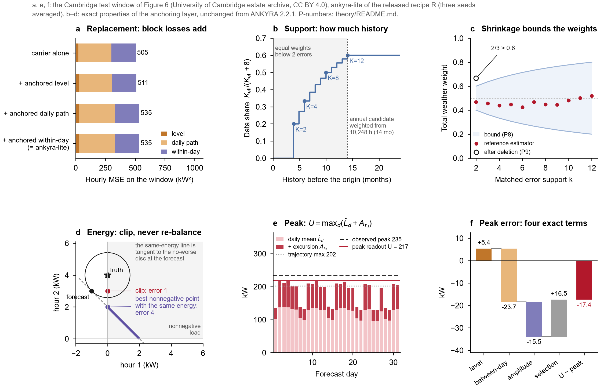

# Theory: the exact properties behind ankyra-lite

[中文](README.zh-CN.md) · [Proofs](PROOFS.md) · [Operators](operators.py) · [Checks](test_operators.py) · [Carrier checks](test_carrier_properties.py) · [Back to the forecaster](../README.md)

This folder holds the mathematical properties that sit beside the forecaster. The forecaster is the package
[`ankyra_lite/`](../ankyra_lite/), and nothing in it imports this folder. The properties make the forecaster
inspectable; they are not evidence of accuracy, which is measured ([results/SUMMARY.md](../results/SUMMARY.md)).
There are two groups, one for each part of ankyra-lite:

- **P1–P20, the anchoring layer.** `ankyra_lite.anchor` is a byte-identical copy of the ANKYRA 2.2.1 package, so these
  are the properties, operators and checks of the ANKYRA 2.2.1 theory, with the imports adapted. They explain and
  bound the anchoring layer:
  - why a month-ahead forecast is split into a level, a daily path and a within-day shape;
  - how much history the weights need, and how far they can move from equal;
  - what the energy and peak readouts can and cannot guarantee;
  - why the evaluation reports several estimands side by side.
- **C1–C10, the carrier network.** New in ankyra-lite: what the construction of the carrier network guarantees for any
  weights, trained or not:
  - its forecast is a nonnegative energy budget whose mean is its level;
  - it is built only from data before its issue time, without a unit identifier, and scales with the load;
  - its copy pointer starts at zero and never moves the level;
  - with a 186-day gap between the training cut and the test set, every pseudo-origin forecast that the anchoring
    layer scores is out of sample for the carrier.

Each property is supported in three ways:

| File | What it gives |
|---|---|
| [PROOFS.md](PROOFS.md) | statement, proof and the counterexamples that mark where it stops; where this repository's result files measure a consequence on data, the file |
| [operators.py](operators.py) | P1–P20 as functions that apply to any forecaster's 744-hour trajectory |
| [test_operators.py](test_operators.py) | a numerical check of P1–P20, counterexamples included (31 checks) |
| [test_carrier_properties.py](test_carrier_properties.py) | a numerical check of C1–C10 on random and perturbed carrier weights, counterexamples included (27 checks) |

```bash
python -m unittest discover -s theory -t .
```

The command runs both check files (58 checks; CPU only, about 15 seconds on one thread); no checkpoint and no study
data are needed. Run it from the repository root.



*Figure 7. Panel a replaces the level, the daily path and the within-day block of the carrier's forecast by
ankyra-lite's, one block at a time, on the Cambridge test window of Figure 6: each bar splits exactly into the three
block losses (P1, P4), and with all three blocks replaced the forecast is ankyra-lite's. Panels b–d show how much
history the weights need and how far shrinkage lets them move (P7–P9) and why energy is read before the clip
(P11, P12); panels e and f show the peak readout and its error decomposition (P15, P16). Drawn by
[`figures/make_figures.py`](../figures/README.md).*

## The twenty properties of the anchoring layer

Properties marked *standard* are known results that the design relies on; they are collected here, not claimed as new.
The others hold under the conditions in the third column. None is an accuracy guarantee.

| | Property | Holds when | What the anchoring layer uses it for | Code | Check |
|---|---|---|---|---|---|
| P1 | [Block identity](PROOFS.md#blocks) (standard) | always | assigning each block to a source | `anchor.blocks.block_losses` | `BlockGeometryTests` |
| P2 | [Four blocks; no weekly Fourier bin](PROOFS.md#blocks) | always (744-hour window) | day types instead of a weekly component | `operators.four_block_losses` | `BlockGeometryTests` |
| P3 | [Energy is the level](PROOFS.md#blocks) | always | the energy readout | `anchor.blocks.level` | `BlockGeometryTests` |
| P4 | [Exact replacement and the level-share bound](PROOFS.md#replacement) | fixed replacement estimates | scoring any division from block losses | `operators.replace_blocks` | `ReplacementTests` |
| P5 | [Two-source division: pooled optimum, unit-level asymmetry](PROOFS.md#replacement) | two sources, block-wise | why a fixed division is not enough | `operators.division_log_ratio` | `ReplacementTests` |
| P6 | [Correction accounting](PROOFS.md#replacement) (standard) | always | diagnosing a correction | `operators.correction_accounting` | `ReplacementTests` |
| P7 | [Completed error support](PROOFS.md#historical-weights) | complete records; missing hours only lower the count | how much history the weights need | `operators.completed_windows` | `SupportTests` |
| P8 | [Shrinkage bounds](PROOFS.md#historical-weights) | matched support, no deletion at the origin | how far the weights can move | `operators.mixture_mass_bounds` | `ShrinkageTests` |
| P9 | [Deletion renormalises the mixture](PROOFS.md#historical-weights) | always; a counterexample shows where P8 stops | when the bounds stop holding | `operators.retained_data_share` | `ShrinkageTests` |
| P10 | [Least squares versus inverse MSE under shared errors](PROOFS.md#historical-weights) | forecasts share an error component | the weekly handover weights | `operators.two_source_weights` | `ShrinkageTests` |
| P11 | [Clipping cannot increase any hour's error](PROOFS.md#nonnegativity-and-energy) (standard) | nonnegative load | the delivered trajectory | `operators.clip_nonnegative` | `FeasibilityTests` |
| P12 | [Energy, nonnegativity and no-harm are incompatible](PROOFS.md#nonnegativity-and-energy) | always (two-hour counterexample) | reading energy from the level | `operators.project_to_mean` | `FeasibilityTests` |
| P13 | [Day-level projection: a conditional guarantee](PROOFS.md#nonnegativity-and-energy) | nonnegative level and load; level under-forecast by at most the smallest true daily mean | an optional projection | `operators.daily_projection` | `FeasibilityTests` |
| P14 | [A mean path underestimates the expected peak](PROOFS.md#peak) (standard) | exact conditional means | a separate peak readout | — | `PeakTests` |
| P15 | [Scalar form and bounds of the peak operator](PROOFS.md#peak) | always | the peak readout | `anchor.readouts.peak_readout` | `ReadoutTests` in [tests/anchor/](../tests/anchor/test_blocks_and_readouts.py) |
| P16 | [Peak error decomposition](PROOFS.md#peak) | always; the amplitude term has no fixed sign | how level gains reach the peak | `operators.peak_error_decomposition` | `PeakTests` |
| P17 | [Finite-support median property](PROOFS.md#peak) | constant levels within type, independent draws, $((m-1)/m)^n<1/2$ | what the envelope estimates | `operators.max_lower_median` | `PeakTests` |
| P18 | [Asymmetric peak costs](PROOFS.md#peak) (standard) | always | choosing a peak method under a cost | `operators.asymmetric_peak_cost` | `PeakTests` |
| P19 | [Pooled versus unit-equal summaries](PROOFS.md#estimands) | always (identity) | why several estimands are reported | `anchor.metrics.pooled_ratio_decomposition` | `EstimandTests` |
| P20 | [Evidence bound for choosing among candidates](PROOFS.md#evidence-bound) (standard; null benchmark is an identity) | T pseudo-origin errors per candidate | statistical background for shrinking the level weights strongly (a worst-case rate, not a measurement on these data) | `operators.aggregation_rate`, `operators.exchangeable_hit_rate` | `EvidenceBoundTests` |

`operators.*` is [operators.py](operators.py) in this folder; `anchor.*` is `ankyra_lite.anchor`, the anchoring layer,
whose own functions carry P1, P3, P15 and P19. Check names are test classes in [test_operators.py](test_operators.py)
unless a folder is given.

## The ten properties of the carrier network

All ten follow from the code of `ankyra_lite.carrier` and hold for any weights, trained or not, except C9(a), which is
about the initialisation; the proofs cite the code lines. Real-arithmetic statements are checked in float64,
statements about the delivered carrier forecasts on the package's own float32 path.

| | Property | Holds when | What it gives ankyra-lite | Code | Check |
|---|---|---|---|---|---|
| C1 | [Nonnegative trajectory](PROOFS.md#exact-properties-of-the-carrier-network) | any weights; strictly positive in real arithmetic only (shares can underflow to 0) | a nonnegative carrier candidate; a non-finite forecast is rejected before anchoring | `model.decode_budget`, `inference.carrier_forecasts` | `NonnegativityTests` |
| C2 | [Energy budget: the trajectory's mean is the level](PROOFS.md#exact-properties-of-the-carrier-network) | always (exact in real arithmetic) | the carrier's level, daily path and within-day shape are the P1 blocks of its trajectory | `model.decode_budget` | `EnergyBudgetTests` |
| C3 | [Day shares, hour shares and pointer attention are distributions](PROOFS.md#exact-properties-of-the-carrier-network) | always | the copied profile is a mixture of the unit's own complete days | `model.CopyPointerNetwork` | `ShareTests` |
| C4 | [No input at or after the issue time](PROOFS.md#exact-properties-of-the-carrier-network) | always; the day types of the forecast month are read | every pseudo-origin forecast is a genuine forecast from its own issue time | `features.features`, `inference.carrier_forecasts` | `CausalityTests` |
| C5 | [The encoder is causal in token order](PROOFS.md#exact-properties-of-the-carrier-network) | always | the pointer's key for a recent day summarises that day and earlier days only | `model.SharedCausalBlock` | `EncoderOrderTests` |
| C6 | [Masked tokens are ignored](PROOFS.md#exact-properties-of-the-carrier-network) | always; the masks themselves are inputs | placeholder values of missing days cannot reach the forecast | `model.StructuredLoadNetwork` | `MaskTests` |
| C7 | [Scale equivariance](PROOFS.md#exact-properties-of-the-carrier-network) | $c>0$ and positive load in the last 8,760 h; bit for bit for powers of two; a counterexample otherwise | the carrier forecast does not depend on the unit of the load | `features.features`, `model.StructuredLoadNetwork` | `ScaleTests` |
| C8 | [No unit identifier](PROOFS.md#exact-properties-of-the-carrier-network) | always; the category is an input | the same history in the same category gives the same forecast | `features.features`, `model.build_carrier` | `UnitIdentityTests` |
| C9 | [The copy pointer: zero at initialisation, level unchanged, inactive without a complete recent day](PROOFS.md#exact-properties-of-the-carrier-network) | (a) at initialisation; (b)–(d) any weights | the pointer reshapes the month without moving its energy | `model.CopyPointerNetwork` | `PointerTests` |
| C10 | [Pseudo-origin out-of-sample guarantee](PROOFS.md#exact-properties-of-the-carrier-network) | test origins at least 4,464 h (186 days) after the training cut | every completed pseudo-forecast the anchoring layer scores is out of sample for the carrier | `inference.pseudo_origins`, `train.make_windows` | `PseudoOriginTests` |

`model.*`, `features.*`, `inference.*` and `train.*` are the modules of `ankyra_lite.carrier`; check names are test
classes in [test_carrier_properties.py](test_carrier_properties.py).

## How the properties enter the forecaster

- **Blocks (P1–P3).** The forecast is assembled from three orthogonal blocks, so each can be weighted, scored and
  read out separately, and energy is read from the level alone.
- **Division of labour (P4–P6).** Any division between two forecasters can be scored from block losses, but a division
  that is optimal on pooled error can still lose for the typical unit. The anchoring layer therefore weights each unit
  by its own record.
- **Weights (P7–P10).** A record of $m$ hours supports $\min\lbrace12,\lfloor(m-1344)/744\rfloor\rbrace_+$ completed
  errors; below two the weights are equal. Shrinkage bounds how far they move, and the handover uses least-squares
  weights because shared errors pull inverse-MSE weights towards one half.
- **Energy and nonnegativity (P11–P13).** Clipping cannot hurt any hour, but no map keeps energy, nonnegativity and
  no-harm together, so energy is read before the clip. (On off-state and micro-load windows the anchoring layer
  returns the carrier's trajectory unchanged, without the clip; ankyra-lite's default state rule then delivers the
  weekly seasonal naive instead.)
- **Peak (P14–P18).** The maximum of a smooth forecast underestimates the peak, so the peak is read from a historical
  excursion envelope with an exact scalar form, an error decomposition and a median property under a stated working
  distribution.
- **Estimands (P19).** Pooled and unit-equal summaries can disagree in sign for an algebraic reason, so the result
  files report the unit-equal log ratio, the pooled MSE ratio, the mean per-unit rank and conventional metrics
  together.
- **Evidence bound (P20).** The minimax rate of aggregation is a worst-case result: for seven level candidates and at
  most six pseudo-origin errors its order is a sizeable fraction of the error variance. It is the statistical
  background for shrinking the weights strongly; it is not a measurement on these data and does not by itself show
  that the candidates cannot be told apart here ([PROOFS.md](PROOFS.md#evidence-bound)). The record statistics that
  the anchoring layer reports (`anchoring_record`) are descriptive indicators; the forecaster does not claim to select
  the best candidate.
- **The carrier (C1–C10).** The carrier hands the anchoring layer a nonnegative trajectory whose mean is its level
  (C1–C3), built only from data before each issue time and ignoring placeholder values (C4–C6), in the load's own
  scale and without a unit identifier (C7, C8). Its copy pointer reshapes the month without moving the level and
  starts as the base network (C9). With the 186-day gap between the training cut and the test set, every pseudo-origin
  forecast that the anchoring layer scores against the unit's own history is out of sample for the carrier (C10),
  which is what the layer's per-unit weights assume.

P1–P20 and their files are those of the ANKYRA 2.2.1 theory folder, with the imports changed from `ankyra` to
`ankyra_lite.anchor`. The data evidence of that theory (from the method's earlier development and from the ANKYRA
study, with TimesFM 2.5 as the carrier) is not a result of this repository and is left out; where this repository's
result files measure a consequence, PROOFS.md names the file. C1–C10 and `test_carrier_properties.py` are new.
